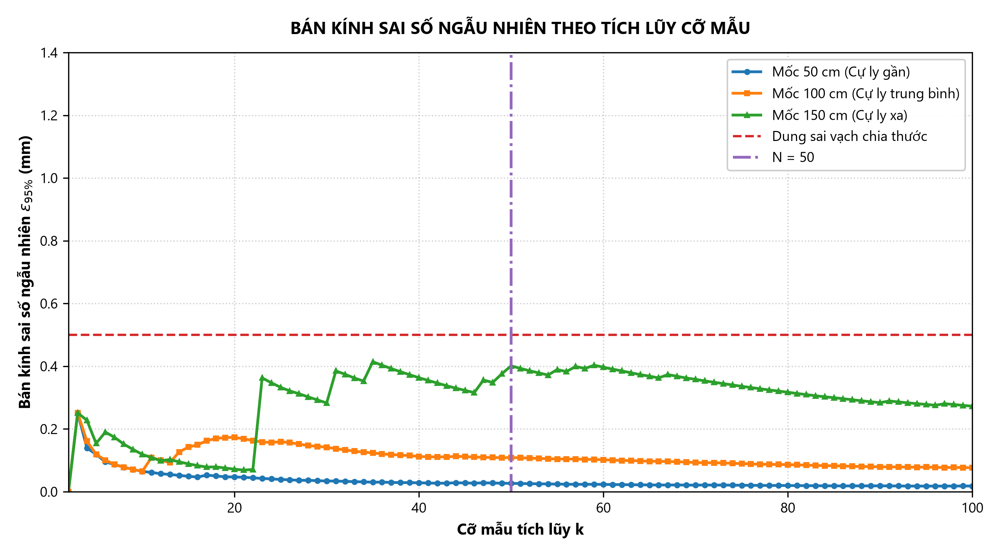
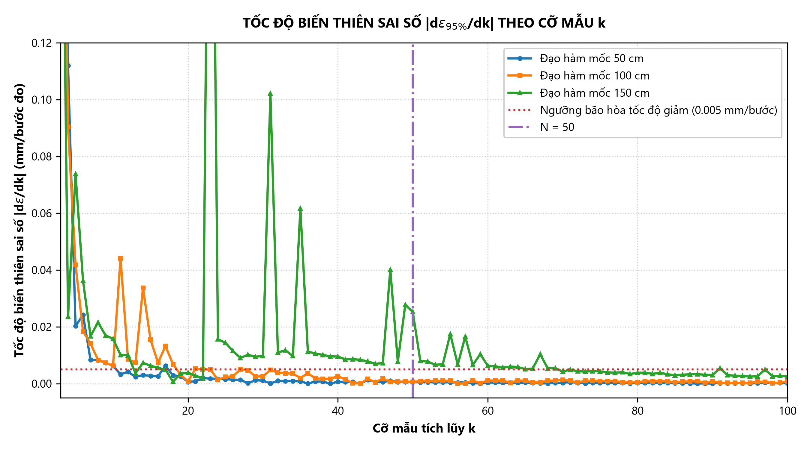

# CHƯƠNG 2: THIẾT KẾ THỰC NGHIỆM

---

## 2.1. MỤC TIÊU VÀ PHƯƠNG PHÁP LUẬN THỰC NGHIỆM

### 2.1.1. Mục tiêu thực nghiệm
Mục tiêu cốt lõi của Chương 2 là thiết kế và chuẩn hóa toàn bộ quy trình đo lường thực nghiệm cho module cảm biến siêu âm RCWL-1601 trên vi điều khiển ESP32, đảm bảo số liệu thu thập được có độ tin cậy khoa học cao và loại trừ tối đa các sai số hệ thống do môi trường và thiết bị. Cụ thể, hệ thống thực nghiệm được thiết kế nhằm đạt được các mục tiêu sau:
1. **Kiểm chứng dải đo thực tế và vùng chết:** Đánh giá giới hạn đo cực cận (vùng chết dưới $5\text{ cm}$) và khả năng đo xa thực tế trên bề mặt phản xạ phẳng nhẵn so với thông số định mức $400\text{ cm}$ theo Datasheet của nhà sản xuất.
2. **Khảo sát toàn diện các chỉ tiêu đo lường tĩnh học:** Thu thập dữ liệu chuẩn hóa phục vụ việc tính toán các đặc tính tĩnh học theo tiêu chuẩn quốc tế ISO/GUM (độ chụm, độ chính xác, độ nhạy thực tế, độ phân giải, độ tuyến tính, độ trễ và đánh giá tổng hợp độ không đảm bảo đo mở rộng).
3. **Định lượng các yếu tố gây nhiễu môi trường:** Đánh giá định lượng tác động của hiện tượng tán xạ sóng âm trên bề mặt gồ ghề (`FRDT`) so với bề mặt phẳng nhẵn (`FSDT`), cũng như tác động của sự thay đổi nhiệt độ môi trường (`FSDT` phòng thường $31^\circ\text{C}$ vs. `FSAT` phòng điều hòa $20^\circ\text{C}$) lên hiện tượng trôi cự ly (Thermal Drift).
4. **Xác lập bộ tham số thực nghiệm cho bài toán ứng dụng:** Làm cơ sở dữ liệu thực nghiệm chuẩn xác để tính toán thiết kế chiều cao lắp đặt, chuỗi bộ lọc số và thuật toán bù nhiệt độ cho hệ thống đo mức chất lỏng bồn chứa thông minh ở Chương 4.

---

### 2.1.2. Phương pháp luận thực nghiệm
Phương pháp luận được áp dụng là **phương pháp đo so sánh trực tiếp với vật chuẩn (Direct Comparison with Standard)**:
- **Chuẩn so sánh (Reference Standard):** Khoảng cách thực $d_{\text{true}}$ được xác lập bằng thước đo tiêu chuẩn có độ chia nhỏ nhất đến milimet với sai số giới hạn $\Delta_{\text{ruler}} = \pm 1\text{ mm}$ ($\pm 0.1\text{ cm}$).
- **Đối tượng đo (Measurement Object):** Khoảng cách đo được $d$ suy ra từ thời gian bay ToF của chùm sóng siêu âm phát ra từ cảm biến RCWL-1601, được vi điều khiển ESP32 số hóa với độ phân giải thời gian $1\text{ }\mu\text{s}$ và cập nhật thuật toán bù nhiệt độ môi trường Laplace $v(T) = 331.3 + 0.606 \cdot T$.
- **Nguyên tắc lặp lại:** Tại mỗi mốc cự ly đặt chuẩn $d_{\text{true}}$, phép đo được kích hoạt lặp lại nhiều lần trong cùng một trạng thái ổn định cơ khí và nhiệt độ để phục vụ phân tích thống kê ngẫu nhiên.

```
       [ Thước đo chuẩn vạch milimet căng giữa hai mép bàn ]
  |===================================================================|
  [RCWL-1601 trên Breadboard] ---------- Sóng ToF ----------> [Viên gạch 40x40 cm]
  (Sát mép bàn 1, độ cao 85 cm)                              (Mép bàn 2, vuông góc mặt bàn)
            |
      (GPIO 5 & 18)
            v
  [Vi điều khiển ESP32] ===== Cáp UART/COM =====> [Máy tính thu thập CSV]
```

---

## 2.2. THIẾT KẾ PHẦN CỨNG VÀ KHÔNG GIAN THỰC NGHIỆM

### 2.2.1. Thiết kế phần cứng và sơ đồ kết nối điện
Hệ thống đo lường sử dụng module cảm biến siêu âm RCWL-1601 kết nối trực tiếp với vi điều khiển ESP32. Cảm biến được cấp nguồn trực tiếp từ chân 3V3 của ESP32. Các đường tín hiệu TRIG và ECHO giao tiếp trực tiếp với các chân GPIO của ESP32 ở mức logic 3.3V mà không cần mạch chuyển đổi mức logic.

Sơ đồ kết nối phần cứng chi tiết:

| Chân RCWL-1601 | Chân ESP32 | Chức năng kỹ thuật |
| :---: | :---: | :--- |
| **`VCC`** | **`3V3`** | Cấp nguồn nuôi cảm biến |
| **`GND`** | **`GND`** | Nối đất chung |
| **`TRIG`** | **`GPIO 5`** | Ngõ vào kích phát xung |
| **`ECHO`** | **`GPIO 18`** | Ngõ ra phản hồi thời gian bay |

---

### 2.2.2. Thiết kế không gian và kiểm soát điều kiện môi trường thực nghiệm
Đặc tính sóng siêu âm có hình nón đòi hỏi không gian đo phải được tính toán để loại trừ các phản xạ phụ:
- **Chiều cao bàn đo ($H_{	ext{table}} = 85	ext{ cm}$):** Hệ thống cảm biến và viên gạch phản xạ được đặt trên hai bàn thí nghiệm có độ cao $H_{	ext{table}} = 85.0	ext{ cm}$ so với mặt sàn phòng đo, đảm bảo búp sóng không quét chạm vào nền sàn.
- **Nhiệt độ phòng đo và vi khí hậu:** Thực nghiệm được bố trí dọc theo hành lang kín gió dài 10 m, chiều rộng 2.8 m. Cảm biến đặt cách tường bên ít nhất 1.4 m. Trong suốt quá trình đo, hệ thống cửa được đóng kín tránh gió lùa và biến thiên nhiệt độ đột ngột.

---

### 2.2.3. Bố trí mô hình và định vị thiết bị đo
Để đảm bảo phép đo đạt độ chính xác cao và hạn chế tối đa sai số góc lệch trục, mô hình thực nghiệm được bố trí khoa học và chắc chắn:
1. **Cố định cảm biến tại vị trí mốc đo gốc:** Module cảm biến RCWL-1601 được cắm cố định vững chắc trên breadboard. Breadboard gắn cảm biến cùng vi điều khiển ESP32 và máy tính thu thập dữ liệu được đặt trên bàn có độ cao khoảng $85	ext{ cm}$ so với mặt sàn. Cảm biến được bố trí ở sát mép bàn, hướng hai mắt phát - thu trực diện ra ngoài.
2. **Vật thể phản xạ mục tiêu:** Vật thể đo chuẩn là một viên gạch kích thước $40 	imes 40	ext{ cm}$ có hai mặt với đặc tính bề mặt khác nhau: mặt trước phẳng nhẵn và mặt sau gồ ghề. Viên gạch được dựng thẳng đứng sát mép của chiếc bàn có cùng chiều cao $85	ext{ cm}$. Khi tiến hành đo, viên gạch luôn được căn chỉnh vuông góc với mặt bàn và đối diện trực diện với trục phát của cảm biến.
3. **Căn chỉnh cự ly bằng thước đo tiêu chuẩn:** Khoảng cách chuẩn $d_{	ext{true}}$ được xác định thủ công bằng thước dây đo chuẩn có độ chia nhỏ nhất đến milimet. Thước được căng thẳng giữa hai mép bàn để định vị chính xác từng mốc cự ly đo trước khi người thực nghiệm phát lệnh kích hoạt cảm biến đo và ghi nhận chuỗi dữ liệu trên máy tính.

---

## 2.3. CÁC TRƯỜNG HỢP ĐO VÀ ĐIỀU KIỆN THỰC NGHIỆM

Để đánh giá đầy đủ, độc lập và toàn diện các đặc tính kỹ thuật của cảm biến trong các điều kiện làm việc khác nhau, hệ thống thực nghiệm thiết lập **4 trường hợp đo chuyên biệt** với các tham số môi trường và hình học đối chứng:

| Tham số | FSDT (Chuẩn) | BSDT (Trễ) | FRDT (Nhám) | FSAT (Nhiệt độ) |
| :--- | :---: | :---: | :---: | :---: |
| **Bề mặt phản xạ** | Mặt nhẵn | Mặt nhẵn | Mặt gồ ghề | Mặt nhẵn |
| **Chiều di chuyển** | Tiến ($1 – 600\text{ cm}$) | Lùi ($300 – 10\text{ cm}$) | Tiến ($10 – 375\text{ cm}$) | Tiến ($10 – 300\text{ cm}$) |
| **Số mốc cự ly** | 35 | 19 | 23 | 19 |
| **Nhiệt độ môi trường** | $27.0^\circ\text{C}$ | $27.0^\circ\text{C}$ | $27.0^\circ\text{C}$ | $20.0^\circ\text{C}$ |
| **Số lần đo lặp N** | 50 | 50 | 50 | 50 |
| **Tổng số mẫu** | 1.750 | 950 | 1.150 | 950 |
| **Mục đích** | Toàn dải, độ chụm, độ chính xác, độ nhạy | Khảo sát độ trễ (Hysteresis) | Khảo sát tán xạ bề mặt | Khảo sát trôi nhiệt độ |

*Bảng 2.2: Bảng tổng hợp các trường hợp đo và thông số thực nghiệm*

---

## 2.4. XÁC ĐỊNH CỠ MẪU TỐI ƯU

### 2.4.1. Bản chất bài toán tối ưu cỡ mẫu trong đo lường siêu âm
Trong kỹ thuật đo lường, kết quả đo khoảng cách thực nghiệm không thể là một giá trị đơn độc, mà luôn được biểu diễn dưới dạng một khoảng tin cậy:

$$d \in [\bar{d} - \varepsilon, \, \bar{d} + \varepsilon] \iff d = \bar{d} \pm \varepsilon$$

Trong đó $\bar{d}$ là trung bình mẫu và $\varepsilon$ là bán kính sai số ngẫu nhiên giới hạn của giá trị trung bình ở mức tin cậy $95\%$. Theo phân phối Student, bán kính sai số $\varepsilon$ được xác định theo mô hình:

$$\varepsilon(N) = t_{0.975, \, N-1} \cdot \frac{s}{\sqrt{N}}$$

Trong đó: $s$ là độ lệch chuẩn đại diện cho độ tán xạ và nhiễu phần cứng thực tế trong môi trường truyền sóng; thừa số $1/\sqrt{N}$ đóng vai trò nén sai số khi tăng số lần đo lặp $N$. Mâu thuẫn đặt ra là: muốn sai số $\varepsilon$ cực nhỏ thì phải tăng $N$ thật lớn, nhưng $N$ càng lớn thì thời gian đo càng dài và nguy cơ trôi nhiệt độ môi trường càng cao. Mục tiêu bài toán là xác định kích thước mẫu $N$ tối ưu để sai số $\varepsilon < 0.5\text{ mm}$ (dung sai vạch chia thước), tốc độ đạo hàm đạt ngưỡng dừng bão hòa ($|d\varepsilon/dN| \approx 0$), và thời gian đo đủ ngắn để môi trường vi khí hậu được coi là bất biến.

---

### 2.4.2. Phân tích dữ liệu thực nghiệm

Thực nghiệm tiến hành đo liên tục 100 lần tại 3 cự ly: $50\text{ cm}$, $100\text{ cm}$ và $150\text{ cm}$ (nhiệt độ $27.0^\circ\text{C}$). Dữ liệu được lưu trữ tại bảng tổng hợp `du_lieu_tong_hop/mau_100.csv`. Thuật toán duyệt $k$ từ 2 đến 100 trên tệp `mau_100.csv` để tính độ lệch chuẩn tích lũy $s(k)$, bán kính sai số $\varepsilon_{95\%}(k)$ và đạo hàm bậc 1. Toàn bộ kết quả được phân tách thành 3 tệp độc lập trong thư mục `du_lieu_tong_hop/chuong_2/`: `hoi_tu_50cm.csv`, `hoi_tu_100cm.csv` và `hoi_tu_150cm.csv`.



*Hình 2.1: Bán kính sai số ngẫu nhiên theo tích lũy cỡ mẫu tại 3 cự ly.*

**Đánh giá từ đồ thị Hình 2.1:** Khi số lần đo $k$ tăng từ 2 đến khoảng 30, bán kính sai số ngẫu nhiên $\varepsilon_{95\%}$ giảm nhanh ở cả 3 cự ly do hệ số Student giảm và mẫu số $\sqrt{k}$ tăng. Từ $k \ge 40 - 50$, đường cong bắt đầu đi ngang và hội tụ ổn định. Tại $k = 50$, bán kính sai số ở cự ly $50\text{ cm}$ là $\pm 0.03\text{ mm}$, ở $100\text{ cm}$ là $\pm 0.11\text{ mm}$, và ở $150\text{ cm}$ là $\pm 0.40\text{ mm}$; tất cả đều nhỏ hơn giới hạn dung sai của thước cơ khí ($\pm 0.5\text{ mm}$).



*Hình 2.2: Tốc độ biến thiên sai số |dε_95%/dk| theo cỡ mẫu k.*

**Đánh giá từ đồ thị Hình 2.2:** Đồ thị thể hiện tốc độ suy giảm sai số $|d\varepsilon_{95\%}/dk|$ sau mỗi lần đo bổ sung. Ở các giá trị $k < 20$, tốc độ biến thiên lớn (từ $0.05$ đến $0.15\text{ mm/bước}$), cho thấy việc tăng số lần đo ở giai đoạn đầu giảm sai số rất hiệu quả. Khi $k$ tiến dần đến 50, tốc độ biến thiên giảm nhanh về xấp xỉ 0 ($|d\varepsilon/dk| \le 0.0005\text{ mm/bước} \approx 0$), đồ thị chuyển sang trạng thái bão hòa, việc đo thêm sau mốc 50 hầu như không làm sai số giảm thêm.

Bảng số liệu đối chiếu trích xuất tại các mốc cỡ mẫu:

| Cỡ mẫu $k$ | Mốc 50cm ($\varepsilon_{95\%}$) | Mốc 100cm ($\varepsilon_{95\%}$) | Mốc 150cm ($\varepsilon_{95\%}$) | Nhận xét |
| :---: | :---: | :---: | :---: | :--- |
| **$k = 5$** | $\pm 0.12\text{ mm}$ | $\pm 0.12\text{ mm}$ | $\pm 0.15\text{ mm}$ | Mẫu nhỏ, sai số còn lớn |
| **$k = 10$** | $\pm 0.06\text{ mm}$ | $\pm 0.06\text{ mm}$ | $\pm 0.12\text{ mm}$ | Sai số giảm nhanh nhưng chưa phản ánh đủ biến động |
| **$k = 20$** | $\pm 0.05\text{ mm}$ | $\pm 0.17\text{ mm}$ | $\pm 0.07\text{ mm}$ | Sai số tiếp tục giảm, bắt đầu phân hóa theo cự ly |
| **$k = 30$** | $\pm 0.03\text{ mm}$ | $\pm 0.14\text{ mm}$ | $\pm 0.28\text{ mm}$ | Xuất hiện trượt chu kỳ sóng tại 150cm, sai số tăng lên |
| **$k = 50$ (Tối ưu)** | **$\pm 0.03\text{ mm}$** | **$\pm 0.11\text{ mm}$** | **$\pm 0.40\text{ mm}$** | **Mốc tối ưu:** Sai số nhỏ hơn $0.5\text{ mm}$ ở cả 3 cự ly, đạt bão hòa |
| **$k = 100$** | $\pm 0.02\text{ mm}$ | $\pm 0.08\text{ mm}$ | $\pm 0.27\text{ mm}$ | Vùng bão hòa, sai số hầu như không giảm thêm |

*Bảng 2.3: Bảng trích số liệu của bán kính sai số Student 95%*

**Đánh giá từ Bảng 2.3:** Số liệu định lượng xác nhận xu hướng hội tụ của phép đo. Việc tăng cỡ mẫu từ $k = 10$ lên $k = 50$ giúp giảm sai số hơn 2 lần ở cả 3 cự ly. Tuy nhiên, khi tăng từ $k = 50$ lên $k = 100$, sai số tại mốc 100 cm chỉ giảm thêm $0.03\text{ mm}$ (từ $0.11\text{ mm}$ xuống $0.08\text{ mm}$), giá trị này nhỏ hơn nhiều so với độ phân giải phần cứng của vi điều khiển ($\approx 0.175\text{ mm}$).

**Kết luận:** Dựa trên các phân tích và đánh giá từ hai đồ thị và bảng số liệu nêu trên, nhóm nghiên cứu đưa ra quyết định lựa chọn cỡ mẫu **$N = 50$** cho toàn bộ các phép đo thực nghiệm của đề tài với các lý do:
1. **Đạt tiêu chuẩn dung sai đo lường:** Tại $N = 50$, bán kính sai số ngẫu nhiên $\varepsilon_{95\%}$ ở cả 3 cự ly đều nhỏ hơn dung sai vạch chia của thước chuẩn cơ khí ($\pm 0.5\text{ mm}$): đạt $\pm 0.03\text{ mm}$ tại 50cm; $\pm 0.11\text{ mm}$ tại 100cm; và $\pm 0.40\text{ mm}$ tại 150cm.
2. **Điểm dừng đạo hàm tối ưu bão hòa:** Đồ thị Hình 2.2 chứng minh tại $k = 50$, đạo hàm sai phân $|d\varepsilon/dk| \le 0.0005\text{ mm/bước} \approx 0$, xác nhận đường cong đã bước vào vùng bão hòa. Việc tăng số lần đo lên $N = 100$ chỉ giảm thêm $0.03\text{ mm}$ ở mốc 100cm (nhỏ hơn độ phân giải phần cứng vi điều khiển $\approx 0.175\text{ mm}$).
3. **Bảo toàn tính ổn định vi khí hậu:** Với chu kỳ lấy mẫu $50\text{ ms}$ (tần số quét $20\text{ Hz}$), việc thu thập $N = 50$ mẫu chỉ mất đúng $T_{\text{total}} = 2.5\text{ giây}$ cho mỗi mốc cự ly. Khoảng thời gian $2.5\text{ giây}$ đủ ngắn để nhiệt độ phòng và vi khí hậu được coi là bất biến, loại trừ hiện tượng trôi nhiệt độ môi trường.
