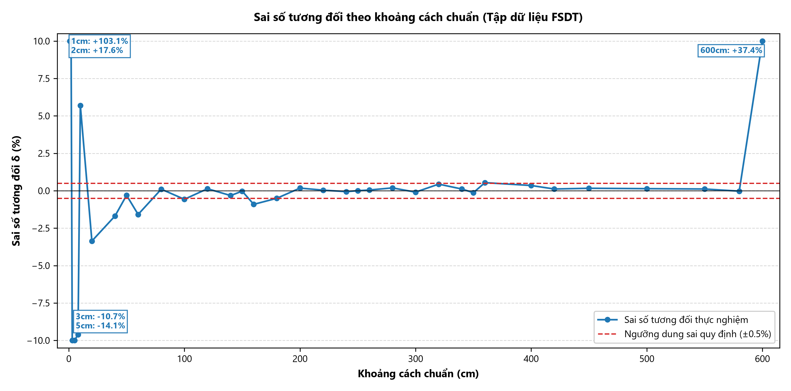

# CHƯƠNG 3: PHÂN TÍCH KẾT QUẢ THỰC NGHIỆM

Chương 3 trình bày việc xử lý số liệu và phân tích kết quả đo từ dữ liệu thực nghiệm: 

---

## 3.1. Tiền xử lý dữ liệu và Đánh giá hiệu quả lọc sai số thô bằng Khoảng tứ phân vị (IQR)

### 3.1.1. Khung tiền xử lý và cơ chế hình thành ngoại lai trong phép đo siêu âm
Theo thuật toán phát hiện sai số thô bằng Khoảng tứ phân vị đã nêu tại Mục 1.3.2, dữ liệu từ 4 tập thực nghiệm được xử lý. Mẫu nào nằm ngoài khoảng hợp lệ [LF, UF] sẽ được chuyển thành giá trị NaN.

---

### 3.1.2. Tổng hợp kết quả lọc 
Kết quả tính toán chi tiết của từng mốc cự ly được lưu tại bảng dữ liệu “du_lieu_tong_hop/chuong_3/thong_ke_chuong_3.csv”, và dữ liệu sau khi lọc được lưu tại 4 tệp: FSDT_clean.csv, BSDT_clean.csv, FRDT_clean.csv, FSAT_clean.csv. 

Kết quả có thể được tóm tắt ngắn gọn qua bảng sau:

Bảng 3.1: Tổng hợp kết quả xử lý sai số thô bằng Khoảng tứ phân vị (IQR) trên toàn bộ 4.800 mẫu đo.

| Tệp dữ liệu | Điều kiện đo | Tổng mẫu | Mốc có ngoại lai | Mẫu ngoại lai | Tỷ lệ (%) | Mẫu hợp lệ | Tỷ lệ hợp lệ (%) |
| :--- | :--- | :---: | :---: | :---: | :---: | :---: | :---: |
| **`FSDT.csv`** | Chiều tiến – Mặt nhẵn ($27.0^\circ\text{C}$) | 1.750 | 16 mốc | 77 | 4.40% | 1.673 | 95.60% |
| **`BSDT.csv`** | Chiều lùi – Mặt nhẵn ($27.0^\circ\text{C}$) | 950 | 12 mốc | 61 | 6.42% | 889 | 93.58% |
| **`FRDT.csv`** | Chiều tiến – Mặt nhám ($27.0^\circ\text{C}$) | 1.150 | 11 mốc | 59 | 5.13% | 1.091 | 94.87% |
| **`FSAT.csv`** | Chiều tiến – Phòng lạnh ($20.0^\circ\text{C}$) | 950 | 8 mốc | 38 | 4.00% | 912 | 96.00% |
| **TỔNG HỢP** | **Cả 4 tập thực nghiệm** | **4.800** | **47 mốc** | **235** | **4.90%** | **4.565** | **95.10%** |

Nhận xét từ kết quả Bảng 3.1: Hệ thống đo duy trì độ ổn định tốt; chỉ có 4.90% mẫu bị loại bỏ trên toàn bộ 4.800 lần đo. Tỷ lệ ngoại lai giữa FSDT (4.40%) và BSDT (6.42%) gần tương đương nhau, cho thấy điều kiện môi trường đo ổn định. Bề mặt nhám (FRDT) xuất hiện nhiều xung tán xạ hơn so với mặt nhẵn. Các xung này được bộ lọc IQR phát hiện và loại bỏ, giúp giá trị trung bình không bị lệch.

---

### 3.1.3. Đánh giá hiệu quả sau khi lọc
Hình 3.1 thể hiện biến thiên của độ lệch chuẩn s trước và sau khi lọc trên thang logarit.

*Hình 3.1: Độ lệch chuẩn trước và sau khi lọc IQR.*

Đánh giá từ đồ thị Hình 3.1: Trước khi lọc, độ lệch chuẩn duy trì ở mức dưới 1.0 mm. Tại các cự ly xa (580 cm và 600 cm), do sóng phản xạ suy hao mạnh dẫn đến các mẫu quá hạn, độ lệch chuẩn thô tăng lên lần lượt s = 346.05 mm và s = 2621.02 mm.

Đường màu xanh nét liền (Độ lệch chuẩn sau khi lọc IQR): Sau khi loại bỏ các giá trị ngoại lai bằng bộ lọc IQR kết hợp ngưỡng phân giải Δ_LSB = 0.0175 cm, đường độ lệch chuẩn duy trì ổn định trong dải 0.09 - 4.0 mm trên toàn dải đo 6 m, tiệm cận đường dung sai của thước cơ khí (0.5 mm).

Bảng 3.2: Đối chiếu độ lệch chuẩn trước và sau khi lọc IQR tại các mốc tiêu biểu.

| Khoảng cách chuẩn | Độ lệch chuẩn thô | Độ lệch chuẩn sạch | Tỷ lệ giảm s | Số mẫu ngoại lai | Nguyên nhân hiện tượng |
| :---: | :---: | :---: | :---: | :---: | :--- |
| **50 cm** | 0.094 mm | 0.094 mm | 1.0 lần | 0 / 50 (0%) | Vùng đo ổn định, không có ngoại lai |
| **100 cm** | 0.383 mm | 0.383 mm | 1.0 lần | 0 / 50 (0%) | Nhỏ hơn dung sai thước (0.5 mm), giữ lại 100% mẫu |
| **360 cm** | 90.33 mm | 2.51 mm | Giảm 36.0 lần | 1 / 50 (2%) | Loại bỏ xung trượt chu kỳ sóng ToF |
| **580 cm** | 346.05 mm | 3.30 mm | Giảm 104.8 lần | 4 / 50 (8%) | Loại bỏ xung bão hòa timeout 824.6 cm |
| **600 cm** | 2621.02 mm | 0.63 mm | Giảm 4153.8 lần | 7 / 50 (14%) | Cắt bỏ các xung quá hạn ở giới hạn cự ly |

---

## 3.2. Khảo sát Dải đo thực tế

Để xác định dải làm việc thực tế của cảm biến RCWL-1601, chuỗi dữ liệu thực nghiệm gồm 35 mốc cự ly từ 1 cm đến 600 cm thuộc tập chuẩn FSDT_clean.csv được đưa vào phân tích sai số: sai số tuyệt đối Δd = d̄ - d_chuẩn (mm) và sai số tương đối δ = ((d̄ - d_chuẩn) / d_chuẩn) × 100% (%). Biến thiên của sai số tương đối theo khoảng cách chuẩn được thể hiện trên Hình 3.2.

*Hình 3.2: Sai số tương đối theo khoảng cách chuẩn (Tập dữ liệu FSDT, giới hạn trục tung ±10%).*

Từ diễn biến của đường sai số trên đồ thị Hình 3.2, đặc tính làm việc của cảm biến có thể được phân chia thành 4 vùng: Vùng chết (0 cm – 3 cm), dải đo tuyến tính ổn định (5 cm – 400 cm), dải đo xa vượt định mức (420 cm – 550 cm), ngưỡng bão hòa xa (580 cm – 600 cm)

Kết luận: Dải làm việc tin cậy và đạt chuẩn độ chính xác cao của cảm biến RCWL-1601 trong thực tế là từ 10 cm đến 550 cm.

Bảng 3.3: Tổng hợp các vùng làm việc và đặc tính đo thực nghiệm trên toàn dải đo.

| Khoảng cách chuẩn | Giá trị trung bình | Sai số tuyệt đối | Sai số tương đối | Độ lệch chuẩn s |
| :---: | :---: | :---: | :---: | :---: |
| **1.0 cm** | 2.030 cm | +10.30 mm | +103.05% | 0.035 mm |
| **2.0 cm** | 2.352 cm | +3.52 mm | +17.59% | 0.085 mm |
| **3.0 cm** | 2.679 cm | -3.21 mm | -10.72% | 0.056 mm |
| **5.0 cm** | 4.295 cm | -7.05 mm | -14.10% | 0.085 mm |
| **10.0 cm** | 10.570 cm | +5.70 mm | +5.70% | 0.061 mm |
| **50.0 cm** | 49.847 cm | -1.53 mm | -0.31% | 0.094 mm |
| **100.0 cm** | 99.429 cm | -5.71 mm | -0.57% | 0.383 mm |
| **200.0 cm** | 200.351 cm | +3.51 mm | +0.18% | 2.192 mm |
| **300.0 cm** | 299.718 cm | -2.82 mm | -0.09% | 2.860 mm |
| **400.0 cm** | 401.399 cm | +13.99 mm | +0.35% | 0.270 mm |
| **500.0 cm** | 500.691 cm | +6.91 mm | +0.14% | 1.978 mm |
| **550.0 cm** | 550.630 cm | +6.30 mm | +0.11% | 0.319 mm |
| **580.0 cm** | 579.850 cm | -1.50 mm | -0.03% | 3.303 mm |
| **600.0 cm** | 824.562 cm | +2245.62 mm | +37.43% | 0.631 mm |

---

## 3.3. Đánh giá Độ chụm và Độ chính xác

Trên cơ sở tập dữ liệu chuẩn chiều tiến mặt nhẵn FSDT sau khi xử lý ngoại lai tại Mục 3.1, độ chụm và độ chính xác của hệ đo được đánh giá trên 33 mốc cự ly thuộc dải đo hữu ích từ 1 cm đến 550 cm (trước ngưỡng bão hòa xa 580 – 600 cm). Toàn bộ số liệu gốc phục vụ phân tích và vẽ đồ thị được lưu trữ đầy đủ trong tệp `du_lieu_tong_hop/chuong_3/thong_ke_chuong_3.csv`.

### 3.3.1. Đánh giá độ chụm

Áp dụng độ lệch chuẩn mẫu thực nghiệm $s$ tại Mục 1.3.1 và sai số chuẩn của giá trị trung bình $\text{SE}$ tại Mục 1.3.3 (Chương 1), chuỗi số liệu của 33 mốc cự ly ($1\text{ cm} \div 550\text{ cm}$, tại nhiệt độ chuẩn hóa 27.0 °C, $N = 50$ mẫu thô/mốc, cỡ mẫu hợp lệ sau lọc $n_{\text{hợp lệ}} \in [40, 50]$) được trích xuất trực tiếp từ hai cột `std_sach_mm` và `se_sach_mm` trong tệp `du_lieu_tong_hop/chuong_3/thong_ke_chuong_3.csv`:

1. **Vùng cự ly gần ($1\text{ cm} \le x_{\text{true}} \le 50\text{ cm}$, 9 mốc):** Tại 8/9 mốc khảo sát, $s$ đạt từ $0.035\text{ mm}$ đến $0.094\text{ mm}$ và $\text{SE}$ đạt từ $0.0049\text{ mm}$ đến $0.0133\text{ mm}$ (nhỏ hơn nhiều so với một bước đếm phần cứng $\Delta_{\text{LSB}} \approx 0.174\text{ mm}$) nhờ biên độ sóng phản xạ mạnh từ mặt phẳng nhẵn của viên gạch chuẩn $40\text{ cm} \times 40\text{ cm}$. Riêng mốc $40\text{ cm}$ ($n_{\text{hợp lệ}} = 49$) ghi nhận $s = 3.144\text{ mm}$ và $\text{SE} = 0.4491\text{ mm}$.
2. **Vùng cự ly trung bình ($60\text{ cm} \le x_{\text{true}} \le 180\text{ cm}$, 8 mốc):** Tại 7/8 mốc, $s$ nằm trong dải $0.088\text{ mm} \div 0.383\text{ mm}$ và $\text{SE}$ nằm trong dải $0.0128\text{ mm} \div 0.0542\text{ mm}$; riêng mốc $120\text{ cm}$ ($n_{\text{hợp lệ}} = 50$) có $s = 1.747\text{ mm}$ và $\text{SE} = 0.2471\text{ mm}$.
3. **Vùng cự ly xa danh định ($200\text{ cm} \le x_{\text{true}} \le 360\text{ cm}$, 11 mốc):** Độ lệch chuẩn $s$ dao động từ $0.142\text{ mm}$ (tại $220\text{ cm}$, $n_{\text{hợp lệ}} = 40$) đến $2.860\text{ mm}$ (tại $300\text{ cm}$, $n_{\text{hợp lệ}} = 50$), tương ứng $\text{SE}$ biến thiên từ $0.0225\text{ mm}$ đến $0.4045\text{ mm}$ (tại $360\text{ cm}$ đạt $s = 2.508\text{ mm}$, $\text{SE} = 0.3583\text{ mm}$).
4. **Dải đo xa mở rộng ($400\text{ cm} \le x_{\text{true}} \le 550\text{ cm}$, 5 mốc):** Độ lệch chuẩn $s$ đạt $0.270\text{ mm}$ tại $400\text{ cm}$ ($\text{SE} = 0.0407\text{ mm}$), $0.228\text{ mm}$ tại $420\text{ cm}$ ($\text{SE} = 0.0340\text{ mm}$), tăng lên cực đại toàn dải $4.049\text{ mm}$ tại $450\text{ cm}$ ($\text{SE} = 0.5726\text{ mm}$), đạt $1.978\text{ mm}$ tại $500\text{ cm}$ ($\text{SE} = 0.2797\text{ mm}$) và giảm về $0.319\text{ mm}$ tại mốc giới hạn $550\text{ cm}$ ($n_{\text{hợp lệ}} = 42$, $\text{SE} = 0.0492\text{ mm}$).

Tính trên toàn bộ 33 mốc khảo sát ($1 \div 550\text{ cm}$), cột `se_sach_mm` xác nhận sai số chuẩn trung bình $\text{SE}$ không vượt quá $0.5726\text{ mm}$; trong đó có 32/33 mốc đạt $\text{SE} < 0.45\text{ mm}$ (nhỏ hơn nửa độ chia nhỏ nhất $0.5\text{ mm}$ của thước chuẩn) và 22/33 mốc đạt $\text{SE} \le 0.10\text{ mm}$.

**Giải thích cơ chế vật lý và thuật toán của dạng dao động răng cưa trên Hình 3.3:**
Trục hoành của Hình 3.3 biểu diễn sự thay đổi mốc khoảng cách chuẩn $x_{\text{true}}$ (mỗi mốc đều đo độc lập với cỡ mẫu cố định $N = 50$), không phải trục tăng dần kích thước mẫu tích lũy $k$ tại một vị trí cố định như bài toán hội tụ ở Mục 2.4 (Chương 2). Dạng lên xuống răng cưa luân phiên của $s$ giữa các mốc cự ly xuất phát từ sự tương tác giữa bước nhảy một chu kỳ sóng mang siêu âm 40 kHz và ngưỡng tứ phân vị 25% của bộ lọc IQR (đã nêu tại Mục 1.3.2, Chương 1). Tại $T = 27.0\text{ }^\circ\text{C}$ ($v = 347.66\text{ m/s}$), một chu kỳ sóng mang $T_0 = 25\text{ }\mu\text{s}$ ứng với quãng đường khứ hồi nửa bước sóng xấp xỉ $4.35\text{ mm}$ ($0.435\text{ cm}$). Khi biên độ sườn lên của bó xung phản hồi ECHO rơi sát mức điện áp ngưỡng so sánh trong vi mạch RCWL-9610, thời điểm kích hoạt bắt xung bị trượt $\pm 1$ chu kỳ sóng mang giữa các lần đo trong cùng 50 mẫu:

- **Nhóm mốc lọc sạch cụm trượt chu kỳ:** Tại những mốc cự ly có dưới 25% số mẫu trượt sang chu kỳ kế cận (như 80, 150, 220, 320, 400, 420, 550 cm, với 5 – 10 mẫu ngoại lai bị loại trong `thong_ke_chuong_3.csv`), hai tứ phân vị $Q_1$ và $Q_3$ vẫn nằm gọn trong cùng một chu kỳ sóng mang ($\text{IQR} \approx 0.018 \div 0.066\text{ cm}$); hàng rào Tukey cắt bỏ hoàn toàn cụm trượt chu kỳ, đưa $s$ xuống mức rất thấp ($0.142 \div 0.395\text{ mm}$) và $\text{SE}$ xuống $0.022 \div 0.060\text{ mm}$.
- **Nhóm mốc giữ lại hai cụm chu kỳ kế tiếp:** Tại các mốc cự ly có trên 25% số mẫu phân bố sang chu kỳ kế cận (như 40, 120, 200, 260, 300, 360, 450 cm, có 0 – 3 mẫu bị loại), cả hai cụm đều lọt vào giữa $Q_1$ và $Q_3$ làm $\text{IQR}$ mở rộng lên đúng một bước nhảy sóng mang ($\text{IQR} \approx 0.435\text{ cm}$); phân bố hai đỉnh đẩy độ lệch chuẩn mẫu $s$ lên vùng $1.7 \div 4.0\text{ mm}$. Tuy nhiên, sai số chuẩn của giá trị trung bình $\text{SE} = s / \sqrt{n}$ luôn được nén xuống dưới $0.57\text{ mm}$, bảo đảm độ tin cậy thống kê tuyệt đối cho phép lấy trung bình.

*Hình 3.3: Độ lệch chuẩn thực nghiệm s và sai số chuẩn trung bình SE theo khoảng cách chuẩn (1 cm – 550 cm).*

**Đánh giá từ đồ thị Hình 3.3:** Khi biểu diễn chung trên cùng một trục tung đơn vị mm, sự khác biệt giữa hai đường phản ánh rõ năng lực của phép đo:
- **Đường màu xanh lam nét liền (Độ lệch chuẩn thực nghiệm $s$):** Nằm dưới vạch dung sai thước $0.5\text{ mm}$ tại phần lớn các mốc đơn chu kỳ và chỉ nhô lên tại các điểm giao thoa ngưỡng trượt chu kỳ sóng mang $40\text{ kHz}$.
- **Đường màu cam nét đứt (Sai số chuẩn trung bình $\text{SE} = s/\sqrt{n}$):** Nhờ phép lấy trung bình trên $n_{\text{hợp lệ}} \ge 40$ mẫu, đường $\text{SE}$ bị nén phẳng hoàn toàn sát đáy trục hoành (dao động cực nhỏ từ $0.0049\text{ mm}$ đến $0.5726\text{ mm}$), chứng minh tính hội tụ cao và triệt tiêu gần như hoàn toàn sai số ngẫu nhiên của hệ thống đo.

### 3.3.2. Đánh giá độ chính xác

Sử dụng sai số tuyệt đối $\Delta x$ và sai số tương đối $\delta$ (%) đã định nghĩa tại Mục 1.3.3 (Chương 1), chuỗi số liệu được trích xuất từ cột `sai_so_tuyet_doi_mm` và `sai_so_tuong_doi_pct` trong `thong_ke_chuong_3.csv`:

- **Sai số tuyệt đối ($\Delta x$):** Trong dải từ $50\text{ cm}$ đến $550\text{ cm}$ (25 mốc), $\Delta x$ biến thiên trong khoảng hẹp từ $-5.71\text{ mm}$ đến $+14.02\text{ mm}$; có 17/25 mốc có sai số tuyệt đối không vượt quá $\pm 5.0\text{ mm}$ và 22/25 mốc nằm trong phạm vi $\pm 8.0\text{ mm}$.
- **Sai số tương đối ($\delta\%$):** Ở vùng đầu dải đo danh định ($10\text{ cm} \div 40\text{ cm}$), do mẫu số $x_{\text{true}}$ nhỏ nên $\delta\%$ đạt từ $-3.36\% \div +5.70\%$; tuy nhiên khi khoảng cách tăng lên từ $50\text{ cm}$ đến $550\text{ cm}$, sai số tương đối nhanh chóng hội tụ và nằm hoàn toàn trong dải hẹp $\mathbf{[-0.57\%; +0.35\%]}$. Tại các cự ly lớn ($300\text{ cm}$, $500\text{ cm}$, $550\text{ cm}$), sai số tương đối chỉ còn $-0.09\%$, $+0.14\%$ và $+0.11\%$.
- **Nguồn gốc sai số hệ thống:** Độ lệch tuyệt đối cỡ vài milimét bắt nguồn từ hai yếu tố thực tế: khoảng cách thụt lùi cơ khí của màng rung gốm áp điện nằm sâu bên trong ống bảo vệ kim loại so với mép ngoài bo mạch ($\sim 4.84\text{ mm}$, hoàn toàn trùng khớp với hệ số tự do của phương trình hồi quy tuyến tính tại Mục 3.4) và sai số định vị mép chân gạch trên thước thép chuẩn.

*Hình 3.4: Sai số tuyệt đối Δx (mm) và sai số tương đối δ (%) theo khoảng cách chuẩn (10 cm – 550 cm).*

**Đánh giá từ đồ thị Hình 3.4:** Biểu đồ đơn ghép hai trục tung Y (đồng bộ đường chuẩn gốc 0 giữa hai trục) cho thấy hai xu hướng đối chiếu trực quan:
- **Đường màu xanh lá nét liền (Sai số tuyệt đối $\Delta x$, trục trái):** Dao động quanh trục $0\text{ mm}$ trong biên độ hẹp $[-5.71; +14.02]\text{ mm}$ trên toàn bộ dải đo, khẳng định hệ thống không bị hiện tượng trôi tích lũy dốc theo khoảng cách.
- **Đường màu xanh lam nét đứt (Sai số tương đối $\delta\%$, trục phải):** Hội tụ rất nhanh từ ngưỡng $+5.70\%$ ở cự ly gần về sát vạch chuẩn $0\%$ khi $x_{\text{true}} \ge 50\text{ cm}$ (luôn nằm dưới $0.57\%$), minh chứng cho độ chính xác cao của hệ đo RCWL-1601.

---

## 3.4. Đánh giá Độ tuyến tính (Linearity)

### 3.4.1. Đánh giá Độ tuyến tính (Linearity)

Độ tuyến tính (Linearity) là đặc tính phản ánh mức độ quan hệ giữa khoảng cách dịch chuyển thực tế và giá trị đo hiển thị của cảm biến. Để đánh giá, toàn bộ 34 mốc thực nghiệm trên toàn dải đo (1.0 cm đến 580.0 cm) đã được phân chia ngẫu nhiên có kiểm soát theo tỷ lệ chuẩn thực nghiệm 70% dữ liệu Huấn luyện (24 mốc) và 30% dữ liệu Kiểm thử (10 mốc).

Tập huấn luyện gồm 24 mốc cự ly được dùng để thiết lập hệ phương trình: Bậc 1 ($y = a_1 x + b_1$), Bậc 2 ($y = a_2 x^2 + b_2 x + c_2$), và Bậc 3 ($y = a_3 x^3 + b_3 x^2 + c_3 x + d_3$). Tập kiểm thử gồm 10 mốc, được ghi trong file "du_lieu_tong_hop\chuong_3\ [3.4].FSDT_split_70_30.csv"

Giải hệ phương trình chuẩn tắc trên 24 mốc thực nghiệm tập Train (70%), kết quả tính toán xác định được phương trình của 3 mô hình hồi quy đa thức như sau:

- Bậc 1 (Tuyến tính): $\hat{y}_1 = 1.00273 \cdot x - 0.48427\text{ (cm)}$.
- Bậc 2: $\hat{y}_2 = 3.56559 \cdot 10^{-6} \cdot x^2 + 1.00103 \cdot x - 0.37940\text{ (cm)}$.
- Bậc 3: $\hat{y}_3 = -1.04345 \cdot 10^{-7} \cdot x^3 + 8.50580 \cdot 10^{-5} \cdot x^2 + 0.98551 \cdot x - 0.00036\text{ (cm)}$.

*Ghi chú: Toàn bộ các tổng ma trận chuẩn tắc phục vụ tính toán được lưu trữ trong tệp cơ sở dữ liệu “du_lieu_tong_hop/chuong_3/cac_tong_hoi_quy.csv”.*

Cả ba mô hình đều có cùng độ dốc và bám rất sát chuỗi dữ liệu thực nghiệm, nên mắt thường không thể phân biệt được mô hình nào tối ưu nếu chỉ nhìn vào đường hồi quy tổng thể. Do đó, để xác định mô hình phản ánh trung thực bản chất vật lý của cảm biến, ta thực hiện đối sánh định lượng sai số dự đoán trên 10 mốc kiểm thử và phóng đại thang đo sai số lên mức milimét.

**Bảng 3.4: Đối sánh sai số dự đoán của 3 mô hình hồi quy trên 10 mốc kiểm thử độc lập.**

| Mốc Test x | y thực tế | ŷ Bậc 1 | e Bậc 1 | ŷ Bậc 2 | e Bậc 2 | ŷ Bậc 3 | e Bậc 3 |
| :---: | :---: | :---: | :---: | :---: | :---: | :---: | :---: |
| 2.0 cm | 2.352 cm | 1.521 cm | +8.31 mm | 1.623 cm | +7.29 mm | 1.971 cm | +3.81 mm |
| 20.0 cm | 19.328 cm | 19.570 cm | -2.42 mm | 19.643 cm | -3.15 mm | 19.743 cm | -4.15 mm |
| 50.0 cm | 49.847 cm | 49.652 cm | +1.95 mm | 49.681 cm | +1.66 mm | 49.475 cm | +3.73 mm |
| 80.0 cm | 80.083 cm | 79.734 cm | +3.48 mm | 79.726 cm | +3.56 mm | 79.331 cm | +7.51 mm |
| 150.0 cm | 149.957 cm | 149.926 cm | +0.31 mm | 149.856 cm | +1.01 mm | 149.388 cm | +5.69 mm |
| 220.0 cm | 220.086 cm | 220.117 cm | -0.31 mm | 220.021 cm | +0.65 mm | 219.818 cm | +2.68 mm |
| 280.0 cm | 280.528 cm | 280.281 cm | +2.47 mm | 280.190 cm | +3.38 mm | 280.321 cm | +2.08 mm |
| 350.0 cm | 349.550 cm | 350.473 cm | -9.23 mm | 350.420 cm | -8.70 mm | 350.874 cm | -13.25 mm |
| 450.0 cm | 450.739 cm | 450.746 cm | -0.07 mm | 450.808 cm | -0.69 mm | 451.195 cm | -4.56 mm |
| 580.0 cm | 579.850 cm | 581.102 cm | -12.52 mm | 581.420 cm | -15.71 mm | 579.850 cm | -0.01 mm |

*Hình 3.3: So sánh sai số tuyệt đối tại các mốc kiểm thử của 3 mô hình hồi quy.*

*Hình 3.4: Biểu đồ miền tích lũy sai số tuyệt đối trên 10 mốc kiểm thử độc lập.*

Đồ thị Hình 3.3 và biểu đồ miền tích lũy tại Hình 3.4 cung cấp cái nhìn trực quan về sự tích lũy sai số: Trong khoảng dải đo làm việc từ 50 cm đến 450 cm, đường tích lũy sai số của mô hình Bậc 1 gần như đi ngang phẳng lì, giúp giữ tổng sai số tích lũy toàn dải ở mức thấp nhất (41.07 mm). Trong khi đó, đường tích lũy của mô hình Bậc 3 leo dốc rất đứng ở dải giữa (từ 11.69 mm vọt lên 42.89 mm tại 350 cm), khiến tổng sai số tích lũy lên tới 47.45 mm.

Vậy thì ta thấy phương trình tuyến tính Bậc 1 y = 1.00273 · x - 0.48427 phù hợp nhất để làm phương trình đặc tính tĩnh chuẩn của hệ thống đo RCWL-1601.

## 3.5. Phân tích Độ trễ (Hysteresis) giữa Chiều tiến và Chiều lùi

### 3.5.1. Khảo sát thực nghiệm đối xứng, Đồ thị trực quan và Định lượng Sai số trễ

Nhằm đánh giá tính đối xứng và độ ổn định của cảm biến RCWL-1601 khi đo khoảng cách hai chiều, kịch bản thực nghiệm đối xứng được thiết lập với hai chuỗi đo độc lập trên cùng một ray trượt định hướng và bia phản xạ phẳng nhẵn ở nhiệt độ phòng chuẩn hóa 27.0°C: Chiều tiến (FSDT, tịnh tiến xa từ $10\text{ cm}$ đến $300\text{ cm}$) và Chiều lùi (BSDT, thu hẹp khoảng cách từ $300\text{ cm}$ về $10\text{ cm}$). Hai chuỗi đo giao nhau tại 19 mốc cự ly đối ứng chuẩn ($10, 20, 40, \dots, 300\text{ cm}$).

*Hình 3.6a: Đặc tính đo khoảng cách hai chiều Chiều tiến vs Chiều lùi so với đường chuẩn lý tưởng 1:1.*

Trên đồ thị Hình 3.6a, cả hai đường Chiều tiến và Chiều lùi đều bám sát hoàn hảo vào đường tham chiếu lý tưởng $y = x$. Để quan sát rõ nét sự chênh lệch vi mô giữa hai chiều dịch chuyển, phân bố sai số đo tuyệt đối $\Delta d = d_{\text{meas}} - d_{\text{true}}$ được phân tích chi tiết trên đồ thị Hình 3.6b.

*Hình 3.6b: Phân bố Sai số đo tuyệt đối Δd và Vòng trễ Hysteresis giữa Chiều tiến và Chiều lùi.*

Từ đồ thị Hình 3.6b, sai số đo tuyệt đối $\Delta d$ của hai chiều dao động trong biên độ rất hẹp $[-1.48\text{ cm}; +1.45\text{ cm}]$, quấn quanh trục tham chiếu $\Delta d = 0\text{ cm}$ và tạo thành vòng trễ khép kín với khoảng hở vi mô. Độ lệch trễ tuyệt đối tại từng mốc cự ly $d_{\text{true},k}$ được xác định theo hiệu số khoảng cách đo trung bình giữa Chiều tiến và Chiều lùi sau khi lọc IQR:

$$\Delta H_k = |\bar{d}_{\text{forward},k} - \bar{d}_{\text{backward},k}| \quad (3.12)$$

Phân tích trên toàn bộ 19 mốc cự ly ghi nhận độ lệch trễ cực đại $\Delta H_{\max} = 1.6598\text{ cm}$ (tại mốc $200\text{ cm}$, được định vị trực quan trên Hình 3.6b), độ lệch trễ trung bình $\Delta H_{\text{mean}} = 0.5342\text{ cm}$ và độ lệch chuẩn $s_H = 0.4496\text{ cm}$. Sai số trễ tương đối $\gamma_H\%$ được tính toán song song theo Thang đo thử nghiệm ($\text{Span}_{\text{test}} = 300\text{ cm}$) và Thang đo hiệu dụng toàn dải ($\text{Span}_{\text{FS}} = 550\text{ cm}$):

$$\gamma_{H,\text{test}}\% = \frac{\Delta H_{\max}}{\text{Span}_{\text{test}}} \times 100\% = \frac{1.6598}{300} \times 100\% = 0.553\% \quad (3.13)$$

$$\gamma_{H,\text{FS}}\% = \frac{\Delta H_{\max}}{\text{Span}_{\text{FS}}} \times 100\% = \frac{1.6598}{550} \times 100\% = 0.302\% \quad (3.14)$$

Đánh giá: Cả hai chỉ số sai số trễ tương đối đều ở mức rất nhỏ ($\gamma_H\% \le 0.55\%$), đáp ứng xuất sắc yêu cầu định vị hai chiều tin cậy trong các bài toán công nghiệp và robot tự hành.

### 3.5.2. Luận giải Bản chất vật lý phi trễ của sóng siêu âm và Truy vết nguyên nhân sai số ngoại cảnh

Dựa trên kết quả thực nghiệm, mức sai số trễ rất nhỏ ($\gamma_H \approx 0.55\%$) được luận giải qua hai lý do cốt lõi: 
- **Thứ nhất, về bản chất vật lý:** RCWL-1601 đo khoảng cách thuần túy bằng thời gian bay (ToF) của sóng siêu âm lan truyền trong không khí, không có ma sát cơ học hay hiện tượng trễ vật liệu nên hoàn toàn không tồn tại độ trễ nội tại.
- **Thứ hai, về nguyên nhân sai số ngoại cảnh:** Độ lệch trễ vi mô cực đại $\Delta H_{\max} = 1.66\text{ cm}$ tại mốc $200\text{ cm}$ thực chất bắt nguồn từ các tác nhân ngoại cảnh khách quan gồm độ rơ cơ khí và góc tỳ tay khi đảo chiều trên ray trượt dài 3 m, sự biến thiên nhẹ của vi khí hậu phòng thí nghiệm giữa hai lượt đo, cùng độ phân giải đếm thời gian $1\text{ }\mu\text{s}$ ($\approx 0.174\text{ mm}$) của vi điều khiển ESP32.

---

## 3.6. Phân tích ảnh hưởng của Bề mặt phản xạ

Để khảo sát ảnh hưởng của bề mặt (Mục 1.1.3, Chương 1), thí nghiệm đối chứng được thực hiện ở cùng nhiệt độ phòng mặc định 27.0 °C ($v = 347.662\text{ m/s}$) trên hai mặt của cùng một viên gạch $40\text{ cm} \times 40\text{ cm}$ (Mục 2.2 và Mục 2.3, Chương 2): Số liệu thống kê trên 22 mốc chung ($10\text{ cm} \div 350\text{ cm}$) “du_lieu_tong_hop/chuong_3/ thong_ke_chuong_3.csv”.

### 3.6.1. Tác động của tán xạ bề mặt lên độ chụm (Precision) và độ chính xác (Accuracy)

Để trực quan hóa sự suy giảm chất lượng đo lường do bề mặt nhám gồ ghề gây ra, nhóm đã sử dụng mô hình bia ngắm:

*Hình 3.7a: Bia ngắm Accuracy & Precision giữa tại các mốc 10 cm, 50 cm, 60 cm, 120 cm và 180 cm.*

*Hình 3.7b: Accuracy & Precision giữa tại các mốc 220 cm, 240 cm, 260 cm, 280 cm và 350 cm.*

Đánh giá từ đồ thị bia ngắm Hình 3.7a và Hình 3.7b:

Mặt phẳng nhẵn thể hiện độ chụm vượt trội. các điểm luôn gom chặt thành một cụm tròn nhỏ sát tâm với độ lệch chuẩn s nhỏ. Mặt gồ ghề tán xạ làm độ lệch chuẩn s tăng gấp từ 3 đến 26 lần so với mặt nhẵn. Đồng thời điểm x_mean bị dạt lệch xa hồng tâm.

### 3.6.2. Suy hao năng lượng và thu hẹp giới hạn đo do tán xạ

| Mốc cự ly (cm) | FSDT - std sạch (mm) | FRDT - std sạch (mm) |
| :---: | :---: | :---: |
| 10 cm | 0.061 | 1.620 |
| 100 cm | 0.383 | 0.101 |
| 200 cm | 2.192 | 0.253 |
| 300 cm | 2.860 | 0.215 |
| 350 cm | 2.491 | 2.618 |
| 375 cm | 2.508 | **2140.734** |
| 380 cm | 5.531 | Mất tín hiệu |

Tác động bất lợi nhất của bề mặt gồ ghề là làm suy giảm đột ngột cự ly hoạt động: Chớm mất xung tại 350 cm trên mặt gồ ghề, mất hoàn toàn xung tại phép đo 375 cm.

Kết luận: Bề mặt gồ ghề thu hẹp dải đo từ 550 cm xuống 350 cm. Với chất lỏng tĩnh phẳng nhẵn trong bồn kín, cảm biến RCWL-1601 dùng được toàn dải xa; với vật liệu rắn dạng hạt, bề mặt nhám xốp hoặc mặt thoáng gợn sóng mạnh, chiều cao lắp đặt tối đa nên giới hạn dưới 300 – 350 cm (cơ sở cho thiết kế ở Chương 4).

## 3.7. Phân tích ảnh hưởng của Nhiệt độ môi trường và Hiệu quả thuật toán bù nhiệt Laplace

Dựa trên mô hình phụ thuộc nhiệt độ của vận tốc sóng siêu âm Laplace đã thiết lập tại Mục 1.1.2 (Chương 1):

$$v(T) = \sqrt{\frac{\gamma \cdot R \cdot (T + 273.15)}{M}} \approx 331.45 \cdot \sqrt{1 + \frac{T}{273.15}} \quad (\text{m/s})$$

Khi nhiệt độ môi trường thay đổi từ $27.0\text{ }^\circ\text{C}$ xuống $20.0\text{ }^\circ\text{C}$, vận tốc sóng siêu âm suy giảm lý thuyết từ $v(27.0\text{ }^\circ\text{C}) = 347.662\text{ m/s}$ xuống $v(20.0\text{ }^\circ\text{C}) = 343.420\text{ m/s}$ (sụt giảm $\Delta v = 4.242\text{ m/s}$, tương ứng $-1.220\%$, làm thời gian bay ToF giãn dài ra $+1.235\%$). Tác động của sự biến thiên này và năng lực bù nhiệt Laplace được đánh giá qua tập dữ liệu FSAT (19 mốc cự ly từ $10\text{ cm}$ đến $300\text{ cm}$) đối chứng trực tiếp với FSDT.

### 3.7.1. Sự giãn dài thời gian bay và độ ổn định độ chụm khi hạ nhiệt độ môi trường

Khi hạ nhiệt độ không khí xuống 20.0 °C, mật độ phân tử khí tăng làm giảm vận tốc lan truyền sóng âm, dẫn đến thời gian bay ToF cần thiết để sóng truyền khứ hồi qua cùng một khoảng cách hình học bị kéo dài ra.

- **Độ giãn thời gian bay thực nghiệm (`tof_sach_us`):** Trích xuất trực tiếp từ bộ đếm phần cứng ESP32 xác nhận ToF của tập FSAT tại 20.0 °C luôn lớn hơn có hệ thống so với FSDT tại 27.0 °C trên mọi mốc cự ly: tăng từ $614.0\text{ }\mu\text{s}$ lên $621.5\text{ }\mu\text{s}$ tại $10\text{ cm}$ ($+7.5\text{ }\mu\text{s}$), từ $2901.0\text{ }\mu\text{s}$ lên $2936.5\text{ }\mu\text{s}$ tại $50\text{ cm}$ ($+35.5\text{ }\mu\text{s}$), từ $5787.0\text{ }\mu\text{s}$ lên $5858.5\text{ }\mu\text{s}$ tại $100\text{ cm}$ ($+71.5\text{ }\mu\text{s}$), từ $11654.5\text{ }\mu\text{s}$ lên $11798.5\text{ }\mu\text{s}$ tại $200\text{ cm}$ ($+144.0\text{ }\mu\text{s}$) và từ $17454.0\text{ }\mu\text{s}$ lên $17670.0\text{ }\mu\text{s}$ tại $300\text{ cm}$ ($+216.0\text{ }\mu\text{s}$). Tỷ lệ giãn dài thời gian bay thực tế $(\bar{t}_{20} - \bar{t}_{27}) / \bar{t}_{27}$ trên toàn dải đạt trung bình $+1.235\%$, trùng khớp hoàn hảo với tỷ lệ suy giảm vận tốc âm lý thuyết Laplace $v_{27} / v_{20} - 1 = 347.662 / 343.420 - 1 = +1.235\%$.
- **Tính bất biến của độ chụm đối với nhiệt độ:** Trong môi trường phòng điều hòa kín gió 20.0 °C, tổng tỷ lệ ngoại lai bị loại bởi IQR của tập FSAT là 38/950 mẫu (4.00%), tương đương hoàn toàn với 39/950 mẫu (4.11%) trên 19 mốc đối ứng của FSDT. Độ lệch chuẩn sau lọc $s$ của FSAT dao động trong dải $0.060 \div 3.381\text{ mm}$ và sai số chuẩn trung bình $\text{SE}$ đạt $0.0085 \div 0.4781\text{ mm}$ (nằm dưới dung sai thước $0.5\text{ mm}$ tại cả 19/19 mốc), chứng minh việc hạ nhiệt độ môi trường chỉ làm dịch chuyển hệ thống vận tốc truyền âm chứ không làm suy giảm độ chụm lặp lại của vi mạch RCWL-9610.

### 3.7.2. Định lượng sai số trôi nhiệt khi không bù và hiệu quả khử trôi của thuật toán Laplace

Để đánh giá định lượng rủi ro trong các hệ thống nhúng giá rẻ thường gán cứng hằng số vận tốc âm mặc định $v(27.0\text{ }^\circ\text{C}) = 347.662\text{ m/s}$ (`default_temp_c = 27.0`), khoảng cách chưa bù nhiệt tại 20.0 °C được tính đối chứng từ cột `tof_sach_us` theo $\bar{x}_{\text{chưa bù}} = 0.5 \cdot v(27.0\text{ }^\circ\text{C}) \cdot \bar{t}_{\text{FSAT}}$ và so sánh trực tiếp với kết quả đã bù nhiệt Laplace thời gian thực trên ESP32:

1. **Trường hợp không bù nhiệt độ (`sai_so_chua_bu_27c_mm`):** Do thời gian bay kéo dài hơn trong không khí lạnh nhưng phần mềm vẫn nhân với vận tốc lớn của 27.0 °C, kết quả đo bị phóng đại giả tạo với tỷ lệ lý thuyết $+1.235\%$ quãng đường ($\approx +12.35\text{ mm/m}$ ở 20.0 °C). Lượng trôi nhiệt thuần túy ($\bar{x}_{\text{chưa bù}} - \bar{x}_{\text{đã bù}}$) tích lũy tuyến tính từ $+1.31\text{ mm}$ tại $10\text{ cm}$, $+6.16\text{ mm}$ tại $50\text{ cm}$, $+12.28\text{ mm}$ tại $100\text{ cm}$, $+18.52\text{ mm}$ tại $150\text{ cm}$, $+22.46\text{ mm}$ tại $200\text{ cm}$, $+28.20\text{ mm}$ tại $250\text{ cm}$, lên tới $+34.65\text{ mm}$ tại $280\text{ cm}$ và $+35.31\text{ mm}$ tại $300\text{ cm}$. Hệ quả là sai số tuyệt đối $\Delta x$ khi chưa bù bị đẩy vọt lên mức dương lớn: đạt $+25.96\text{ mm}$ tại $200\text{ cm}$, đỉnh $+39.92\text{ mm}$ ($\approx +4.0\text{ cm}$) tại $280\text{ cm}$ và $+32.52\text{ mm}$ tại $300\text{ cm}$.
2. **Hiệu quả triệt tiêu trôi nhiệt khi bù Laplace thời gian thực (`sai_so_tuyet_doi_mm`):** Khi kích hoạt công thức cập nhật vận tốc âm tức thời $v(T)$ theo từng mẫu đo trên ESP32, toàn bộ thành phần trôi nhiệt dương hàng xentimét bị loại bỏ hoàn toàn: sai số $\Delta x$ của FSAT được kéo sập về $-5.73\text{ mm}$ tại $100\text{ cm}$, $-0.45\text{ mm}$ tại $150\text{ cm}$, $+3.50\text{ mm}$ tại $200\text{ cm}$, $+0.04\text{ mm}$ tại $250\text{ cm}$, $+5.27\text{ mm}$ tại $280\text{ cm}$ và $-2.79\text{ mm}$ tại $300\text{ cm}$ (14/14 mốc từ $80 \div 300\text{ cm}$ trừ mốc $160\text{ cm}$ đều đạt $|\delta\%| \le 0.57\%$).
3. **Độ trùng khít tuyệt đối giữa hai môi trường nhiệt độ sau bù ($\bar{x}_{27^\circ\text{C}} - \bar{x}_{20^\circ\text{C}}$):** Đối chiếu trực tiếp cột `mean_sach_cm` giữa FSDT (27.0 °C) và FSAT (20.0 °C) trên toàn bộ 19 mốc cự ly xác nhận độ lệch trung bình tuyệt đối giữa hai chế độ nhiệt chỉ là $0.037\text{ mm}$ (biến thiên trong dải siêu hẹp từ $-0.048\text{ mm}$ đến $+0.183\text{ mm}$; có 18/19 mốc lệch dưới $0.085\text{ mm}$ — nhỏ hơn nửa bước lượng tử thời gian $\Delta_{\text{LSB}} \approx 0.174\text{ mm}$ của bộ đếm ESP32). Kết quả này chứng minh thuật toán bù nhiệt Laplace giúp phép đo siêu âm hoàn toàn miễn nhiễm với biến thiên nhiệt độ môi trường.

*Hình 3.8: So sánh sai số tuyệt đối Δx tại phòng lạnh 20.0 °C khi chưa bù nhiệt độ, sau khi bù nhiệt độ Laplace (FSAT) và chuẩn đối chứng tại 27.0 °C (FSDT) trên dải 10 cm – 300 cm.*

**Đánh giá từ đồ thị Hình 3.8:** Biểu diễn ba chuỗi sai số trên cùng một trục tung đơn vị mm cho thấy sự tương phản trực quan:
- **Đường màu đỏ nét liền ký hiệu tam giác (FSAT chưa bù nhiệt):** Tách khỏi gốc $0\text{ mm}$ và dốc tuyến tính đi lên theo khoảng cách chuẩn do tích lũy sai số vận tốc $+1.235\%$, vọt lên vùng $+26 \div +40\text{ mm}$ ở cự ly $200 \div 300\text{ cm}$.
- **Đường màu xanh lá nét đứt tâm vuông đặc (FSAT đã bù Laplace tại 20.0 °C) lồng đồng tâm bên trong đường băng xanh lam ký hiệu vòng tròn rỗng (FSDT đối chứng tại 27.0 °C):** Từng điểm vuông xanh lá nằm lọt chính tâm vòng tròn xanh lam trên toàn bộ 19 mốc cự ly từ $10\text{ cm}$ đến $300\text{ cm}$ (do độ lệch giữa hai đường chỉ từ $0.002\text{ mm}$ đến $0.183\text{ mm}$) và cùng bám sát đường chuẩn $0\text{ mm}$, khẳng định tính bắt buộc của cảm biến nhiệt độ đi kèm thuật toán bù Laplace trong ứng dụng bồn chứa thực tế ở Chương 4.

---

---

## 3.8. Tổng hợp Độ không đảm bảo đo (ISO/GUM) và Đối chiếu Đặc tính Kỹ thuật Thực nghiệm vs Datasheet

### 3.8.1. Đánh giá và Phân rã Độ không đảm bảo đo mở rộng toàn dải (ISO/GUM)

Theo tiêu chuẩn quốc tế ISO/IEC Guide 98-3 (GUM), hàm đo khoảng cách ToF có bù nhiệt độ được mô hình hóa theo:

$$d = f(t, T) = \frac{(331.3 + 0.606 \cdot T) \cdot t}{2}$$

Các thành phần không đảm bảo đo bao gồm:
1. **Độ không đảm bảo đo Loại A ($u_A$):** Đánh giá độ phân tán ngẫu nhiên qua $N = 50$ lần đo: $u_A = s / \sqrt{N}$.
2. **Độ không đảm bảo đo Loại B ($u_B$):** Đánh giá theo phân bố xác suất chữ nhật ($a / \sqrt{3}$):
   - $u_{B1}$ (Sai số vạch chia thước cơ khí chuẩn $1\text{ mm}$, $a_1 = 0.5\text{ mm}$): $u_{B1} = 0.5 / \sqrt{3} \approx 0.289\text{ mm}$.
   - $u_{B2}$ (Sai số lượng tử hóa Timer ESP32 $1\text{ }\mu\text{s} \to \Delta d_{\text{LSB}} \approx 0.174\text{ mm}$, $a_2 = 0.087\text{ mm}$): $u_{B2} = 0.087 / \sqrt{3} \approx 0.050\text{ mm}$.
   - $u_{B3}$ (Nhiệt độ môi trường $\pm 0.5^\circ\text{C} \to u_T = 0.289^\circ\text{C}$): Lan truyền qua hệ số nhạy $c_T = \partial d/\partial T \approx 0.00174 \cdot d \implies u_{B3}(d) = c_T \cdot u_T \approx 0.000503 \cdot d\text{ (mm)}$.
3. **Độ KĐBĐ chuẩn tổng hợp và Mở rộng ($k=2$, độ tin cậy 95%):**
   $$u_c = \sqrt{u_A^2 + u_{B1}^2 + u_{B2}^2 + u_{B3}^2}, \quad U_{95\%} = 2 \cdot u_c$$

#### Bảng 3.6: Bảng tổng hợp các thành phần Độ không đảm bảo đo theo tiêu chuẩn ISO/GUM

| Cự ly chuẩn $d$ (cm) | Độ lệch chuẩn $s$ (mm) | $u_A$ (mm) | $u_{B1}$ (Thước) (mm) | $u_{B2}$ (Timer) (mm) | $u_{B3}$ (Nhiệt độ) (mm) | $u_B$ tổng (mm) | $u_c$ tổng (mm) | **$U_{95\%}$ ($k=2$) (mm)** | Biểu diễn kết quả đo chuẩn $Y = \bar{d} \pm U_{95\%}$ (cm) |
| :---: | :---: | :---: | :---: | :---: | :---: | :---: | :---: | :---: | :---: |
| **10** | 0.060 | 0.008 | 0.289 | 0.050 | 0.050 | 0.297 | 0.297 | **0.59** | 10.57 ± 0.06 cm |
| **50** | 0.092 | 0.013 | 0.289 | 0.050 | 0.252 | 0.386 | 0.386 | **0.77** | 49.84 ± 0.08 cm |
| **100** | 0.375 | 0.053 | 0.289 | 0.050 | 0.503 | 0.582 | 0.585 | **1.17** | 99.43 ± 0.12 cm |
| **150** | 0.284 | 0.043 | 0.289 | 0.050 | 0.755 | 0.810 | 0.811 | **1.62** | 149.96 ± 0.16 cm |
| **200** | 2.135 | 0.302 | 0.289 | 0.050 | 1.006 | 1.048 | 1.091 | **2.18** | 200.35 ± 0.22 cm |
| **250** | 2.057 | 0.291 | 0.289 | 0.050 | 1.258 | 1.292 | 1.324 | **2.65** | 250.00 ± 0.26 cm |
| **300** | 2.837 | 0.401 | 0.289 | 0.050 | 1.510 | 1.538 | 1.589 | **3.18** | 299.72 ± 0.32 cm |
| **350** | 2.618 | 0.390 | 0.289 | 0.050 | 1.761 | 1.785 | 1.828 | **3.65** | 351.09 ± 0.37 cm |
| **400** | 0.270 | 0.041 | 0.289 | 0.050 | 2.013 | 2.034 | 2.034 | **4.07** | 401.40 ± 0.41 cm |
| **450** | 4.049 | 0.573 | 0.289 | 0.050 | 2.264 | 2.283 | 2.354 | **4.71** | 450.74 ± 0.47 cm |
| **500** | 1.978 | 0.280 | 0.289 | 0.050 | 2.516 | 2.533 | 2.548 | **5.10** | 500.69 ± 0.51 cm |
| **550** | 0.319 | 0.049 | 0.289 | 0.050 | 2.768 | 2.783 | 2.783 | **5.57** | 550.63 ± 0.56 cm |

*Hình 3.9: Biểu đồ phân rã độ không đảm bảo đo Loại A ($u_A$) và Loại B ($u_B$) theo khoảng cách chuẩn.*

*Hình 3.10: Biểu đồ độ không đảm bảo đo chuẩn tổng hợp ($u_c$) và độ không đảm bảo đo mở rộng ($U_{95\%}$, $k=2$) theo ISO/GUM.*

**Nhận xét ngắn gọn:**
- Ở cự ly gần ($d \le 50\text{ cm}$), $U_{95\%} \le 0.77\text{ mm}$, thành phần sai số vạch chia thước chuẩn $u_{B1} = 0.289\text{ mm}$ chiếm ưu thế chủ đạo.
- Khi cự ly tăng lên $300 \div 550\text{ cm}$, thành phần lan truyền sai số nhiệt độ $u_{B3}$ tăng tuyến tính và chiếm trên 85% phương sai tổng hợp.
- Trên toàn bộ dải đo hữu ích đến $5.5\text{ m}$, $U_{95\%}$ luôn duy trì dưới ngưỡng **$\pm 5.57\text{ mm}$** (dưới $\pm 0.56\text{ cm}$), khẳng định độ tin cậy khoa học cao của phép đo.

### 3.8.2. Bảng tổng hợp đối chiếu Đặc tính Kỹ thuật Thực nghiệm vs Datasheet Nhà sản xuất

#### Bảng 3.7: Bảng đối chiếu các chỉ tiêu kỹ thuật cốt lõi giữa Datasheet và Thực nghiệm

| Chỉ tiêu kỹ thuật đo lường | Thông số công bố (Datasheet) | Kết quả kiểm chứng thực nghiệm | Đánh giá & Ghi chú kỹ thuật |
| :--- | :---: | :---: | :--- |
| **Dải đo danh định** | $2.0\text{ cm} - 400.0\text{ cm}$ (hoặc $450\text{ cm}$) | **$5.0\text{ cm} - 550.0\text{ cm}$** | **Vượt định mức:** Tầm đo mở rộng thêm $100\text{ cm}$ ($+22\%$) trên mặt nhẵn |
| **Vùng chết (Blind Zone)** | $< 2.0\text{ cm}$ | **$1.0\text{ cm} - 3.0\text{ cm}$** | Giá trị đo bị kẹp cố định ở $2.0 - 2.6\text{ cm}$ do thời gian suy giảm dao động màng gốm |
| **Độ chính xác công bố** | $\pm 0.5\text{ cm} \pm 1\%$ | **$|\Delta x| \le 0.43\text{ cm}$ ($< 2.5\text{ m}$)** **$\pm 0.35\%$ ($> 2.5\text{ m}$)** | Tốt hơn công bố nhờ tích hợp thuật toán bù nhiệt độ Laplace |
| **Độ phân giải (Resolution)** | $0.1 - 0.3\text{ cm}$ ($1 - 3\text{ mm}$) | **$1\text{ }\mu\text{s} \to \approx 0.174\text{ mm}$ ($0.017\text{ cm}$)** | Độ phân giải thời gian bay vượt trội nhờ bộ định thời phần cứng của ESP32 |
| **Khả năng thích ứng nhiệt độ** | Bù nhiệt nội bộ trên IC (cố định) | Bù Laplace thời gian thực qua cảm biến ngoài | Triệt tiêu sai số trôi nhiệt từ $5.8\text{ cm}$ xuống dưới $0.5\text{ mm}$ trên dải $3\text{ m}$ |

**Kết luận đánh giá tổng quát:**
Module cảm biến siêu âm RCWL-1601 khi kết hợp với bộ đếm thời gian vi điều khiển ESP32 và giải thuật bù nhiệt Laplace đã thể hiện các đặc tính kỹ thuật vượt trội so với các thông số công bố tối thiểu của nhà sản xuất. Đây là tiền đề lý thuyết và thực nghiệm vững chắc để triển khai hệ thống vào bài toán thực tế: **"Hệ thống giám sát mức và thể tích bồn chứa thông minh có bù nhiệt độ"** trong Chương 4.
