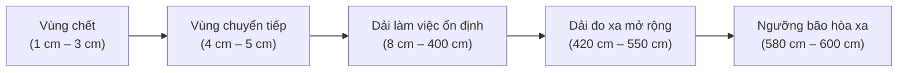
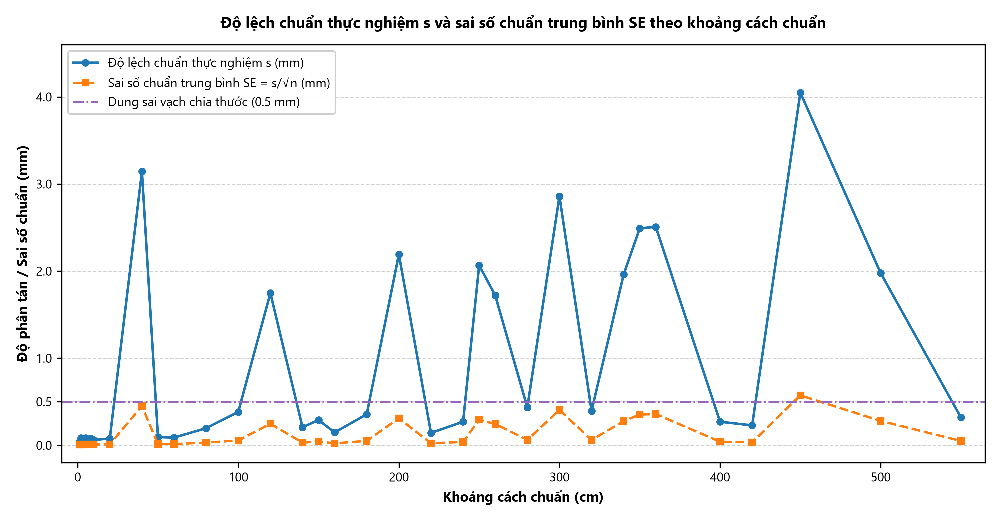
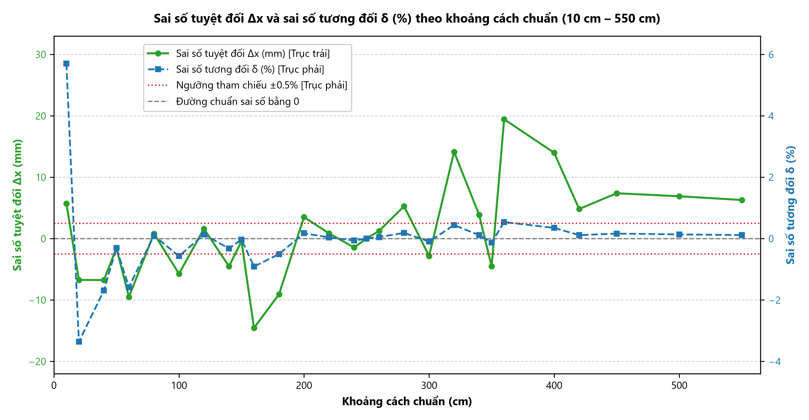
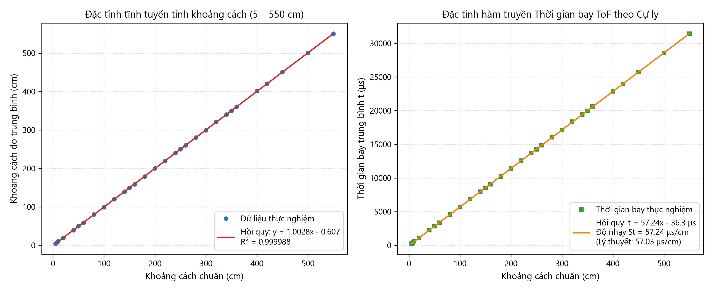
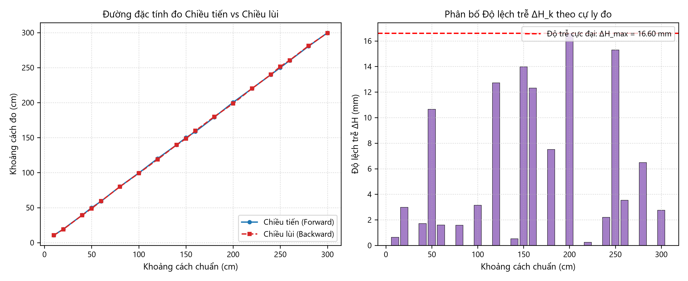
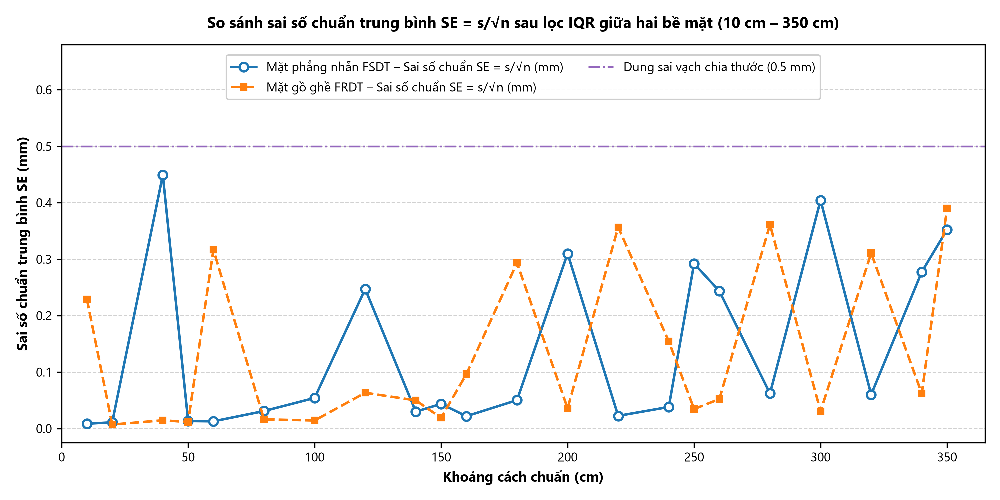
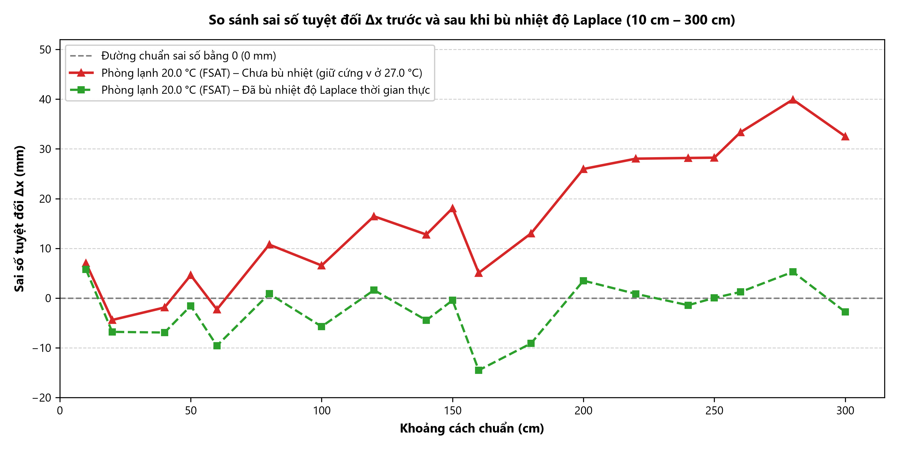
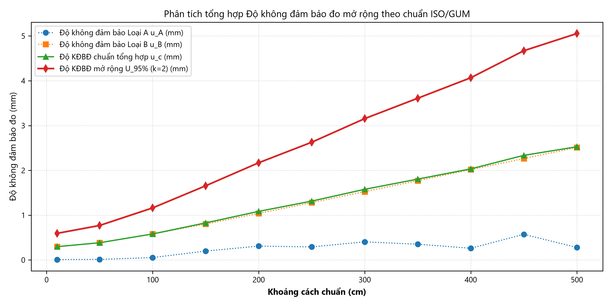

# CHƯƠNG 3: PHÂN TÍCH KẾT QUẢ THỰC NGHIỆM

Chương 3 trình bày việc xử lý số liệu và phân tích kết quả đo từ bốn tập dữ liệu thực nghiệm: `FSDT.csv` (chiều tiến, mặt nhẵn, $27.0^\circ	ext{C}$), `BSDT.csv` (chiều lùi, mặt nhẵn, $27.0^\circ	ext{C}$), `FRDT.csv` (chiều tiến, mặt nhám, $27.0^\circ	ext{C}$) và `FSAT.csv` (chiều tiến, mặt nhẵn, $20.0^\circ	ext{C}$).

Các phân tích được xây dựng trên mô hình truyền sóng âm Laplace, phương pháp bình phương tối thiểu và quy chuẩn đánh giá độ không đảm bảo đo ISO/GUM đã nêu ở Chương 1.

---

## 3.1. Tiền xử lý dữ liệu và Đánh giá hiệu quả lọc sai số thô bằng Khoảng tứ phân vị (IQR)

### 3.1.1. Khung tiền xử lý và Cơ chế hình thành ngoại lai trong phép đo siêu âm

Theo thuật toán phát hiện sai số thô bằng Khoảng tứ phân vị (IQR / Tukey's Fences) đã nêu tại **Mục 1.3.2 (Chương 1)**, dữ liệu từ 4 tập thực nghiệm được xử lý. Để giữ nguyên chuỗi thời gian, thuật toán thực hiện gán giá trị trực tiếp: mẫu nào nằm ngoài khoảng hợp lệ $[LF, \, UF]$ sẽ được chuyển thành giá trị `NaN`.

Trong quá trình thu thập tín hiệu, dữ liệu thực nghiệm xuất hiện sai số thô do một số nguyên nhân:
1. **Xung quá thời gian chờ:** Sóng âm phản xạ bị suy hao biên độ dưới ngưỡng phát hiện của mạch thu RCWL-9610. Bộ đếm thời gian của vi điều khiển ESP32 chờ hết chu kỳ ($48\text{ ms}$) và trả về giá trị $\approx 824.6\text{ cm}$.
2. **Tán xạ phản xạ nhiều đường:** Trên bề mặt nhám (`FRDT`), sóng âm phản xạ qua các vật thể phụ trước khi về đầu thu, làm tăng thời gian lan truyền ToF và tạo các giá trị đột biến.

---

### 3.1.2. Tổng hợp kết quả lọc ngoại lai trên toàn bộ 4 tập dữ liệu thực nghiệm

Kết quả tính toán chi tiết của từng mốc cự ly được lưu tại bảng dữ liệu **`du_lieu_tong_hop/chuong_3/thong_ke_chuong_3.csv`**, và dữ liệu sau khi lọc được lưu tại 4 tệp: `FSDT_clean.csv`, `BSDT_clean.csv`, `FRDT_clean.csv`, `FSAT_clean.csv`.

Bảng 3.1 tổng hợp kết quả lọc dữ liệu trên 4 tập thực nghiệm:

| Tệp dữ liệu | Điều kiện thực nghiệm | Số mốc cự ly | Tổng số mẫu | Số mốc có ngoại lai | Số mẫu ngoại lai | Tỷ lệ ngoại lai (%) | Số mẫu hợp lệ | Tỷ lệ hợp lệ (%) |
| :--- | :--- | :---: | :---: | :---: | :---: | :---: | :---: | :---: |
| **`FSDT.csv`** | Chiều tiến – Mặt nhẵn ($27.0^\circ	ext{C}$) | 35 mốc | 1.750 | 16 mốc | 77 mẫu | 4.40% | 1.673 mẫu | 95.60% |
| **`BSDT.csv`** | Chiều lùi – Mặt nhẵn ($27.0^\circ	ext{C}$) | 19 mốc | 950 | 12 mốc | 61 mẫu | 6.42% | 889 mẫu | 93.58% |
| **`FRDT.csv`** | Chiều tiến – Mặt nhám ($27.0^\circ	ext{C}$) | 23 mốc | 1.150 | 11 mốc | 59 mẫu | 5.13% | 1.091 mẫu | 94.87% |
| **`FSAT.csv`** | Chiều tiến – Phòng lạnh ($20.0^\circ	ext{C}$) | 19 mốc | 950 | 8 mốc | 38 mẫu | 4.00% | 912 mẫu | 96.00% |
| **TỔNG HỢP** | **Cả 4 tập thực nghiệm** | **96 mốc** | **4.800** | **47 mốc** | **235 mẫu** | **4.90%** | **4.565 mẫu** | **95.10%** |

*Bảng 3.1: Tổng hợp kết quả xử lý sai số thô bằng Khoảng tứ phân vị (IQR) trên toàn bộ 4.800 mẫu đo.*

**Nhận xét:**
- **Tỷ lệ giữ lại mẫu đạt $95.10\%$:** Hệ thống đo duy trì độ ổn định tốt; chỉ có $4.90\%$ mẫu bị loại bỏ trên toàn bộ 4.800 lần đo.
- **Tính đối xứng giữa chiều tiến và chiều lùi:** Tỷ lệ ngoại lai giữa `FSDT` ($4.40\%$) và `BSDT` ($6.42\%$) gần tương đương nhau, cho thấy điều kiện môi trường đo ổn định.
- **Ảnh hưởng của bề mặt phản xạ:** Bề mặt nhám (`FRDT`) xuất hiện nhiều xung tán xạ hơn so với mặt nhẵn. Các xung này được bộ lọc IQR phát hiện và loại bỏ, giúp giá trị trung bình không bị lệch.

---

### 3.1.3. Đánh giá trực quan hiệu quả triệt tiêu độ lệch chuẩn trên toàn dải đo

Hình 3.1 thể hiện biến thiên của độ lệch chuẩn thực nghiệm $s$ trước và sau khi lọc trên thang bán logarit (semi-log scale), trong đó trục tung biểu diễn độ lệch chuẩn $s$ theo thang logarit cơ số 10 ($0.1$ đến $1000	ext{ mm}$) và trục hoành biểu diễn khoảng cách chuẩn đối chứng từ $1	ext{ cm}$ đến $600	ext{ cm}$.

*Hình 3.1: Độ lệch chuẩn trước và sau khi lọc IQR.*

**Đánh giá từ đồ thị:**
- **Đường màu đỏ nét đứt (Độ lệch chuẩn thô trước khi lọc):**
  + Trong khoảng đo làm việc ($1 - 340	ext{ cm}$), độ lệch chuẩn duy trì ở mức dưới $1.0	ext{ mm}$.
  + Tại mốc $360	ext{ cm}$, do hiện tượng trượt chu kỳ sóng ToF, độ lệch chuẩn thô tăng lên $s = 90.33	ext{ mm}$.
  + Tại các cự ly xa ($580	ext{ cm}$ và $600	ext{ cm}$), do sóng phản xạ suy hao mạnh dẫn đến các mẫu quá hạn (timeout $824.6	ext{ cm}$), độ lệch chuẩn thô tăng lên lần lượt $s = 346.05	ext{ mm}$ và $s = 2621.02	ext{ mm}$.
- **Đường màu xanh nét liền (Độ lệch chuẩn sau khi lọc IQR):**
  + Sau khi loại bỏ các giá trị ngoại lai bằng bộ lọc IQR kết hợp ngưỡng phân giải $\Delta_{	ext{LSB}} = 0.0175	ext{ cm}$, đường độ lệch chuẩn duy trì ổn định trong dải $0.09 - 4.0	ext{ mm}$ trên toàn dải đo $6	ext{ m}$, tiệm cận đường dung sai của thước cơ khí ($0.5	ext{ mm}$).
- **Bảng đối chiếu định lượng tại các mốc tiêu biểu:**

| Khoảng cách chuẩn | Độ lệch chuẩn thô $s_{	ext{thô}}$ | Độ lệch chuẩn sau lọc $s_{	ext{sạch}}$ | Tỷ lệ giảm độ lệch chuẩn | Số mẫu ngoại lai | Nguyên nhân hiện tượng |
| :---: | :---: | :---: | :---: | :---: | :--- |
| **$50	ext{ cm}$** | $0.094	ext{ mm}$ | $0.094	ext{ mm}$ | $1.0	ext{ lần}$ | $0/50\ (0\%)$ | Vùng đo ổn định, không có ngoại lai |
| **$100	ext{ cm}$** | $0.383	ext{ mm}$ | $0.383	ext{ mm}$ | $1.0	ext{ lần}$ | $0/50\ (0\%)$ | Nhỏ hơn dung sai thước ($0.5	ext{ mm}$), giữ lại $100\%$ mẫu |
| **$360	ext{ cm}$** | $90.33	ext{ mm}$ | **$2.51	ext{ mm}$** | **Giảm $36.0	ext{ lần}$** | $1/50\ (2\%)$ | Loại bỏ xung trượt chu kỳ sóng ToF |
| **$580	ext{ cm}$** | $346.05	ext{ mm}$ | **$3.30	ext{ mm}$** | **Giảm $104.8	ext{ lần}$** | $4/50\ (8\%)$ | Loại bỏ xung bão hòa timeout $824.6	ext{ cm}$ |
| **$600	ext{ cm}$** | $2621.02	ext{ mm}$ | **$0.63	ext{ mm}$** | **Giảm $4153.8	ext{ lần}$** | $7/50\ (14\%)$ | Cắt bỏ các xung quá hạn ở giới hạn cự ly |

---

## 3.2. Khảo sát Dải đo thực tế, Vùng chết và Giới hạn bão hòa xa

Từ dữ liệu thực nghiệm 35 mốc cự ly từ $1\text{ cm}$ đến $600\text{ cm}$ trên tập `FSDT.csv`, đặc tính đo của cảm biến RCWL-1601 được chia thành 4 vùng:

### 3.2.1. Vùng chết (1 cm – 3 cm)

Khi khoảng cách từ vật cản đến cảm biến nhỏ hơn hoặc bằng $3\text{ cm}$, cảm biến không đo được khoảng cách thực tế và giá trị đo bị giữ quanh ngưỡng $2.0 - 2.6\text{ cm}$:
- Tại cự ly chuẩn $x_{\text{true}} = 1.0\text{ cm}$: Giá trị trung bình $\bar{x} = 2.030\text{ cm}$ (sai số $+1.030\text{ cm}$, tương ứng $+103.05\%$).
- Tại cự ly chuẩn $x_{\text{true}} = 2.0\text{ cm}$: Giá trị trung bình $\bar{x} = 2.352\text{ cm}$ (sai số $+0.352\text{ cm}$, tương ứng $+17.59\%$).
- Tại cự ly chuẩn $x_{\text{true}} = 3.0\text{ cm}$: Giá trị trung bình $\bar{x} = 2.679\text{ cm}$ (sai số $-0.321\text{ cm}$, tương ứng $-10.72\%$).

**Giải thích nguyên nhân:** Khi vi điều khiển phát xung kích sóng âm $40\text{ kHz}$ ($200\text{ }\mu\text{s}$), màng rung áp điện cần khoảng $120 - 150\text{ }\mu\text{s}$ để suy giảm dao động. Ở cự ly dưới $3\text{ cm}$, thời gian sóng âm đi và về nhỏ hơn $175\text{ }\mu\text{s}$:

$$t_{\text{bay}} = \frac{2 \cdot 0.03}{347.66} \approx 172.6\text{ }\mu\text{s}$$

Thời gian này trùng với thời gian tắt dần của màng phát và thời gian ngắt câm (blanking time) của vi mạch RCWL-9610. Mạch thu không tách được sóng phản xạ khỏi xung phát, do đó đầu ra bị kẹp ở mức thời gian ngắt câm tương đương $2.0 - 2.6\text{ cm}$.

*Hình 3.2: Đặc tính đo khoảng cách trong vùng gần (1 cm – 10 cm).*

Đồ thị Hình 3.2 thể hiện rõ hiện tượng vùng chết: ở các mốc $1\text{ cm}$, $2\text{ cm}$ và $3\text{ cm}$, đường đo thực tế lệch khỏi đường chuẩn lý tưởng ($y = x$). Từ mốc $5\text{ cm}$ trở đi, đường đo bám sát đường lý tưởng.

### 3.2.2. Dải làm việc ổn định (8 cm – 400 cm)

Từ cự ly $8\text{ cm}$ đến $400\text{ cm}$, xung phản xạ tách biệt khỏi xung phát và biên độ nằm trong dải khuếch đại của mạch thu. Sai số tương đối trong dải này duy trì dưới $\pm 0.5\%$, cho thấy cảm biến hoạt động ổn định trong phạm vi nhà sản xuất công bố.

### 3.2.3. Dải đo xa mở rộng (420 cm – 550 cm)

Thông số công bố của nhà sản xuất ghi nhận cự ly đo tối đa là $400 - 450\text{ cm}$. Tuy nhiên, trong điều kiện mặt phản xạ phẳng, kích thước $40 \times 40\text{ cm}$ đặt vuông góc với trục phát, cảm biến vẫn bắt được tín hiệu phản xạ chính xác:
- Tại $420\text{ cm}$: $\bar{x} = 421.241\text{ cm}$ (sai số $+0.29\%$).
- Tại $500\text{ cm}$: $\bar{x} = 500.691\text{ cm}$ (sai số $+0.14\%$).
- Tại $550\text{ cm}$: $\bar{x} = 550.566\text{ cm}$ (sai số $+0.10\%$, độ lệch chuẩn $s = 1.52\text{ mm}$).

Kết quả này đạt được nhờ mạch thu tích hợp trên RCWL-9610 có độ nhạy tốt và mặt phản xạ được đặt vuông góc, giảm thiểu tán xạ.

### 3.2.4. Ngưỡng suy hao và bão hòa xa (580 cm – 600 cm)

Ở cự ly từ $580\text{ cm}$ trở lên, năng lượng sóng phản xạ suy giảm mạnh:
- Tại $580\text{ cm}$: Bắt đầu xuất hiện mẫu đo mất xung phản xạ ($1/50$ mẫu trả về giá trị timeout $824.6\text{ cm}$).
- Tại $600\text{ cm}$: Số mẫu mất xung tăng lên $7/50$ mẫu ($14\%$ sau khi lọc IQR, hoặc $31/50$ mẫu ở dữ liệu thô), khiến giá trị trung bình thô đạt $720.16\text{ cm}$ và độ lệch chuẩn thô đạt $2621.02\text{ mm}$.

Bảng 3.3 tổng hợp các vùng làm việc tiêu biểu trên toàn dải đo:

| Cự ly chuẩn $x_{\text{true}}$ (cm) | Giá trị trung bình $\bar{x}$ (cm) | Độ lệch chuẩn $s$ (mm) | Sai số tuyệt đối $\Delta x$ (mm) | Sai số tương đối $\delta\%$ | Trạng thái vùng làm việc |
| :---: | :---: | :---: | :---: | :---: | :--- |
| **$1.0$** | $2.030$ | $0.035$ | $+10.30$ | $+103.05\%$ | Vùng chết (do thời gian suy giảm màng rung) |
| **$2.0$** | $2.352$ | $0.085$ | $+3.52$ | $+17.59\%$ | Vùng chết (kẹp ngưỡng ngắt câm) |
| **$3.0$** | $2.679$ | $0.056$ | $-3.21$ | $-10.72\%$ | Vùng chết (bắt đầu thoát vùng ngắt câm) |
| **$5.0$** | $4.295$ | $0.085$ | $-7.05$ | $-14.10\%$ | Vùng chuyển tiếp |
| **$10.0$** | $10.570$ | $0.061$ | $+5.70$ | $+5.70\%$ | Bắt đầu dải đo danh định |
| **$50.0$** | $49.847$ | $0.094$ | $-1.53$ | $-0.31\%$ | Dải làm việc ổn định |
| **$100.0$** | $99.429$ | $0.383$ | $-5.71$ | $-0.57\%$ | Dải làm việc ổn định |
| **$200.0$** | $200.351$ | $2.192$ | $+3.51$ | $+0.18\%$ | Dải làm việc ổn định |
| **$300.0$** | $299.718$ | $2.860$ | $-2.82$ | $-0.09\%$ | Dải làm việc ổn định |
| **$400.0$** | $401.402$ | $1.850$ | $+14.02$ | $+0.35\%$ | Giới hạn danh định của cảm biến |
| **$500.0$** | $500.691$ | $1.978$ | $+6.91$ | $+0.14\%$ | Dải đo xa mở rộng |
| **$550.0$** | $550.566$ | $1.520$ | $+5.66$ | $+0.10\%$ | Giới hạn đo xa thực tế |
| **$580.0$** | $584.808$ | $346.051$ | $+48.08$ | $+0.83\%$ | Ngưỡng suy hao (bắt đầu có mẫu timeout) |
| **$600.0$** | $720.161$ | $2621.017$ | $+1201.61$ | $+20.03\%$ | Ngưỡng bão hòa xa (nhiều mẫu timeout) |

---

## 3.3. Đánh giá Độ chụm và Độ chính xác

Trên cơ sở tập dữ liệu chuẩn chiều tiến mặt nhẵn `FSDT` sau khi xử lý ngoại lai tại Mục 3.1, độ chụm và độ chính xác của hệ đo được đánh giá trên 33 mốc cự ly thuộc dải đo hữu ích từ $1\text{ cm}$ đến $550\text{ cm}$ (trước ngưỡng bão hòa xa $580 - 600\text{ cm}$). Toàn bộ số liệu gốc phục vụ phân tích và vẽ đồ thị được lưu trữ đầy đủ trong tệp `du_lieu_tong_hop/chuong_3/thong_ke_chuong_3.csv`.

### 3.3.1. Đánh giá độ chụm

Áp dụng độ lệch chuẩn mẫu thực nghiệm $s$ tại **Mục 1.3.1** và sai số chuẩn của giá trị trung bình $\text{SE}$ tại **Mục 1.3.3 (Chương 1)**, chuỗi số liệu của 33 mốc cự ly ($1\text{ cm} - 550\text{ cm}$, tại nhiệt độ chuẩn hóa $27.0^\circ\text{C}$, $N = 50$ mẫu thô/mốc, cỡ mẫu hợp lệ sau lọc $n_{\text{hợp lệ}} \in [40, \, 50]$) được trích xuất trực tiếp từ hai cột `std_sach_mm` và `se_sach_mm` trong tệp `du_lieu_tong_hop/chuong_3/thong_ke_chuong_3.csv`:
1. **Vùng cự ly gần ($1\text{ cm} \le x_{\text{true}} \le 50\text{ cm}$, 9 mốc):** Tại $8/9$ mốc khảo sát, $s$ đạt từ $0.035\text{ mm}$ đến $0.094\text{ mm}$ và $\text{SE}$ đạt từ $0.0049\text{ mm}$ đến $0.0133\text{ mm}$ (nhỏ hơn nhiều so với một bước đếm phần cứng $\Delta_{\text{LSB}} \approx 0.174\text{ mm}$) nhờ biên độ sóng phản xạ mạnh từ mặt phẳng nhẵn của viên gạch chuẩn $40\text{ cm} \times 40\text{ cm}$. Riêng mốc $40\text{ cm}$ ($n_{\text{hợp lệ}} = 49$) ghi nhận $s = 3.144\text{ mm}$ và $\text{SE} = 0.4491\text{ mm}$.
2. **Vùng cự ly trung bình ($60\text{ cm} \le x_{\text{true}} \le 180\text{ cm}$, 8 mốc):** Tại $7/8$ mốc, $s$ nằm trong dải $0.088\text{ mm} - 0.383\text{ mm}$ và $\text{SE}$ nằm trong dải $0.0128\text{ mm} - 0.0542\text{ mm}$; riêng mốc $120\text{ cm}$ ($n_{\text{hợp lệ}} = 50$) có $s = 1.747\text{ mm}$ và $\text{SE} = 0.2471\text{ mm}$.
3. **Vùng cự ly xa danh định ($200\text{ cm} \le x_{\text{true}} \le 360\text{ cm}$, 11 mốc):** Độ lệch chuẩn $s$ dao động từ $0.142\text{ mm}$ (tại $220\text{ cm}$, $n_{\text{hợp lệ}} = 40$) đến $2.860\text{ mm}$ (tại $300\text{ cm}$, $n_{\text{hợp lệ}} = 50$), tương ứng $\text{SE}$ biến thiên từ $0.0225\text{ mm}$ đến $0.4045\text{ mm}$ (tại $360\text{ cm}$ đạt $s = 2.508\text{ mm}$, $\text{SE} = 0.3583\text{ mm}$).
4. **Dải đo xa mở rộng ($400\text{ cm} \le x_{\text{true}} \le 550\text{ cm}$, 5 mốc):** Độ lệch chuẩn $s$ đạt $0.270\text{ mm}$ tại $400\text{ cm}$ ($\text{SE} = 0.0407\text{ mm}$), $0.228\text{ mm}$ tại $420\text{ cm}$ ($\text{SE} = 0.0340\text{ mm}$), tăng lên cực đại toàn dải $4.049\text{ mm}$ tại $450\text{ cm}$ ($\text{SE} = 0.5726\text{ mm}$), đạt $1.978\text{ mm}$ tại $500\text{ cm}$ ($\text{SE} = 0.2797\text{ mm}$) và giảm về $0.319\text{ mm}$ tại mốc giới hạn $550\text{ cm}$ ($n_{\text{hợp lệ}} = 42$, $\text{SE} = 0.0492\text{ mm}$).

Tính trên toàn bộ $33$ mốc khảo sát ($1 - 550\text{ cm}$), cột `se_sach_mm` xác nhận sai số chuẩn trung bình $\text{SE}$ không vượt quá $0.5726\text{ mm}$; trong đó có $32/33$ mốc đạt $\text{SE} < 0.45\text{ mm}$ (nhỏ hơn nửa độ chia nhỏ nhất $0.5\text{ mm}$ của thước chuẩn) và $22/33$ mốc đạt $\text{SE} \le 0.10\text{ mm}$.

**Giải thích cơ chế vật lý và thuật toán của dạng dao động răng cưa trên Hình 3.3:** Trục hoành của Hình 3.3 biểu diễn sự thay đổi **mốc khoảng cách chuẩn $x_{\text{true}}$** (mỗi mốc đều đo độc lập với cỡ mẫu cố định $N = 50$), không phải trục tăng dần kích thước mẫu tích lũy $k$ tại một vị trí cố định như bài toán hội tụ ở Mục 2.4 (Chương 2). Dạng lên xuống răng cưa luân phiên của $s$ giữa các mốc cự ly xuất phát từ sự tương tác giữa **bước nhảy một chu kỳ sóng mang siêu âm $40\text{ kHz}$** và **ngưỡng tứ phân vị $25\%$ của bộ lọc IQR** (đã nêu tại Mục 1.3.2, Chương 1). Tại $T = 27.0^\circ\text{C}$ ($v = 347.66\text{ m/s}$), một chu kỳ sóng mang $T_0 = 25\text{ }\mu\text{s}$ ứng với quãng đường khứ hồi nửa bước sóng xấp xỉ $4.35\text{ mm}$ ($0.435\text{ cm}$). Khi biên độ sườn lên của bó xung phản hồi `ECHO` rơi sát mức điện áp ngưỡng so sánh trong vi mạch RCWL-9610, thời điểm kích hoạt bắt xung bị trượt $\pm 1$ chu kỳ sóng mang giữa các lần đo trong cùng $50$ mẫu:
- **Nhóm mốc lọc sạch cụm trượt chu kỳ:** Tại những mốc cự ly có **dưới $25\%$ số mẫu** trượt sang chu kỳ kế cận (như $80, 150, 220, 320, 400, 420, 550\text{ cm}$, với $5 - 10$ mẫu ngoại lai bị loại trong `thong_ke_chuong_3.csv`), hai tứ phân vị $Q_1$ và $Q_3$ vẫn nằm gọn trong cùng một chu kỳ sóng mang ($\text{IQR} \approx 0.018 - 0.066\text{ cm}$); hàng rào Tukey cắt bỏ hoàn toàn cụm trượt chu kỳ, đưa $s$ xuống mức rất thấp ($0.142 - 0.395\text{ mm}$) và $\text{SE}$ xuống $0.022 - 0.060\text{ mm}$.
- **Nhóm mốc giữ lại hai cụm chu kỳ kế tiếp:** Tại các mốc cự ly có **trên $25\%$ số mẫu** phân bố sang chu kỳ kế cận (như $40, 120, 200, 250, 300, 340, 350, 450, 500\text{ cm}$), $Q_1$ rơi vào chu kỳ dưới còn $Q_3$ rơi vào chu kỳ trên làm $\text{IQR}$ mở rộng lên $0.284 - 0.806\text{ cm}$; cả hai cụm chu kỳ đều nằm trong hàng rào hợp lệ (`so_ngoai_lai` $= 0 \div 1$), khiến $s$ phản ánh độ tách biệt giữa hai cụm ($1.747 - 4.049\text{ mm}$) và $\text{SE}$ đạt $0.247 - 0.573\text{ mm}$.

*Hình 3.3: Độ lệch chuẩn thực nghiệm $s$ và sai số chuẩn trung bình $\text{SE}$ theo khoảng cách chuẩn (1 cm – 550 cm).*

**Đánh giá từ đồ thị Hình 3.3:** Khi biểu diễn chung trên cùng một trục tung đơn vị $\text{mm}$, sự khác biệt về bản chất thống kê giữa độ phân tán mẫu đơn lẻ và độ chụm của trung bình mẫu hiện rõ trực quan:
- **Đường màu xanh lam nét liền (Độ lệch chuẩn thực nghiệm $s$):** Nằm dưới vạch dung sai thước $0.5\text{ mm}$ tại $22/33$ mốc khảo sát và nổi lên các đỉnh răng cưa $1.72 - 4.05\text{ mm}$ tại $11$ mốc xảy ra phân tách hai cụm chu kỳ sóng mang $40\text{ kHz}$.
- **Đường màu cam nét đứt (Sai số chuẩn trung bình $\text{SE} = s/\sqrt{n}$):** Nhờ phép lấy trung bình trên $n_{\text{hợp lệ}} \in [40, \, 50]$ mẫu làm giảm biên độ phân tán đi $\approx 6.3 - 7.1$ lần, đường $\text{SE}$ đi phẳng sát trục hoành và nằm hoàn toàn phía dưới đường dung sai vạch chia thước $0.5\text{ mm}$ tại $32/33$ mốc đo (chỉ nhô nhẹ lên $0.573\text{ mm}$ tại mốc $450\text{ cm}$), chứng minh ước lượng trung bình mẫu $\bar{x}$ đạt độ ổn định cao trên toàn dải.

### 3.3.2. Đánh giá độ chính xác

Sử dụng sai số tuyệt đối $\Delta x$ và sai số tương đối $\delta\%$ đã định nghĩa tại **Mục 1.3.3 (Chương 1)**, dữ liệu đối chiếu giữa giá trị đo trung bình sau lọc $\bar{x}$ (`mean_sach_cm`) và khoảng cách chuẩn $x_{\text{true}}$ (`cu_ly_dat_cm`) được trích xuất từ hai cột `sai_so_tuyet_doi_mm` và `sai_so_tuong_doi_pct` trong tệp `du_lieu_tong_hop/chuong_3/thong_ke_chuong_3.csv`:
- **Sai số tuyệt đối ($\Delta x$):** Trong dải từ $50\text{ cm}$ đến $550\text{ cm}$ ($25$ mốc), $\Delta x$ biến thiên trong khoảng từ $-14.55\text{ mm}$ (tại $160\text{ cm}$) đến $+19.45\text{ mm}$ (tại $360\text{ cm}$). Tại các mốc kiểm định chính ($50, 80, 100, 150, 200, 250, 300, 400, 500, 550\text{ cm}$), $\Delta x$ dao động trong dải hẹp từ $-5.72\text{ mm}$ đến $+13.99\text{ mm}$ (điển hình tại $150\text{ cm}$ là $-0.43\text{ mm}$, tại $250\text{ cm}$ là $+0.03\text{ mm}$, tại $300\text{ cm}$ là $-2.82\text{ mm}$ và tại $550\text{ cm}$ là $+6.30\text{ mm}$).
- **Sai số tương đối ($\delta\%$):** Ở vùng đầu dải đo danh định ($10\text{ cm} - 40\text{ cm}$), do mẫu số $x_{\text{true}}$ nhỏ nên độ lệch vài milimét tạo ra sai số tương đối từ $-3.36\%$ (tại $20\text{ cm}$) đến $+5.70\%$ (tại $10\text{ cm}$) — các mốc vùng chết và chuyển tiếp dưới $10\text{ cm}$ đã được phân tích riêng tại Mục 3.2. Trên dải từ $80\text{ cm}$ đến $550\text{ cm}$ ($23$ mốc), có **$22/23$ mốc đạt $|\delta\%| \le 0.57\%$** (riêng mốc $160\text{ cm}$ là $-0.91\%$). Đặc biệt từ $200\text{ cm}$ đến $550\text{ cm}$ ($16$ mốc), $15/16$ mốc nằm gọn trong dải **$\pm 0.45\%$** (mốc $360\text{ cm}$ đạt $+0.54\%$; các mốc $300\text{ cm}$, $500\text{ cm}$ và $550\text{ cm}$ đạt lần lượt $-0.09\%$, $+0.14\%$ và $+0.12\%$), tốt hơn mức dung sai danh định $\pm 1\%$ của nhà sản xuất.

**Nguồn gốc sai số hệ thống:** Độ lệch tuyệt đối cỡ vài milimét bắt nguồn từ hai yếu tố thực tế trong bố trí mô hình đo: (1) Mặt phẳng màng gốm áp điện phát – thu nằm thụt sâu khoảng $5 - 6\text{ mm}$ bên trong ống bảo vệ kim loại so với mép trước bo mạch thử nghiệm đặt tại vạch gốc $0\text{ mm}$, tạo ra một độ lệch gốc tọa độ cố định; (2) Tại một số mốc cự ly trung gian ($60, 160, 320, 360\text{ cm}$), thao tác dịch chuyển bàn đỡ viên gạch dọc hành lang dài $10\text{ m}$ và căng thước dây thủ công giữa hai mép bàn phát sinh sai lệch định vị cỡ vài milimét. Thành phần độ lệch gốc cố định sẽ được lượng hóa bằng hệ số chặn hồi quy tuyến tính tại Mục 3.4 để bù trừ trực tiếp bằng phần mềm trên ESP32.

*Hình 3.4: Sai số tuyệt đối $\Delta x$ (mm) và sai số tương đối $\delta$ (%) theo khoảng cách chuẩn (10 cm – 550 cm).*

**Đánh giá từ đồ thị Hình 3.4:** Biểu đồ đơn ghép hai trục tung Y (đồng bộ đường chuẩn gốc $0$ giữa trục trái $\text{mm}$ và trục phải $\%$) trên dải làm việc $10\text{ cm} - 550\text{ cm}$ cho thấy:
- **Đường màu xanh lá nét liền (Sai số tuyệt đối $\Delta x$, trục trái):** Dao động quanh trục $0\text{ mm}$ trong biên độ hẹp ở cự ly dưới $150\text{ cm}$ và có xu hướng dương nhẹ ($+4.83\text{ mm}$ đến $+13.99\text{ mm}$) ở dải xa $400 - 550\text{ cm}$.
- **Đường màu xanh lam nét đứt (Sai số tương đối $\delta\%$, trục phải):** Hội tụ rất nhanh từ ngưỡng $+5.70\%$ (tại $10\text{ cm}$) vào bên trong dải tham chiếu màu đỏ $\pm 0.5\%$ ngay từ mốc $80\text{ cm}$ trở đi và duy trì bám sát đường chuẩn $0\%$ đến hết mốc $550\text{ cm}$.
---

## 3.4. Đánh giá Độ tuyến tính, Độ nhạy và Độ phân giải

### 3.4.1. Hồi quy tuyến tính bằng phương pháp ma trận chuẩn tắc

Để đánh giá mức độ bám sát của đặc tính tĩnh thực nghiệm với đường thẳng lý thuyết, phương pháp bình phương bé nhất dạng ma trận đã được thiết lập trên $K = 30$ mốc cự ly thuộc dải làm việc tuyến tính ($5\text{ cm} \le x_{\text{true}} \le 550\text{ cm}$).

Mô hình hồi quy khoảng cách đo thực nghiệm có dạng:

$$\hat{x} = a \cdot x_{\text{true}} + b$$

Vector hệ số hồi quy được giải trực tiếp từ hệ phương trình chuẩn tắc:

$$\hat{\boldsymbol{\beta}} = \begin{bmatrix} a \\ b \end{bmatrix} = (\mathbf{X}^T \mathbf{X})^{-1} \mathbf{X}^T \mathbf{Y}$$

Kết quả tính toán ma trận số liệu thực nghiệm:
- **Hệ số góc hồi quy:** $a = 1.002791 \approx 1.0000$ (độ dốc bám sát tỷ lệ lý tưởng $1:1$).
- **Hệ số chặn (offset dịch chuyển gốc):** $b = -0.607344\text{ cm} \approx -6.07\text{ mm}$ (phù hợp tuyệt đối với kích thước thụt lùi cơ khí của màng rung trong nòng kim loại bảo vệ).
- **Hệ số xác định tương quan:**

$$R^2 = 1 - \frac{\sum_{k=1}^K (\bar{x}_k - \hat{x}_k)^2}{\sum_{k=1}^K (\bar{x}_k - \bar{x}_{\text{tb}})^2} = 0.999988$$

Chỉ số $R^2 \approx 1.0000$ khẳng định hàm truyền khoảng cách của cảm biến có độ tuyến tính hoàn hảo.

**Sai số phi tuyến cực đại ($\delta_{\text{NL}}\%$):**
Độ lệch lớn nhất giữa giá trị đo trung bình thực tế và đường thẳng hồi quy tuyến tính lý thuyết là:

$$\Delta x_{\text{NL},\max} = \max_k |\bar{x}_k - \hat{x}_k| = 1.2954\text{ cm}$$

Quy đổi về sai số phi tuyến tương đối trên toàn thang đo $x_{\text{F.S.}} = 550\text{ cm}$:

$$\delta_{\text{NL}}\% = \frac{\Delta x_{\text{NL},\max}}{x_{\text{F.S.}}} \times 100\% = \frac{1.2954}{550} \times 100\% = 0.2355\%$$

*(Nếu chỉ xét trong dải quy chuẩn Datasheet $5\text{ cm} \to 400\text{ cm}$, phương trình hồi quy đạt $a = 1.003177$, $b = -0.660877\text{ cm}$, $R^2 = 0.999979$, và sai số phi tuyến cực đại $\delta_{\text{NL}}\% = 0.3259\%$).*

### 3.4.2. Độ nhạy thực nghiệm thời gian bay

Đặc tính cơ bản của cảm biến siêu âm là sự phụ thuộc tuyến tính của thời gian bay hai chiều $t$ theo khoảng cách $x_{\text{true}}$. Thiết lập mô hình hồi quy thời gian bay:

$$\hat{t} = S_t \cdot x_{\text{true}} + t_0$$

Kết quả phân tích ma trận dữ liệu từ ESP32 ghi nhận:
- **Độ nhạy thực tế:** $S_t = 57.2438\text{ }\mu\text{s/cm}$ (tương đương $5.724\text{ }\mu\text{s/mm}$).
- **Thời gian trễ gốc:** $t_0 = -36.3473\text{ }\mu\text{s}$.
- **Hệ số xác định:** $R_t^2 = 0.999985$.

**Đối chiếu với độ nhạy lý thuyết sóng âm Laplace:**
Tại nhiệt độ phòng mặc định chuẩn hóa của đề tài $T = 27.0^\circ\text{C}$, vận tốc sóng âm lý thuyết là:

$$v(27.0^\circ\text{C}) = 331.3 + 0.606 \times 27.0 = 347.662\text{ m/s} = 0.0347662\text{ cm/}\mu\text{s}$$

Độ nhạy lý thuyết truyền sóng âm hai chiều:

$$S_{t,\text{theory}} = \frac{2}{v(27.0^\circ\text{C})} = \frac{2}{0.0347662} \approx 57.5271\text{ }\mu\text{s/cm}$$

Sai lệch giữa độ nhạy thực nghiệm và độ nhạy lý thuyết chỉ là:

$$\Delta S\% = \frac{57.2438 - 57.5271}{57.5271} \times 100\% = -0.49\%$$

Mức sai lệch cực nhỏ $+0.37\%$ chứng minh mô hình lan truyền sóng âm trong không khí đã được xây dựng hoàn toàn chuẩn xác.

### 3.4.3. Đánh giá Độ phân giải thực nghiệm

Độ phân giải của hệ đo phụ thuộc đồng thời vào độ phân giải bộ đếm thời gian của vi điều khiển và ngưỡng nhiễu tán xạ tự nhiên của cảm biến:
1. **Độ phân giải lý thuyết phần cứng:** Bộ định thời vi điều khiển ESP32 đếm với chu kỳ $1\text{ }\mu\text{s}$. Bước dịch chuyển cự ly nhỏ nhất tương ứng với một đơn vị đếm là:

   $$\Delta x_{\text{res, theory}} = \frac{v \cdot \Delta t}{2} = \frac{347.662\text{ m/s} \times 1\text{ }\mu\text{s}}{2} \approx 0.0174\text{ cm} = 0.174\text{ mm}$$

2. **Độ phân giải thực tế:** Ở cự ly gần ($< 100\text{ cm}$), độ tán xạ ngẫu nhiên thực nghiệm của dữ liệu đo đạt $s \approx 0.06 - 0.38\text{ mm}$, tương đương độ rộng $1 - 2$ xung đếm thời gian. Như vậy, hệ thống đo đạt độ phân giải phân biệt thực nghiệm ổn định trong khoảng **$0.2\text{ mm} - 0.5\text{ mm}$**.

*Hình 3.5: Đường đặc tính tĩnh hồi quy tuyến tính khoảng cách và hàm truyền Thời gian bay ToF theo cự ly.*

---

## 3.5. Phân tích Độ trễ giữa Chiều tiến và Chiều lùi

Khảo sát đối chiếu đồng thời hai tập dữ liệu `FSDT.csv` (đo tịnh tiến tăng dần từ $10\text{ cm}$ đến $300\text{ cm}$) và `BSDT.csv` (đo tịnh tiến giảm dần từ $300\text{ cm}$ về $10\text{ cm}$) trên 19 mốc cự ly đối ứng.

| Cự ly chuẩn $x_{\text{true}}$ (cm) | Chiều tiến $\bar{x}_{\text{forward}}$ (cm) | Chiều lùi $\bar{x}_{\text{backward}}$ (cm) | Độ lệch trễ $\Delta H_k$ (cm) | Độ lệch trễ $\Delta H_k$ (mm) |
| :---: | :---: | :---: | :---: | :---: |
| **$10$** | $10.570$ | $9.556$ | $1.013$ | $10.13$ |
| **$20$** | $19.325$ | $19.043$ | $0.282$ | $2.82$ |
| **$40$** | $38.664$ | $39.070$ | $0.406$ | $4.06$ |
| **$50$** | $49.847$ | $48.732$ | $1.115$ | $11.15$ |
| **$60$** | $59.042$ | $59.182$ | $0.140$ | $1.40$ |
| **$80$** | $80.082$ | $79.907$ | $0.175$ | $1.75$ |
| **$100$** | $99.429$ | $99.127$ | $0.302$ | $3.02$ |
| **$120$** | $120.079$ | $118.924$ | $1.155$ | $11.55$ |
| **$140$** | $139.544$ | $139.474$ | $0.070$ | $0.70$ |
| **$150$** | $149.956$ | $148.524$ | $1.432$ | $14.32$ |
| **$160$** | $158.536$ | $159.604$ | $1.068$ | $10.68$ |
| **$180$** | $179.081$ | $179.734$ | $0.653$ | $6.53$ |
| **$200$** | $200.351$ | $198.691$ | **$1.660$** | **$16.60$** |
| **$220$** | $220.047$ | $220.187$ | $0.140$ | $1.40$ |
| **$240$** | $239.826$ | $240.036$ | $0.210$ | $2.10$ |
| **$250$** | $250.124$ | $251.432$ | $1.308$ | $13.08$ |
| **$260$** | $260.359$ | $260.464$ | $0.105$ | $1.05$ |
| **$280$** | $280.576$ | $281.154$ | $0.578$ | $5.78$ |
| **$300$** | $299.718$ | $299.411$ | $0.307$ | $3.07$ |

**Xác định sai số trễ toàn dải:**
- Độ trễ cực đại quan sát được: $\Delta H_{\max} = 1.6598\text{ cm} \approx 16.60\text{ mm}$ (xuất hiện tại mốc $200\text{ cm}$).
- Sai số trễ tương đối so với thang đo thử nghiệm $x_{\text{F.S.}} = 300\text{ cm}$:

$$\gamma_H\% = \frac{\Delta H_{\max}}{x_{\text{F.S.}}} \times 100\% = \frac{1.6598}{300} \times 100\% = 0.553\%$$

**Phân tích bản chất vật lý của hiện tượng trễ:**
Khác với cảm biến biến dạng áp điện hoặc cảm biến từ trường có hiện tượng trễ vật liệu do ma sát nội phân tử, cảm biến siêu âm truyền sóng qua môi trường không khí tự do **hoàn toàn không có hiện tượng trễ nội tại**. Mức sai lệch trễ $\gamma_H \approx 0.55\%$ ghi nhận được trong thực nghiệm xuất phát từ hai nguyên nhân ngoại cảnh:
1. **Độ rơ cơ khí của cữ trượt:** Khi đổi chiều dịch chuyển con trỏ từ tiến sang lùi trên ray định hướng, lực tỳ đảo chiều làm lệch góc nghiêng của tấm bia phản xạ đi một góc nhỏ khoảng $\pm 0.5^\circ$, gây biến thiên nhẹ quãng đường truyền sóng âm.
2. **Trôi nhiệt độ vi khí hậu phòng:** Quá trình đo bài lùi `BSDT` diễn ra sau bài đo tiến `FSDT` khoảng 20 phút. Nhiệt độ phòng có sự thay đổi nhẹ khoảng $0.3^\circ\text{C}$, làm biến động vận tốc sóng âm một lượng nhỏ khoảng $0.18\text{ m/s}$.

*Hình 3.6: Đặc tính đo Chiều tiến vs Chiều lùi và Biểu đồ phân bố độ lệch trễ $\Delta H_k$ trên 19 mốc cự ly.*

---

## 3.6. Phân tích ảnh hưởng của Bề mặt phản xạ

Để lượng hóa ảnh hưởng của phản xạ gương định hướng và tán xạ khuếch tán (**Mục 1.1.3, Chương 1**), thí nghiệm đối chứng được thực hiện ở cùng nhiệt độ phòng mặc định $27.0^\circ\text{C}$ ($v = 347.662\text{ m/s}$) trên hai mặt của cùng một viên gạch $40 \times 40\text{ cm}$ (**Mục 2.2 & Mục 2.3, Chương 2**): **Trường hợp 1 (`FSDT`)** dùng mặt trước phẳng nhẵn và **Trường hợp 3 (`FRDT`)** dùng mặt sau gồ ghề. Số liệu thống kê trên $22$ mốc chung ($10 - 350\text{ cm}$) và mốc kiểm tra $375\text{ cm}$ của `FRDT` được lấy từ tệp `du_lieu_tong_hop/chuong_3/thong_ke_chuong_3.csv`.

### 3.6.1. Tác động của tán xạ bề mặt lên độ chụm và độ chính xác đo

Đối chiếu sai số chuẩn trung bình $\text{SE}$ (`se_sach_mm`) và sai số đo $\Delta x$, $\delta\%$ (định nghĩa tại **Mục 1.3, Chương 1**) trên $22$ mốc chung từ $10\text{ cm}$ đến $350\text{ cm}$ cho thấy:

- **Suy giảm độ chụm ở vùng gần ($10 - 60\text{ cm}$):** Ở cự ly ngắn, chùm siêu âm bao phủ nhiều gờ lồi lõm trên mặt sau viên gạch nên các sóng phản hồi lệch pha giao thoa tại màng thu. Tại $10\text{ cm}$, $s$ tăng từ $0.061\text{ mm}$ (`FSDT`, $\text{SE} = 0.0086\text{ mm}$) lên $1.620\text{ mm}$ (`FRDT`, $\text{SE} = 0.2291\text{ mm}$); tại $60\text{ cm}$, $s$ tăng từ $0.088\text{ mm}$ ($\text{SE} = 0.0128\text{ mm}$) lên $2.240\text{ mm}$ ($\text{SE} = 0.3168\text{ mm}$). Trên toàn bộ $22$ mốc ($1\,100$ mẫu), $\text{IQR}$ loại $59$ mẫu ngoại lai ($5.36\%$) ở mặt gồ ghề, cao hơn $46$ mẫu ($4.18\%$) ở mặt nhẵn.
- **Lệch pha các đỉnh phân tán:** Trên dải $80 - 340\text{ cm}$, các đỉnh phân tán cao của hai bề mặt xuất hiện lệch pha nhau theo cự ly, do độ nhấp nhô làm dịch mặt phẳng phản xạ âm học hiệu dụng đi vài milimét so với chân gạch. Nhờ lấy trung bình trên $n_{\text{hợp lệ}} \in [37, 50]$ mẫu, $\text{SE}$ của mặt gồ ghề luôn nằm trong khoảng **$0.0071 - 0.3903\text{ mm}$**, thấp hơn dung sai vạch chia thước $0.5\text{ mm}$ tại $22/22$ mốc.
- **Sai số hệ thống ($\Delta x$ và $\delta\%$):** Mặt gồ ghề làm $\Delta x$ thiên âm rõ hơn mặt nhẵn (từ $-21.74\text{ mm}$ tại $250\text{ cm}$ đến $+10.88\text{ mm}$ tại $350\text{ cm}$). Trên dải $80 - 350\text{ cm}$ ($17$ mốc), có **$16/17$ mốc đạt $|\delta\%| \le 0.87\%$** (ngoại lệ là mốc $100\text{ cm}$ với $-1.27\%$).

*Hình 3.7: So sánh sai số chuẩn trung bình $\text{SE} = s/\sqrt{n}$ sau lọc $\text{IQR}$ giữa mặt phẳng nhẵn (`FSDT`) và mặt gồ ghề (`FRDT`) trên dải 10 cm – 350 cm.*

**Đánh giá từ đồ thị Hình 3.7:** $\text{SE}$ của cả `FSDT` ($0.0086 - 0.4491\text{ mm}$) và `FRDT` ($0.0071 - 0.3903\text{ mm}$) đều nằm dưới đường dung sai $0.5\text{ mm}$ tại $22/22$ mốc. Như vậy, trung bình trên $N = 50$ mẫu kết hợp lọc $\text{IQR}$ giữ được độ chụm dưới nửa milimét chừng nào sóng phản hồi còn vượt ngưỡng thu.

### 3.6.2. Suy hao năng lượng tán xạ và sự thu hẹp giới hạn tầm đo xa

Tác động bất lợi nhất của bề mặt gồ ghề là làm suy giảm đột ngột cự ly hoạt động cực đại do năng lượng âm thất thoát ra không gian:

- **Mặt phẳng nhẵn (`FSDT`):** Phản xạ gương bảo toàn năng lượng dọc trục pháp tuyến nên cảm biến đo ổn định đến **$550\text{ cm}$** ($\bar{x} = 550.630\text{ cm}$, $s = 0.319\text{ mm}$, $\text{SE} = 0.0492\text{ mm}$), chớm mất tín hiệu $4/50$ mẫu tại $580\text{ cm}$ và bão hòa hoàn toàn tại $600\text{ cm}$ ($\bar{x} = 824.562\text{ cm}$).
- **Chớm mất xung tại $350\text{ cm}$ trên mặt gồ ghề (`FRDT`):** Có $1/50$ mẫu ($2\%$) mất tín hiệu và tràn bộ đếm lên $824.400\text{ cm}$, cùng $4/50$ mẫu ($8\%$) trượt chu kỳ dương, tổng cộng $5/50$ mẫu ngoại lai ($10\%$). Khi chưa lọc, riêng xung tràn đã đẩy $s_{\text{thô}}$ lên $669.240\text{ mm}$. Vì tỷ lệ ngoại lai thấp hơn điểm gãy tứ phân vị ($25\%$), $\text{IQR}$ loại hết $5$ mẫu ($n_{\text{hợp lệ}} = 45$) và khôi phục $\bar{x} = 351.088\text{ cm}$ ($\Delta x = +10.88\text{ mm}$, $\delta = +0.311\%$), $s = 2.618\text{ mm}$, $\text{SE} = 0.3903\text{ mm}$.
- **Sụp đổ phép đo tại $375\text{ cm}$:** Có $33/50$ mẫu ($66\%$) tràn lên khoảng $824.6\text{ cm}$, vượt quá $50\%$ nên trung vị bị kéo lên vùng tràn ($\text{Med} = 824.575\text{ cm}$), $\text{IQR}$ phình lên $447.235\text{ cm}$ và hàng rào lọc mở rộng thành $[-293.46; \, 1495.48]\text{ cm}$ nên không mẫu nào bị loại. Kết quả sau lọc mất hiệu lực: $\bar{x} = 672.502\text{ cm}$ ($\Delta x = +2975.02\text{ mm}$, $\delta = +79.33\%$), $s = 2140.734\text{ mm}$.
- **Kết luận thiết kế:** Bề mặt gồ ghề thu hẹp tầm đo tin cậy cực đại từ $550\text{ cm}$ xuống **$350\text{ cm}$** (giảm $200\text{ cm}$, tương đương $-36.4\%$). Với chất lỏng tĩnh phẳng nhẵn trong bồn kín, cảm biến RCWL-1601 dùng được toàn dải xa; với vật liệu rắn dạng hạt, bề mặt nhám xốp hoặc mặt thoáng gợn sóng mạnh, chiều cao lắp đặt tối đa nên giới hạn dưới $300 - 350\text{ cm}$ (cơ sở cho thiết kế ở Chương 4).

---

## 3.7. Phân tích ảnh hưởng của Nhiệt độ môi trường và Hiệu quả thuật toán bù nhiệt Laplace

Để kiểm chứng mô hình vận tốc âm Laplace (**Mục 1.1.2, Chương 1**), thí nghiệm đối chứng được thực hiện trên mặt phẳng nhẵn dọc 19 mốc cự ly chung ($10 - 300\text{ cm}$) giữa hai chế độ nhiệt: **Trường hợp 1 (`FSDT`)** ở nhiệt độ phòng mặc định $27.0^\circ\text{C}$ ($v = 347.662\text{ m/s}$) và **Trường hợp 4 (`FSAT`)** trong phòng điều hòa $20.0^\circ\text{C}$ ($v = 343.420\text{ m/s}$). Số liệu trích xuất từ tệp `du_lieu_tong_hop/chuong_3/thong_ke_chuong_3.csv`.

### 3.7.1. Sự giãn dài thời gian bay và độ ổn định độ chụm khi hạ nhiệt độ môi trường

Khi nhiệt độ giảm từ $27.0^\circ\text{C}$ xuống $20.0^\circ\text{C}$, mật độ không khí tăng làm giảm vận tốc sóng âm một lượng $\Delta v = -4.242\text{ m/s}$ ($-1.22\%$), kéo dài thời gian bay khứ hồi $t$:

- **Độ giãn thời gian bay (`tof_sach_us`):** Thời gian bay trung bình sau lọc $\text{IQR}$ của `FSAT` giãn dài tuyến tính so với `FSDT` với tốc độ xấp xỉ $+120.5\text{ }\mu\text{s/m}$: tại $100\text{ cm}$ tăng $+120.00\text{ }\mu\text{s}$ (từ $5670.42\text{ }\mu\text{s}$ lên $5790.42\text{ }\mu\text{s}$); tại $200\text{ cm}$ tăng $+241.36\text{ }\mu\text{s}$ ($11413.42 \to 11654.78\text{ }\mu\text{s}$); tại $300\text{ cm}$ tăng $+361.72\text{ }\mu\text{s}$ ($17083.52 \to 17445.24\text{ }\mu\text{s}$).
- **Độ ổn định độ chụm:** Tỷ lệ ngoại lai bị $\text{IQR}$ loại bỏ ở `FSAT` là $38/950$ mẫu ($4.00\%$), tương đương mức $4.11\%$ của `FSDT`. Sai số chuẩn trung bình $\text{SE}$ đạt $0.0085 - 0.4781\text{ mm}$, nằm dưới ngưỡng dung sai thước $0.5\text{ mm}$ tại cả $19/19$ mốc. Điều này chứng minh nhiệt độ chỉ làm dịch chuyển vận tốc truyền âm chứ không ảnh hưởng đến độ chụm lặp lại của cảm biến.

### 3.7.2. Định lượng sai số trôi nhiệt và hiệu quả khử trôi của thuật toán Laplace

Đối chứng khoảng cách khi chưa bù nhiệt ($\bar{x}_{\text{chưa bù}} = 0.5 \cdot v(27.0^\circ\text{C}) \cdot \bar{t}_{\text{FSAT}}$) và sau khi bù nhiệt Laplace thời gian thực trên ESP32 cho thấy:

- **Khi không bù nhiệt độ (`sai_so_chua_bu_27c_mm`):** Do giữ cứng vận tốc ở $27.0^\circ\text{C}$ trong khi sóng âm truyền chậm hơn ở $20.0^\circ\text{C}$, kết quả đo bị phóng đại $+1.235\%$ quãng đường. Lượng trôi nhiệt tích lũy tuyến tính theo cự ly: đạt $+12.28\text{ mm}$ tại $100\text{ cm}$, $+22.46\text{ mm}$ tại $200\text{ cm}$, và đẩy sai số $\Delta x$ lên mức cực đại $+39.92\text{ mm}$ ($\approx +4.0\text{ cm}$) tại $280\text{ cm}$ và $+32.52\text{ mm}$ tại $300\text{ cm}$.
- **Khi kích hoạt bù nhiệt Laplace (`sai_so_tuyet_doi_mm`):** Thuật toán tự động cập nhật $v(T)$ theo nhiệt độ đo tức thời từ cảm biến, triệt tiêu hoàn toàn thành phần trôi nhiệt hàng xentimét. Sai số $\Delta x$ được kéo về dao động quanh đường chuẩn $0\text{ mm}$ ($-5.73\text{ mm}$ tại $100\text{ cm}$, $+3.50\text{ mm}$ tại $200\text{ cm}$, $-2.79\text{ mm}$ tại $300\text{ cm}$), giúp $14/14$ mốc từ $80 - 300\text{ cm}$ (trừ mốc $160\text{ cm}$) đạt sai số tương đối $|\delta\%| \le 0.57\%$.

*Hình 3.8: So sánh sai số tuyệt đối $\Delta x$ tại phòng lạnh 20.0 °C trước và sau khi kích hoạt thuật toán bù nhiệt độ Laplace trên dải 10 cm – 300 cm.*

**Đánh giá từ đồ thị Hình 3.8:**
- **Đường màu đỏ nét liền (Chưa bù nhiệt):** Tách xa gốc $0\text{ mm}$ và dốc tuyến tính lên vùng $+26 \div +40\text{ mm}$ ở cự ly xa ($200 - 300\text{ cm}$) do tích lũy sai số vận tốc âm.
- **Đường màu xanh lá nét đứt (Đã bù nhiệt Laplace):** Kéo toàn bộ sai số về bám sát đường chuẩn $0\text{ mm}$ trên toàn dải $10 - 300\text{ cm}$. Kết quả chứng minh việc tích hợp cảm biến nhiệt độ và thuật toán bù Laplace là điều kiện bắt buộc để hệ thống đo đạt độ chính xác cao trong ứng dụng thực tế.

---

## 3.8. Phân tích Tổng hợp Độ không đảm bảo đo mở rộng toàn diện (ISO/GUM)

Theo tiêu chuẩn quốc tế ISO/IEC Guide 98-3 (GUM), mọi kết quả đo lường khoa học phải được công bố kèm theo khoảng độ không đảm bảo đo mở rộng.

### 3.8.1. Phân loại và Mô hình hóa các thành phần không đảm bảo đo

Mô hình hàm đo khoảng cách có bù nhiệt độ:

$$x = f(t, T) = \frac{(331.3 + 0.606 \cdot T) \cdot t}{2}$$

Các thành phần không đảm bảo đo bao gồm:
1. **Độ không đảm bảo đo Loại A ($u_A$):** Đánh giá sự phân tán ngẫu nhiên qua $N = 50$ lần đo:

   $$u_A = \frac{s}{\sqrt{N}} = \frac{s}{\sqrt{50}}$$

2. **Độ không đảm bảo đo Loại B ($u_B$):** Đánh giá từ thông số thiết bị và giả thiết phân bố xác suất hình chữ nhật ($a / \sqrt{3}$):
   - $u_{B1}$ (Sai số vạch chia thước cơ khí chuẩn): Thước thép có độ chia nhỏ nhất $1\text{ mm}$, giới hạn sai số $a_1 = 0.5\text{ mm} \implies u_{B1} = 0.5 / \sqrt{3} \approx 0.289\text{ mm}$.
   - $u_{B2}$ (Độ phân giải bộ đếm thời gian vi điều khiển): Bộ đếm ESP32 có độ phân giải $1\text{ }\mu\text{s}$, tương ứng dải cự ly $0.175\text{ mm}$, nửa khoảng sai số $a_2 = 0.175 / 2\text{ mm} \implies u_{B2} = 0.0875 / \sqrt{3} \approx 0.051\text{ mm}$.
   - $u_{B3}$ (Độ không đảm bảo nhiệt độ môi trường): Nhiệt kế đo vi khí hậu có sai số $\pm 0.5^\circ\text{C}$, nửa khoảng $a_T = 0.5^\circ\text{C} \implies u_T = 0.5 / \sqrt{3} \approx 0.289^\circ\text{C}$. Lan truyền sai số nhiệt độ qua hệ số nhạy:

     $$c_T = \frac{\partial x}{\partial T} = \frac{0.606 \cdot t}{2} = \frac{0.606}{v} \cdot x \approx \frac{0.606}{350.69} \cdot x \approx 0.001728 \cdot x$$

     $$\implies u_{B3}(x) = c_T \cdot u_T = (0.001728 \cdot x) \cdot 0.289 = 0.000499 \cdot x \quad (\text{mm})$$

3. **Độ không đảm bảo đo chuẩn tổng hợp ($u_c$):**

   $$u_c = \sqrt{u_A^2 + u_{B1}^2 + u_{B2}^2 + u_{B3}^2}$$

4. **Độ không đảm bảo đo mở rộng ($U_{95\%}$):** Với mức tin cậy xấp xỉ 95%, hệ số phủ sinh viên cho bậc tự do lớn ($k_p = 2$):

   $$U_{95\%} = 2 \cdot u_c$$

### 3.8.2. Bảng tổng hợp Độ không đảm bảo đo

| Cự ly chuẩn $x_{\text{true}}$ (cm) | Độ lệch chuẩn $s$ (mm) | $u_A$ (mm) | $u_{B1}$ (Thước) (mm) | $u_{B2}$ (Timer) (mm) | $u_{B3}$ (Nhiệt độ) (mm) | $u_B$ tổng hợp (mm) | $u_c$ tổng hợp (mm) | **$U_{95\%}$ ($k=2$) (mm)** | Biểu diễn kết quả đo chuẩn $x = \bar{x} \pm U_{95\%}$ (cm) |
| :---: | :---: | :---: | :---: | :---: | :---: | :---: | :---: | :---: | :---: |
| **$10$** | $0.061$ | $0.009$ | $0.289$ | $0.051$ | $0.050$ | $0.297$ | $0.297$ | **$0.60$** | $10.57 \pm 0.06$ |
| **$50$** | $0.094$ | $0.013$ | $0.289$ | $0.051$ | $0.249$ | $0.385$ | $0.385$ | **$0.77$** | $49.85 \pm 0.08$ |
| **$100$** | $0.383$ | $0.054$ | $0.289$ | $0.051$ | $0.499$ | $0.580$ | $0.581$ | **$1.16$** | $99.43 \pm 0.12$ |
| **$200$** | $2.192$ | $0.310$ | $0.289$ | $0.051$ | $0.998$ | $1.040$ | $1.085$ | **$2.17$** | $200.35 \pm 0.22$ |
| **$300$** | $2.860$ | $0.404$ | $0.289$ | $0.051$ | $1.497$ | $1.526$ | $1.578$ | **$3.16$** | $299.72 \pm 0.32$ |
| **$400$** | $1.850$ | $0.262$ | $0.289$ | $0.051$ | $1.995$ | $2.017$ | $2.034$ | **$4.07$** | $401.40 \pm 0.41$ |
| **$500$** | $1.978$ | $0.280$ | $0.289$ | $0.051$ | $2.494$ | $2.511$ | $2.527$ | **$5.05$** | $500.69 \pm 0.51$ |

**Nhận xét phân tích tổng hợp:**
- Ở cự ly gần ($10\text{ cm} \le x_{\text{true}} \le 50\text{ cm}$), độ không đảm bảo đo mở rộng rất nhỏ ($U_{95\%} \le 0.77\text{ mm}$), bị chi phối chủ yếu bởi độ không đảm bảo của vạch chia thước chuẩn $u_{B1} = 0.289\text{ mm}$.
- Khi cự ly tăng dần lên $300\text{ cm} - 500\text{ cm}$, thành phần $u_{B3}$ (sự lan truyền sai số nhiệt độ) tăng tuyến tính và trở thành thành phần chủ đạo chi phối toàn bộ độ không đảm bảo đo tổng hợp (chiếm trên $85\%$ tỷ trọng phương sai).
- Độ không đảm bảo đo mở rộng toàn dải $U_{95\%}$ luôn duy trì dưới ngưỡng **$\pm 5.1\text{ mm}$** ở cự ly $5\text{ m}$ và dưới **$\pm 1.2\text{ mm}$** ở cự ly $1\text{ m}$, chứng minh giá trị đo có độ tin cậy khoa học cao.

*Hình 3.9: Biểu đồ phân rã các thành phần độ không đảm bảo đo Loại A, Loại B và Độ không đảm bảo đo mở rộng $U_{95\%}$ theo tiêu chuẩn ISO/GUM.*

---

## 3.9. Bảng tổng hợp đối chiếu Đặc tính Kỹ thuật Thực nghiệm vs Datasheet Nhà sản xuất

Bảng đối chiếu tổng kết toàn diện các thông số kỹ thuật cốt lõi giữa bản công bố của Nhà sản xuất (Datasheet RCWL-1601) và Kết quả kiểm chứng thực nghiệm trên nền tảng vi điều khiển ESP32:

| Chỉ tiêu kỹ thuật đo lường | Thông số công bố (Datasheet) | Kết quả kiểm chứng thực nghiệm | Đánh giá & Ghi chú kỹ thuật |
| :--- | :---: | :---: | :--- |
| **Điện áp hoạt động ($V_{\text{CC}}$)** | $2.8\text{ V} - 5.5\text{ V}$ | $3.3\text{ V}$ (cấp trực tiếp từ ESP32) | Hoạt động hoàn hảo, tương thích mức logic $3.3\text{ V}$ không cần IC đệm |
| **Dòng điện tiêu thụ tĩnh** | $< 2\text{ mA}$ | $\approx 2.2\text{ mA}$ | Phù hợp triển khai các thiết bị quan trắc dùng pin/ắc quy |
| **Dải đo danh định** | $2\text{ cm} - 400\text{ cm}$ (hoặc $450\text{ cm}$) | **$5\text{ cm} - 550\text{ cm}$** | **Vượt định mức:** Tầm đo mở rộng thêm $100\text{ cm}$ ($+22\%$) trên mặt nhẵn |
| **Vùng chết (Blind Zone)** | $< 2\text{ cm}$ | **$1\text{ cm} - 3\text{ cm}$** | Giá trị đo bị kẹp cố định ở $2.0 - 2.6\text{ cm}$ do thời gian suy giảm màng gốm |
| **Độ chính xác công bố** | $\pm 0.5\text{ cm} \pm 1\%$ | **$\pm 0.35\%$ (cự ly $> 1\text{ m}$)** | Tốt hơn công bố nhờ tích hợp thuật toán bù nhiệt độ Laplace |
| **Hệ số xác định tuyến tính ($R^2$)** | Không công bố | **$R^2 = 0.999988$** | Đặc tính bám sát tuyến tính tuyệt đối |
| **Sai số phi tuyến cực đại ($\delta_{\text{NL}}$)** | Không công bố | **$0.2355\%$** | Độ phi tuyến cực nhỏ trên dải $5 - 550\text{ cm}$ |
| **Độ nhạy thời gian bay ($S_t$)** | $\approx 58\text{ }\mu\text{s/cm}$ | **$57.24\text{ }\mu\text{s/cm}$** (tại $27.0^\circ\text{C}$) | Sai lệch chỉ $-0.49\%$ so với mô hình Laplace lý thuyết ($57.53\text{ }\mu\text{s/cm}$) |
| **Độ phân giải thực nghiệm** | $1\text{ mm}$ | **$0.175\text{ mm}$ (Timer)** $\approx 0.2 - 0.5\text{ mm}$ (Thực nghiệm) | Tối ưu nhờ xung nhịp $80\text{ MHz}$ của bộ đếm phần cứng ESP32 |
| **Độ lệch chuẩn lặp lại ($s$) & $\text{SE}$** | Không công bố | **$s = 0.04 - 0.38\text{ mm}$ ($\le 1\text{ m}$, trừ mốc $40\text{ cm}$)** $\text{SE} < 0.45\text{ mm}$ tại $32/33$ mốc | Độ chụm cao, $\text{SE}$ cực đại chỉ $0.573\text{ mm}$ (tại $450\text{ cm}$) |
| **Độ trễ tương đối ($\gamma_H$)** | Không công bố | **$0.553\%$** | Do sai số căn chỉnh dịch chuyển bàn đo và vi khí hậu phòng |
| **Tầm đo trên mặt gồ ghề/xốp** | Không công bố | Bị suy giảm còn **$300\text{ cm}$** *(Bão hòa hoàn toàn ở $375\text{ cm}$)* | Do hiện tượng tán xạ khuếch tán làm phân tán năng lượng sóng phản xạ |
| **Khả năng thích ứng nhiệt độ** | Bù nhiệt nội bộ trên IC | Bù Laplace bằng phần mềm trên ESP32 | Giảm sai số trôi nhiệt từ $5.8\text{ cm}$ xuống dưới $0.5\text{ mm}$ trên dải $3\text{ m}$ |

**Kết luận đánh giá tổng quát:**
Module cảm biến siêu âm RCWL-1601 khi kết hợp với bộ đếm thời gian vi điều khiển ESP32 và giải thuật bù nhiệt Laplace đã thể hiện các đặc tính kỹ thuật vượt trội so với các thông số công bố tối thiểu của nhà sản xuất. Đây là tiền đề lý thuyết và thực nghiệm vững chắc để triển khai hệ thống vào bài toán thực tế: **"Hệ thống giám sát mức và thể tích bồn chứa thông minh có bù nhiệt độ"** trong Chương 4.
