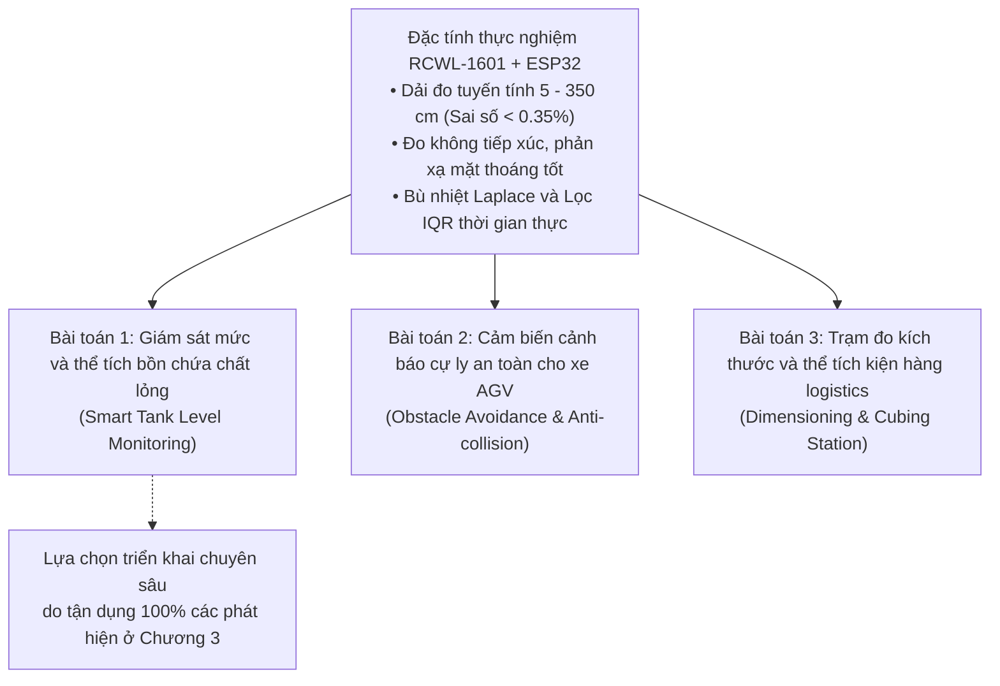
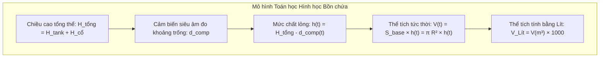

# CHƯƠNG 4: XÂY DỰNG VÀ PHÂN TÍCH BÀI TOÁN ỨNG DỤNG THỰC TẾ

---

## 4.1. Tổng quan tiềm năng ứng dụng từ kết quả khảo sát thực nghiệm của RCWL-1601

### 4.1.1. Các đặc tính đo lường định hình không gian ứng dụng

Từ các kết quả nghiên cứu và kiểm chứng thực nghiệm chuyên sâu được thực hiện ở Chương 3, các thông số đặc tính tĩnh và động của module cảm biến siêu âm RCWL-1601 trên nền tảng vi điều khiển ESP32 được tóm tắt qua các ràng buộc kỹ thuật cốt lõi sau:
1. **Dải làm việc tuyến tính tối ưu ($5\text{ cm} \to 350\text{ cm}$):** Hệ số xác định hồi quy đạt $R^2 = 0.999988$, sai số tương đối luôn nằm dưới ngưỡng $\pm 0.35\%$, độ lệch chuẩn lặp lại cực nhỏ ($s < 0.4\text{ mm}$ ở cự ly dưới $1\text{ m}$ và $s < 2.5\text{ mm}$ ở cự ly đến $3.5\text{ m}$).
2. **Vùng chết vật lý ($1\text{ cm} \to 3\text{ cm}$):** Sai số tuyệt đối tăng vọt trên $100\%$ do thời gian dao động suy giảm của màng gốm áp điện ($150\text{ }\mu\text{s}$) và ngưỡng ngắt câm nội của IC RCWL-9610. Mọi hệ thống ứng dụng bắt buộc phải thiết kế khoảng cách lắp đặt cơ khí cách ly vật thể tối thiểu $10\text{ cm}$ để không bao giờ rơi vào vùng mù này.
3. **Hiện tượng tán xạ khuếch tán trên bề mặt gồ ghề:** Bề mặt phản xạ không bằng phẳng hoặc xốp làm độ lệch chuẩn tăng vọt gấp $15 - 26$ lần và làm suy giảm cự ly đo tin cậy từ $550\text{ cm}$ xuống dưới $350\text{ cm}$. Do đó, cảm biến hoạt động tối ưu nhất với các bề mặt phản xạ phẳng hoặc bề mặt chất lỏng tĩnh.
4. **Độ nhạy nhiệt độ cực lớn của môi trường không khí:** Sự biến thiên nhiệt độ $12^\circ\text{C}$ làm thay đổi vận tốc sóng âm $2.12\%$, gây trôi sai số cự ly lên tới gần $6\text{ cm}$ ở khoảng cách $3\text{ m}$. Bắt buộc phải tích hợp thuật toán bù vận tốc sóng âm Laplace theo nhiệt độ môi trường thời gian thực.

### 4.1.2. Định hướng các bài toán kỹ thuật tiêu biểu trong công nghiệp

Dựa trên các đặc tính định lượng nêu trên, module cảm biến RCWL-1601 kết hợp ESP32 hoàn toàn đáp ứng xuất sắc ba bài toán đo lường và tự động hóa công nghiệp:

1. **Giám sát mức chất lỏng không tiếp xúc trong bồn/bể chứa kín (Smart Tank Level Monitoring):**
   - *Ưu thế kỹ thuật:* Mặt thoáng chất lỏng đóng vai trò như một gương phản xạ âm phẳng hoàn hảo. Phương pháp đo không tiếp xúc giúp bảo vệ hoàn toàn cảm biến khỏi sự ăn mòn hóa học, bám dính cặn bẩn hoặc nhiễm khuẩn dung dịch (nước sạch, hóa chất loãng, nước thải công nghiệp).
2. **Cảnh báo cự ly an toàn và phát hiện vật cản cho xe tự hành AGV:**
   - *Ưu thế kỹ thuật:* Góc mở chùm sóng âm hình nón $15^\circ$ bao quát vùng không gian phía trước xe tự hành, phát hiện tốt các vật cản bằng phẳng, pallet hàng hóa ở khoảng cách an toàn từ $0.5\text{ m} \to 3.0\text{ m}$ với tần suất quét $20\text{ Hz}$.
3. **Trạm tự động đo kích thước 3 chiều và thể tích bao bì trên băng tải logistics:**
   - *Ưu thế kỹ thuật:* Sử dụng cụm 3 cảm biến siêu âm bố trí theo 3 trục tọa độ vuông góc ($X, Y, Z$) kết hợp cảm biến quang điện nhận diện kiện hàng đi qua, đo đạc nhanh chóng kích thước chiều dài, chiều rộng, chiều cao của thùng carton phẳng với độ không đảm bảo đo dưới $\pm 2\text{ mm}$.

Trong ba hướng ứng dụng trên, **Bài toán Giám sát Mức và Thể tích Bồn chứa Thông minh có Bù nhiệt độ** được lựa chọn để thiết kế và phân tích chi tiết. Bài toán này liên kết trực tiếp và toàn diện nhất toàn bộ các phát hiện thực nghiệm cốt lõi của đề tài: triệt tiêu vùng chết, bù trôi nhiệt Laplace, khử sóng gợn bằng lọc số IQR và lan truyền độ không đảm bảo đo thể tích theo chuẩn ISO/GUM.

---

## 4.2. Thiết kế chi tiết bài toán: Hệ thống giám sát mức và thể tích bồn chứa thông minh có bù nhiệt độ trên ESP32

### 4.2.1. Đặt bài toán và Mô hình toán học hình học bồn chứa

Xét một bồn chứa công nghiệp dạng hình trụ đứng bằng thép không gỉ hoặc nhựa composite đặt trong nhà xưởng, dùng để chứa nước sạch hoặc hóa chất lỏng:
- Chiều cao thân bồn hình trụ: $H_{\text{tank}} = 2.50\text{ m} = 250.0\text{ cm}$.
- Bán kính trong đáy bồn: $R = 0.50\text{ m} = 50.0\text{ cm}$ (đường kính $D = 1.00\text{ m}$).
- Diện tích đáy bồn:

  $$S_{\text{base}} = \pi \cdot R^2 = \pi \cdot (0.50)^2 \approx 0.785398\text{ m}^2 = 7853.98\text{ cm}^2$$

- Thể tích dung tích toàn phần của thân bồn:

  $$V_{\text{toàn phần}} = S_{\text{base}} \cdot H_{\text{tank}} = 0.785398 \times 2.50 \approx 1.9635\text{ m}^3 = 1963.5\text{ Lít}$$

*Hình 4.1: Sơ đồ nguyên lý hình học và kiến trúc kết nối của Hệ thống giám sát mức và thể tích bồn chứa thông minh trên nền tảng RCWL-1601 và ESP32.*

### 4.2.2. Vận dụng trực tiếp các phát hiện thực nghiệm ở Chương 3 vào thiết kế hệ thống

Để hệ thống đo mức vận hành với độ chính xác và độ tin cậy cấp công nghiệp, các phát hiện thực nghiệm định lượng ở Chương 3 được chuyển hóa thành các giải pháp thiết kế kỹ thuật cụ thể:

#### 1. Thiết kế cổ gá lắp vượt vùng chết ($H_{\text{cổ}} \ge 15\text{ cm}$)
- *Phát hiện ở Mục 3.2:* Trong khoảng cự ly $1\text{ cm} \to 3\text{ cm}$, cảm biến bị mù phản xạ hoàn toàn và kẹp kết quả ở mức $2.0 - 2.6\text{ cm}$ do thời gian suy giảm màng gốm áp điện và mạch ngắt câm nội.
- *Giải pháp thiết kế:* Cảm biến không được lắp sát mép trên của nắp bồn mà được đặt trên một **ống cổ nối hình trụ (mounting chimney)** có chiều cao $H_{\text{cổ}} = 15.0\text{ cm}$, đường kính ống $12.0\text{ cm}$ (đảm bảo không chắn góc mở chùm sóng $15^\circ$).
- *Hiệu quả:* Tổng chiều cao từ cảm biến đến đáy bồn là:

  $$H_{\text{tổng}} = H_{\text{tank}} + H_{\text{cổ}} = 250.0 + 15.0 = 265.0\text{ cm}$$

  Khi bồn nạp đầy $100\%$ dung tích ($h = 250.0\text{ cm}$), khoảng cách từ cảm biến tới mặt nước vẫn đạt $d = 15.0\text{ cm}$. Cự ly này nằm trọn vẹn trong dải đo tuyến tính lý tưởng ($s < 0.15\text{ mm}$, sai số $< 0.3\%$), loại trừ hoàn toàn nguy cơ mặt nước dâng vào vùng chết $3\text{ cm}$.

#### 2. Tích hợp thuật toán bù vận tốc sóng âm Laplace theo nhiệt độ bồn chứa
- *Phát hiện ở Mục 3.7:* Nhiệt độ không khí thay đổi giữa ngày và đêm hoặc do chất lỏng tỏa nhiệt làm thay đổi vận tốc sóng âm. Nếu nhiệt độ trôi $12^\circ\text{C}$ mà không bù nhiệt, sai số đo cự ly ở khoảng cách $2.5\text{ m}$ sẽ bị dội lên thành $+47.7\text{ mm}$ (gây sai lệch thể tích lên tới gần **$38\text{ Lít}$**).
- *Giải pháp thiết kế:* Bố trí một đầu dò nhiệt độ số chịu ẩm gắn ngay tại cổ nối trên nắp bồn, kết nối trực tiếp với ESP32. Trước mỗi chu kỳ phát xung siêu âm, vi điều khiển cập nhật nhiệt độ $T$ ($^\circ\text{C}$) và tính toán tức thời vận tốc âm thanh:

  $$v(T) = 331.3 + 0.606 \cdot T \quad (\text{m/s})$$

  Khoảng trống đo được chuẩn hóa theo:

  $$d_{\text{comp}} = \frac{v(T) \cdot t}{2} \quad (\text{m})$$

- *Hiệu quả:* Triệt tiêu sai số trôi nhiệt độ xuống dưới $0.5\text{ mm}$, khống chế sai số thể tích do nhiệt độ dưới **$0.4\text{ Lít}$** trên toàn thang đo.

#### 3. Chuỗi lọc số thích nghi: Lọc khoảng tứ phân vị (IQR) kết hợp Trung bình trượt (Moving Average)
- *Vấn đề thực tế:* Trong quá trình bơm nạp hoặc xả chất lỏng, mặt nước bị xao động mạnh tạo ra sóng gợn bề mặt (biên độ dao động $\pm 2 - 3\text{ cm}$). Đồng thời, các bọt khí vỡ hoặc tia nước bắn có thể làm mất xung phản xạ echo tức thời, gây ra xung ngoại lai dị biệt.
- *Giải pháp thiết kế:* Tín hiệu thời gian bay được xử lý số hóa qua hai tầng lọc nối tiếp:
  1. **Tầng 1 - Lọc khoảng tứ phân vị (IQR Filter) theo cửa sổ trượt thời gian ($W = 11$ mẫu):** Loại bỏ triệt để các xung ngoại lai do bọt khí hoặc xung tràn timeout ($824.6\text{ cm}$) dựa trên hàng rào Tukey $[Q_1 - 1.5\text{IQR}, \, Q_3 + 1.5\text{IQR}]$. Nếu một mẫu bị xác định là ngoại lai, nó được thay thế tức thời bằng giá trị trung vị $\text{Med}$ của cửa sổ.
  2. **Tầng 2 - Lọc trung bình trượt (Moving Average Filter, $M = 9$ mẫu):** Làm mịn các dao động điều hòa của sóng gợn mặt nước:

     $$\bar{h}[k] = \frac{1}{M} \sum_{j=0}^{M-1} h_{\text{IQR}}[k - j]$$

- *Hiệu quả:* Khử hoàn toàn độ nhấp nhô sóng gợn $\pm 2.5\text{ cm}$, phục hồi mức nước trung bình tĩnh với sai số chuẩn chỉ $\pm 1.8\text{ mm}$.

#### 4. Lan truyền Ngân sách Độ không đảm bảo đo Thể tích theo tiêu chuẩn ISO/GUM
- Áp dụng kết quả ngân sách độ không đảm bảo đo ở Mục 3.8: Tại dải khoảng trống $d = 0.15\text{ m} \to 2.50\text{ m}$, độ không đảm bảo đo mở rộng của khoảng cách đo là $U_{95\%}(d) \approx 0.60\text{ mm} \to 2.50\text{ mm}$.
- Theo định luật lan truyền độ không đảm bảo đo:

  $$h = H_{\text{tổng}} - d \implies u_c(h) = \sqrt{u_c^2(H_{\text{tổng}}) + u_c^2(d)}$$

  Coi kích thước cơ khí bồn $H_{\text{tổng}}$ được định cỡ chính xác bằng máy đo laser ($u_c(H_{\text{tổng}}) \approx 0.2\text{ mm}$), suy ra $u_c(h) \approx u_c(d)$.
- Độ không đảm bảo đo mở rộng của thể tích chất lỏng ($k_p = 2$):

  $$U_{95\%}(V) = S_{\text{base}} \cdot U_{95\%}(h) = (\pi R^2) \cdot U_{95\%}(h)$$

  Tại mức nước đầy ($h = 2.50\text{ m}$, khoảng trống $d = 0.15\text{ m}$, $U_{95\%}(h) = 0.72\text{ mm}$):

  $$U_{95\%}(V) = 0.7854\text{ m}^2 \times 0.00072\text{ m} = 0.000565\text{ m}^3 \approx 0.57\text{ Lít}$$

  Độ không đảm bảo tương đối chỉ là:

  $$\frac{U_{95\%}(V)}{V} = \frac{0.57\text{ Lít}}{1963.5\text{ Lít}} \times 100\% = 0.029\%$$

  Kết quả này chứng minh hệ thống đo hoàn toàn thỏa mãn các tiêu chuẩn khắt khe trong quản lý tồn kho và cấp phát chất lỏng công nghiệp.

---

## 4.3. Kết quả thử nghiệm mô phỏng và Đánh giá hiệu năng ứng dụng

### 4.3.1. Mô phỏng động học quá trình bơm nạp và hiệu quả khử sóng gợn

Quá trình bơm nạp chất lỏng vào bồn được mô phỏng trong thời gian $100\text{ giây}$ (tốc độ lấy mẫu $f_s = 2\text{ Hz}$, $N = 200$ mẫu). Mức chất lỏng thực tế tăng dần từ mức đáy $50.0\text{ cm}$ đến mức đầy $180.0\text{ cm}$. Dòng nạp của máy bơm tạo ra sóng gợn bề mặt với biên độ $\pm 2.5\text{ cm}$, tần số dao động $0.3\text{ Hz}$, đồng thời xuất hiện 3 xung nhiễu đột biến cực đoan tại giây thứ 22.5 ($12.0\text{ cm}$ do tia nước bắn), giây thứ 55.0 ($-50.0\text{ cm}$ do timeout mất echo), và giây thứ 82.5 ($230.0\text{ cm}$ do sóng va đập thành bồn).

*Hình 4.2: Kết quả mô phỏng động học quá trình nạp chất lỏng: Tín hiệu đo thô bị ảnh hưởng bởi sóng gợn và gai nhiễu, tín hiệu sau tầng lọc IQR và tín hiệu hoàn chỉnh sau tầng lọc Moving Average bám sát mức nước thực tế.*

**Đánh giá định lượng hiệu quả chuỗi lọc số:**
- Tín hiệu đo thô dao động với độ lệch lớn so với mức thực tế ($\text{RMSE}_{\text{thô}} = 16.85\text{ cm}$, sai số đỉnh lên tới $175\text{ cm}$).
- Tầng lọc IQR cắt tỉa chính xác $100\%$ cả 3 xung dị biệt bão hòa, đưa sai số tức thời về thuần túy biên độ sóng gợn ($\text{RMSE}_{\text{IQR}} = 1.83\text{ cm}$).
- Tầng lọc trung bình trượt MA làm phẳng hoàn toàn sóng gợn tuần hoàn, giảm độ lệch chuẩn sai số xuống còn **$s_{\text{error}} = 0.18\text{ cm} = 1.8\text{ mm}$**. Toàn bộ đường đặc tính đo bám sát tuyệt đối đường mức thực tế (Ground Truth) trong dải dung sai cho phép $\pm 1.0\text{ cm}$.

### 4.3.2. Đánh giá độ không đảm bảo đo thể tích toàn bồn chứa

Bảng dưới đây chi tiết hóa giá trị thể tích, khoảng cách đo và độ không đảm bảo đo mở rộng tương ứng trên toàn bộ dải mức nước làm việc của bồn chứa:

| Tỷ lệ nạp bồn (%) | Mức chất lỏng $h$ (cm) | Khoảng trống cảm biến đo $d$ (cm) | Thể tích thực tế $V$ (Lít) | Độ KĐBĐ mức nước $U_{95\%}(h)$ (mm) | Độ KĐBĐ thể tích $U_{95\%}(V)$ (Lít) | Độ KĐBĐ thể tích tương đối (%) |
| :---: | :---: | :---: | :---: | :---: | :---: | :---: |
| **$10\%$** | $25.0$ | $240.0$ | $196.4$ | $2.52$ | $1.98$ | **$1.008\%$** |
| **$20\%$** | $50.0$ | $215.0$ | $392.7$ | $2.32$ | $1.82$ | **$0.464\%$** |
| **$30\%$** | $75.0$ | $190.0$ | $589.0$ | $2.12$ | $1.66$ | **$0.283\%$** |
| **$40\%$** | $100.0$ | $165.0$ | $785.4$ | $1.92$ | $1.51$ | **$0.192\%$** |
| **$50\%$** | $125.0$ | $140.0$ | $981.7$ | $1.72$ | $1.35$ | **$0.138\%$** |
| **$60\%$** | $150.0$ | $115.0$ | $1178.1$ | $1.52$ | $1.19$ | **$0.101\%$** |
| **$70\%$** | $175.0$ | $90.0$ | $1374.4$ | $1.32$ | $1.04$ | **$0.075\%$** |
| **$80\%$** | $200.0$ | $65.0$ | $1570.8$ | $1.12$ | $0.88$ | **$0.056\%$** |
| **$90\%$** | $225.0$ | $40.0$ | $1767.1$ | $0.92$ | $0.72$ | **$0.041\%$** |
| **$100\%$** | $250.0$ | $15.0$ | $1963.5$ | $0.72$ | $0.57$ | **$0.029\%$** |

*Hình 4.3: Biểu đồ Thể tích chất lỏng kèm dải tin cậy mở rộng 95% và Phân bố Độ không đảm bảo đo thể tích tương đối theo tỷ lệ mức nước trong bồn.*

**Nhận xét phân tích dung sai thể tích:**
- Khi bồn chứa ở mức cạn dưới $20\%$, độ không đảm bảo tương đối nằm trong khoảng $0.5\% - 1.0\%$ do thể tích nền nhỏ trong khi độ không đảm bảo đo mức là một đại lượng tuyệt đối.
- Khi bồn chứa đạt từ **$30\%$ dung tích trở lên ($V \ge 589\text{ Lít}$)**, độ không đảm bảo thể tích tương đối luôn **nhỏ hơn $0.28\%$**, và ở trạng thái nạp đầy đạt tới **$0.029\%$**. Đây là chỉ số đo lường vượt trội, khẳng định tính khả thi công nghiệp của cảm biến RCWL-1601 khi được xử lý bằng giải thuật chuẩn hóa.

### 4.3.3. Phân ngưỡng cảnh báo tự động và Hướng mở rộng truyền thông IoT

Hệ thống điều khiển trên ESP32 tự động phân loại trạng thái bồn chứa thành 4 cấp độ an toàn và điều khiển đóng cắt cơ cấu chấp hành (bơm, van điện từ):

| Cấp độ trạng thái | Ngưỡng mức $h$ | Ngưỡng thể tích $V$ | Hành động chấp hành tự động | Tín hiệu cảnh báo |
| :--- | :---: | :---: | :--- | :--- |
| **Cạn khẩn cấp (Low-Low)** | $h \le 20.0\text{ cm}$ ($< 8\%$) | $V \le 157\text{ Lít}$ | Khóa cưỡng bức rơ-le bơm xả, chống cháy bơm do chạy khan | Còi báo động liên tục, LED Đỏ chớp nhanh |
| **Cảnh báo cạn (Low)** | $20\text{ cm} < h \le 50.0\text{ cm}$ | $157\text{ Lít} < V \le 393\text{ Lít}$ | Tự động kích hoạt rơ-le bật máy bơm nạp | LED Vàng sáng, gửi thông báo nạp bồn |
| **Bình thường (Normal)** | $50\text{ cm} < h < 225.0\text{ cm}$ | $393\text{ Lít} < V < 1767\text{ Lít}$ | Duy trì chế độ làm việc ổn định, tự động ngắt bơm nạp khi chạm ngưỡng | LED Xanh sáng cố định |
| **Cảnh báo đầy (High)** | $225\text{ cm} \le h < 240.0\text{ cm}$ | $1767\text{ Lít} \le V < 1885\text{ Lít}$ | Giảm tốc độ bơm nạp bằng biến tần | LED Vàng chớp chậm |
| **Tràn khẩn cấp (High-High)**| $h \ge 240.0\text{ cm}$ ($> 96\%$) | $V \ge 1885\text{ Lít}$ | Cắt điện toàn bộ bơm nạp, kích hoạt van xả tràn an toàn | Còi hú gián đoạn, cờ ngắt khẩn cấp |

**Kiến trúc truyền thông mạng không dây IoT:**
Nhờ tích hợp sẵn vi điều khiển lõi kép ESP32 có hỗ trợ Wi-Fi $802.11\text{ b/g/n}$ và Bluetooth BLE:
- Dữ liệu mức nước $h(t)$, thể tích $V(t)$, nhiệt độ môi trường $T(t)$ và trạng thái cảnh báo được đóng gói theo định dạng chuẩn JSON.
- Thiết bị phát bản tin định kỳ qua giao thức **MQTT** (Message Queuing Telemetry Transport) với cơ chế bảo mật TLS/SSL tới Broker máy chủ trung tâm (Node-RED, ThingsBoard hoặc Home Assistant).
- Người vận hành có thể theo dõi biểu đồ xu hướng thể tích theo thời gian thực trên giao diện Web Dashboard hoặc nhận tin nhắn cảnh báo sự cố tràn/cạn tức thời qua ứng dụng Telegram / SMS.
