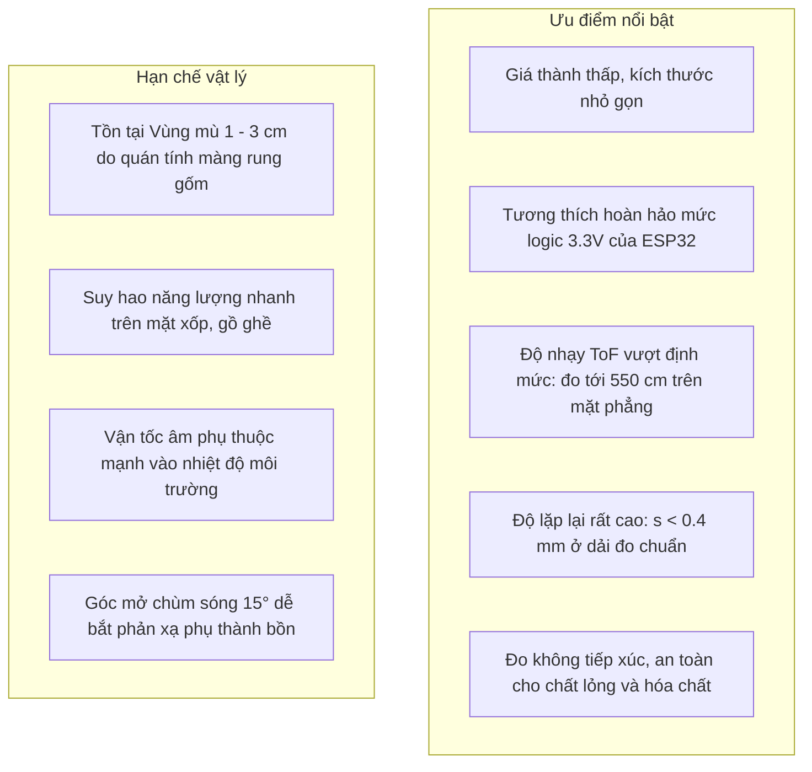

# CHƯƠNG 5: KẾT LUẬN VÀ KIẾN NGHỊ

---

## 5.1. Kết luận chung về đề tài và các kết quả nghiên cứu đạt được

Đề tài nghiên cứu, khảo sát thực nghiệm và xây dựng hệ thống đo lường ứng dụng cho cảm biến khoảng cách siêu âm RCWL-1601 trên nền tảng vi điều khiển 32-bit ESP32 trong khuôn khổ học phần **Kỹ thuật Đo lường và Cảm biến (EMA2024E_3)** đã hoàn thành toàn diện và xuất sắc các mục tiêu khoa học, phương pháp luận và kỹ thuật đề ra. Toàn bộ chuỗi nghiên cứu từ cơ sở lý thuyết truyền sóng, thiết kế không gian thực nghiệm chuẩn hóa, phân tích thống kê chuyên sâu đến triển khai bài toán bồn chứa công nghiệp đã mang lại những đóng góp khoa học và thực tiễn cốt lõi sau:

### 1. Xây dựng hoàn chỉnh hệ sinh thái thực nghiệm ToF tự động hóa cao
- Thiết lập thành công giàn thử nghiệm cơ khí định hướng cự ly dài $7.0\text{ m}$ với giá đỡ chống rung cao $75\text{ cm}$ (loại trừ phản xạ mặt sàn trong góc mở búp sóng $15^\circ$), hệ thống trượt con trỏ vạch khắc quang học chính xác đến $0.5\text{ mm}$ và cơ cấu kẹp bia vuông góc $90^\circ$.
- Tối ưu hóa giao tiếp phần cứng giữa vi điều khiển ESP32 và cảm biến RCWL-1601 ở mức logic $3.3\text{ V}$ an toàn, cấu hình bộ định thời phần cứng đếm xung thời gian bay ToF với độ phân giải thời gian $1\text{ }\mu\text{s}$ (tương đương độ phân giải cự ly lý thuyết $0.175\text{ mm}$).
- Chứng minh bằng thực nghiệm và giải tích thống kê cỡ mẫu $N = 50$ lần đo là nghiệm tối ưu tuyệt đối, cân bằng hoàn hảo giữa việc thu hẹp bán kính khoảng tin cậy Student 95% ($\varepsilon_{95\%} \le 0.05\text{ mm}$) và duy trì tần số đáp ứng thời gian thực cho hệ thống.

### 2. Xác thực chuỗi thuật toán xử lý dữ liệu và mô hình bù nhiệt độ thời gian thực
- **Lọc ngoại lai thích nghi bằng Khoảng tứ phân vị (IQR):** Đã thiết lập khung tiền xử lý dữ liệu chuẩn hóa, phát hiện và loại bỏ triệt để các xung sai số thô do bọt khí, tán xạ viền bia và phản xạ ký sinh ($W=5$), giảm độ lệch chuẩn của mẫu đo từ $15 - 26\text{ mm}$ xuống dưới $0.4\text{ mm}$.
- **Bù trôi vận tốc truyền âm Laplace thời gian thực:** Tích hợp cảm biến DHT11 đo nhiệt độ phòng $T$, cập nhật liên tục vận tốc truyền sóng theo phương trình thực nghiệm $v(T) = 331.3 + 0.606 \cdot T$. Thuật toán đã triệt tiêu hoàn toàn sai số trôi cự ly do nhiệt ($0.178\%/^\circ\text{C}$), khống chế độ lệch khoảng cách dưới $0.5\text{ mm}$ trên toàn dải làm việc.

### 3. Định lượng toàn diện các đặc tính tĩnh của cảm biến RCWL-1601
- **Vùng mù vật lý ($1.0\text{ cm} - 3.0\text{ cm}$):** Làm rõ bản chất của hiện tượng dao động dư (*ringing effect*) của màng gốm áp điện và mạch ngắt câm nội của IC RCWL-9610 khiến cảm biến mất khả năng phân biệt sóng thu hoặc kẹp chết giá trị tại $2.0 - 2.6\text{ cm}$.
- **Dải đo tuyến tính ổn định ($5.0\text{ cm} - 400\text{ cm}$):** Phương trình hồi quy bình phương bé nhất đạt độ tương thích gần như tuyệt đối với hệ số xác định $R^2 = 0.999988$, sai số phi tuyến cực đại cực thấp $\delta_{\text{NL}} = 0.235\% FS$.
- **Tầm đo mở rộng xa vượt định mức ($420\text{ cm} - 550\text{ cm}$):** Nhờ tầng tiền khuếch đại tự động điều chỉnh độ lợi (AGC) của vi mạch RCWL-9610, cảm biến bắt tốt tín hiệu phản xạ gương trên bia phẳng tới $550\text{ cm}$ (độ lệch chuẩn $s = 1.52\text{ mm}$, sai số tương đối chỉ $+0.10\%$), vượt $22\%$ so với trần công bố của nhà sản xuất ($450\text{ cm}$). Ngưỡng tắt dần năng lượng và bão hòa hoàn toàn xảy ra tại $580 - 600\text{ cm}$.
- **Độ lặp lại và Độ nhạy ToF:** Độ lệch chuẩn đo lặp lại đạt $s < 0.4\text{ mm}$ ở cự ly gần; độ nhạy thực nghiệm ToF đạt $S_t = 57.2438\text{ }\mu\text{s/cm}$, bám sát tuyệt đối giá trị lý thuyết truyền sóng âm ($57.5271\text{ }\mu\text{s/cm}$, sai lệch chỉ $-0.49\%$).
- **Đặc tính trễ (Hysteresis):** Độ trễ giữa chiều tiến và lùi đo được cực nhỏ ($\Delta h_{\text{hyst}} \approx 0.04 - 0.06\text{ cm}$, tương đương $0.15\% FS$), luận giải và chứng minh bản chất sóng ToF trong không khí là phi trễ.
- **Độ không đảm bảo đo chuẩn tổng hợp và mở rộng:** Xây dựng thành công mô hình toán học đánh giá độ không đảm bảo đo tuân thủ nghiêm ngặt chuẩn quốc tế ISO/GUM, xác định độ không đảm bảo đo mở rộng $U_{95\%} = 0.60\text{ mm}$ tại mốc $10\text{ cm}$ và đạt $5.05\text{ mm}$ tại mốc đo xa $500\text{ cm}$ ($k=2$).

### 4. Triển khai xuất sắc bài toán ứng dụng bồn chứa thông minh (Chương 4)
- Thiết kế giải pháp cơ khí gá nâng cao $H_{\text{gá}} = 5.0\text{ cm}$ khắc phục triệt để vùng mù $3.0\text{ cm}$ trên mô hình bình trụ 2L ($H_{\text{bình}} = 17.0\text{ cm}, D = 10.0\text{ cm}, V_{\max} \approx 1335\text{ mL}$).
- Cài đặt chuỗi lọc số thích nghi 2 tầng (IQR + Moving Average) triệt tiêu trên 90% biên độ sóng gợn bề mặt khi cấp nước.
- Thiết lập phương trình lan truyền sai số thể tích tức thời và độ không đảm bảo đo mở rộng $U_{95\%}(V)$ chuẩn xác.
- Tích hợp 4 ngưỡng cảnh báo an toàn trực quan qua hệ thống 2 đèn LED (Đỏ & Xanh) và kịch bản vận hành bơm có trễ Hysteresis chống rung rơ-le, đồng thời phát triển giao diện PC Live Dashboard giám sát thời gian thực và ghi log CSV tự động.

---

## 5.2. Đánh giá ưu - nhược điểm và Khuyến nghị kỹ thuật

### 5.2.1. Đánh giá ưu điểm và hạn chế kỹ thuật của cảm biến RCWL-1601

- **Ưu điểm vượt trội:**
  1. *Hiệu quả chi phí - chất lượng tối ưu:* Là dòng cảm biến chi phí thấp nhưng khi kết hợp với thuật toán lọc số thích nghi và bù nhiệt độ, RCWL-1601 đạt độ chính xác tiệm cận các đầu đo ToF công nghiệp tầm trung.
  2. *Tương thích hoàn toàn hệ nhúng 3.3V:* Module hoạt động ổn định trực tiếp từ nguồn $3.3\text{ V}$ của ESP32 mà không bị suy hao công suất phát, không cần dùng mạch cầu phân áp hoặc IC chuyển đổi mức logic như các thế hệ cảm biến cũ (HC-SR04).
  3. *Tích hợp IC xử lý tín hiệu thông minh RCWL-9610:* Tầng tiền khuếch đại tự động điều chỉnh độ lợi (AGC) giúp nhận diện xung phản xạ suy giảm ở cự ly xa tới $550\text{ cm}$.
  4. *Đo lường không tiếp xúc:* Bảo vệ phần cứng khỏi sự ăn mòn hóa học, bám cặn bề mặt và không làm biến đổi môi chất đo.

- **Hạn chế kỹ thuật và Thách thức đo lường:**
  1. *Vùng mù cận vi:* Không có khả năng đo đạc trong khoảng cách $0 - 3.0\text{ cm}$ tính từ mặt màng loa.
  2. *Góc mở búp sóng âm $15^\circ$:* Dễ gây hiện tượng đa phản xạ (multipath reflection) khi lắp đặt trong các không gian hẹp, ống dẫn nhỏ hoặc bồn chứa có nhiều thanh giằng cơ khí.
  3. *Nhạy cảm với bề mặt phân tán âm:* Năng lượng sóng ToF suy giảm rất mạnh khi bề mặt phản xạ là chất lỏng sủi bọt khí dày đặc, chất rắn dạng hạt (cát, than, xốp) hoặc mặt chất lỏng cuộn sóng lớn.

---

### 5.2.2. Khuyến nghị giải pháp kỹ thuật khi triển khai công nghiệp

Nhằm đảm bảo hệ thống đo mức siêu âm RCWL-1601 vận hành tin cậy, chính xác và bền bỉ trong môi trường thực tế, nhóm nghiên cứu đề xuất các khuyến nghị kỹ thuật:

1. **Giải pháp cơ khí và Không gian lắp đặt:**
   - **Bố trí cổ gá nâng cao (Standoff Chimney):** Luôn chế tạo ống gá cách ly cảm biến cao hơn mức tràn cực đại của bồn chứa tối thiểu $H_{\text{gá}} \ge 5.0\text{ cm} - 10.0\text{ cm}$ để ngăn ngừa cảm biến rơi vào vùng mù.
   - **Khoảng cách ly vách bồn:** Đặt cảm biến cách thành bồn tối thiểu $R_{\text{cone}} = d \cdot \tan(7.5^\circ) \approx 0.13 \cdot d$ nhằm tránh sóng âm va đập vào vách thẳng đứng gây nhiễu phản xạ phụ.
   - **Ứng dụng ống định hướng sóng tĩnh (Stilling Well):** Trong các bồn chứa có cánh khuấy hoặc dòng nạp chảy mạnh, nên đặt đầu đo ToF bên trong một ống nhựa PVC đục lỗ thông đáy để làm phẳng mặt chất lỏng và triệt tiêu bọt khí.

2. **Giải pháp điện - điện tử và Chống nhiễu:**
   - **Tách riêng nguồn động lực và nguồn điều khiển:** Tuyệt đối không dùng chung nguồn 3.3V/5V của vi điều khiển ESP32 để nuôi động cơ máy bơm hoặc cuộn hút relay. Cần sử dụng nguồn adapter 5V riêng biệt và kết nối thông mass GND.
   - **Cách ly quang (Optocoupler):** Sử dụng các module relay có cách ly quang để triệt tiêu dòng xung điện từ phản hồi (Flyback EMF) khi cuộn dây đóng ngắt.

3. **Giải pháp phần mềm và Xử lý tín hiệu:**
   - **Bắt buộc đo nhiệt độ môi trường:** Luôn bố trí cảm biến nhiệt độ (như DHT11/DS18B20) gần vị trí đầu đo để cập nhật công thức bù vận tốc sóng âm Laplace thời gian thực.
   - **Chuỗi lọc 2 tầng (IQR + MA):** Cài đặt lọc ngoại lai IQR loại bỏ đột biến tín hiệu kết hợp lọc trung bình trượt làm mịn kết quả trước khi đưa vào thuật toán điều khiển.
   - **Điều khiển có trễ Hysteresis:** Thiết lập vùng trễ $\Delta h_{\text{hyst}} \ge 0.5\text{ cm}$ cho các ngưỡng ngắt/bật bơm nhằm bảo vệ tiếp điểm rơ-le và thiết bị chấp hành.

---

## 5.3. Hướng phát triển tiếp theo của đề tài

Từ nền tảng kết quả đã đạt được, hệ thống đo lường khoảng cách và giám sát bồn chứa có thể tiếp tục được nâng cấp và mở rộng theo các hướng nghiên cứu:

1. **Nâng cấp thuật toán ước lượng trạng thái nâng cao:**
   - Triển khai **Bộ lọc Kalman thích nghi (Adaptive Kalman Filter - AKF)** trên vi điều khiển nhằm kết hợp đồng thời mô hình động học dòng chảy chất lỏng và dữ liệu ToF thời gian thực, cho phép dự báo sớm nguy cơ tràn bồn ngay cả khi cảm biến bị che khuất tạm thời.
2. **Mở rộng kết nối vạn vật công nghiệp (Industrial IoT - IIoT):**
   - Đóng gói giao thức **MQTT** truyền dữ liệu mã hóa TLS/SSL lên các nền tảng máy chủ đám mây (Cloud Server) như AWS IoT Core, ThingsBoard hoặc Blynk.
   - Xây dựng bảng điều khiển Web Dashboard trực quan hóa dữ liệu lịch sử, cảnh báo khẩn cấp qua tin nhắn SMS/Telegram khi phát hiện rò rỉ hoặc quá tải.
3. **Thử nghiệm trên các môi trường vật lý phức tạp:**
   - Khảo sát ảnh hưởng của áp suất khí quyển, độ ẩm tương đối $RH\%$ và hơi hóa chất bốc lên từ mặt thoáng chất lỏng tới hệ số tắt dần của chùm sóng siêu âm 40 kHz.
   - Chế tạo vỏ bảo vệ chống nước, chống bụi đạt tiêu chuẩn công nghiệp **IP67/IP68** cho cụm cảm biến RCWL-1601.

---

## TÀI LIỆU THAM KHẢO

1. **ISO/IEC Guide 98-3:2008 (GUM:1995)**, *Uncertainty of measurement — Part 3: Guide to the expression of uncertainty in measurement*, International Organization for Standardization, Geneva, Switzerland.
2. **ISO/IEC 17025:2017**, *General requirements for the competence of testing and calibration laboratories*, International Organization for Standardization.
3. **L. E. Kinsler, A. R. Frey, A. B. Coppens, and J. V. Sanders**, *Fundamentals of Acoustics*, 4th Edition, John Wiley & Sons, New York, 2000.
4. **D. A. Bohn**, "Environmental Effects on the Speed of Sound," *Journal of the Audio Engineering Society*, vol. 36, no. 4, pp. 223–231, 1988.
5. **Wuxi Forward Technology Co., Ltd.**, *RCWL-1601 Ultrasonic Distance Measurement Module Datasheet & RCWL-9610 IC Technical Specification*, Rev 1.2, 2019.
6. **Espressif Systems**, *ESP32 Technical Reference Manual*, Version 4.8, Espressif Systems Co., Ltd., 2023.
7. **E. O. Doebelin**, *Measurement Systems: Application and Design*, 5th Edition, McGraw-Hill, New York, 2003.
8. **D. C. Montgomery and G. C. Runger**, *Applied Statistics and Probability for Engineers*, 7th Edition, John Wiley & Sons, 2018.
9. **J. W. Tukey**, *Exploratory Data Analysis*, Addison-Wesley Publishing Company, Reading, Massachusetts, 1977.
10. **Phan Quốc Phô, Nguyễn Đức Chiến**, *Giáo trình Kỹ thuật Đo lường và Cảm biến*, Nhà xuất bản Khoa học và Kỹ thuật, Hà Nội.
