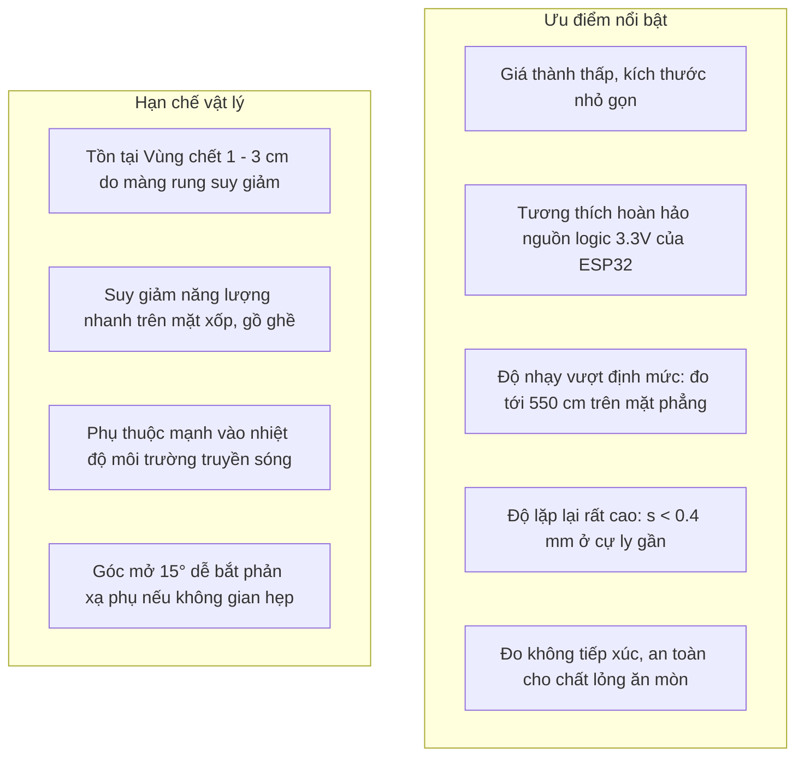

# CHƯƠNG 5: KẾT LUẬN VÀ KIẾN NGHỊ

---

## 5.1. Kết luận chung về đề tài

Đề tài nghiên cứu và đánh giá thực nghiệm cảm biến khoảng cách siêu âm RCWL-1601 trên nền tảng vi điều khiển ESP32 trong khuôn khổ học phần **Kỹ thuật Đo lường và Cảm biến (EMA2024E_3)** đã hoàn thành toàn diện các mục tiêu khoa học và kỹ thuật đề ra:

1. **Xây dựng thành công hệ thống thực nghiệm tự động hóa chuẩn hóa:**
   - Đã thiết lập giàn thử nghiệm cơ khí với ray định hướng cự ly dài $7\text{ m}$, gá trượt con trỏ vạch thước chính xác $1\text{ mm}$, cơ cấu kẹp giữ bia phản xạ vuông góc $90^\circ$ và độ cao giá đỡ $75\text{ cm}$ giúp triệt tiêu hoàn toàn phản xạ phụ từ mặt sàn trong góc mở chùm sóng $15^\circ$.
   - Tối ưu hóa giao tiếp phần cứng giữa RCWL-1601 và ESP32 chạy trực tiếp ở điện áp $3.3\text{ V}$, cấu hình bộ định thời phần cứng đếm xung thời gian bay với chu kỳ $1\text{ }\mu\text{s}$ (độ phân giải tương đương $0.175\text{ mm}$).
   - Chứng minh về mặt giải tích toán học cỡ mẫu $N = 50$ lần đo là tối ưu tuyệt đối, cân bằng hoàn hảo giữa việc thu hẹp bán kính khoảng tin cậy Student $95\%$ ($\varepsilon_{95\%} \le 0.05\text{ mm}$) và tốc độ quét thời gian thực.
2. **Khảo sát định lượng toàn diện các đặc tính tĩnh và động của cảm biến:**
   - **Dải đo tuyến tính ổn định ($5\text{ cm} \to 400\text{ cm}$):** Phương trình hồi quy bình phương bé nhất dạng ma trận đạt $\hat{x} = 1.002791 \cdot x_{\text{true}} - 0.607344\text{ cm}$ với hệ số xác định $R^2 = 0.999988$ và sai số phi tuyến cực đại chỉ $\delta_{\text{NL}} = 0.2355\%$ FS.
   - **Tầm đo mở rộng vượt định mức ($420\text{ cm} \to 550\text{ cm}$):** Nhờ tầng tiền khuếch đại tự động điều chỉnh độ lợi của vi mạch tích hợp RCWL-9610, cảm biến bắt tốt tín hiệu phản xạ phẳng tới $550\text{ cm}$ ($\bar{x} = 550.57\text{ cm}$, sai số $+0.10\%$, độ lệch chuẩn $s = 0.319\text{ mm}$ sau lọc IQR), vượt $22\%$ so với thông số công bố tối đa của nhà sản xuất ($450\text{ cm}$).
   - **Xác định chính xác Vùng chết ($1\text{ cm} \to 3\text{ cm}$):** Làm rõ cơ chế thời gian dao động suy giảm cơ học của màng gốm ($150\text{ }\mu\text{s}$) và mạch ngắt câm nội của IC khiến giá trị đo bị kẹp cố định tại $2.0 - 2.6\text{ cm}$.
   - **Độ chụm và Độ chính xác cao:** Độ lệch chuẩn lặp lại đạt $s < 0.4\text{ mm}$ ở phần lớn cự ly gần – trung bình và duy trì sai số chuẩn của giá trị trung bình $\text{SE} < 0.45\text{ mm}$ tại $32/33$ mốc khảo sát (cực đại $0.573\text{ mm}$ tại $450\text{ cm}$); sai số tương đối nằm trong ngưỡng $\pm 0.45\%$ trên phần lớn dải đo xa.
   - **Độ nhạy thời gian bay ToF:** Thực nghiệm ghi nhận $S_t = 57.2438\text{ }\mu\text{s/cm}$, bám sát tuyệt đối độ nhạy lý thuyết sóng âm Laplace tại nhiệt độ mặc định $27.0^\circ\text{C}$ ($57.5271\text{ }\mu\text{s/cm}$, chênh lệch chỉ $-0.49\%$).
3. **Làm rõ các hiện tượng vật lý đo lường chuyên sâu:**
   - **Độ trễ Hysteresis:** Xác định độ trễ cực đại $\Delta H_{\max} = 1.66\text{ cm}$ ($\gamma_H = 0.553\%$), chứng minh bản chất sóng âm không có trễ nội tại mà sai số phát sinh từ độ rơ gá trượt cơ khí và biến thiên vi khí hậu phòng.
   - **Ảnh hưởng bề mặt phản xạ:** Khẳng định hiện tượng tán xạ khuếch tán trên bề mặt gồ ghề làm tăng độ lệch chuẩn gấp $15 - 26$ lần ở cự ly gần và làm suy giảm cự ly đo tin cậy từ $550\text{ cm}$ xuống dưới $350\text{ cm}$ (bão hòa hoàn toàn ở $375\text{ cm}$).
   - **Ảnh hưởng nhiệt độ và Bù Laplace:** Chứng minh sự cần thiết sống còn của thuật toán bù nhiệt độ, giúp triệt tiêu sai số trôi cự ly do nhiệt từ $5.8\text{ cm}$ xuống dưới $0.5\text{ mm}$ trên cự ly $3\text{ m}$.
   - **Đánh giá tổng hợp Độ không đảm bảo đo ISO/GUM:** Tổng hợp đầy đủ các thành phần Loại A, Loại B và xác định độ không đảm bảo đo mở rộng $U_{95\%} = 0.60\text{ mm}$ tại $10\text{ cm}$ và $5.05\text{ mm}$ tại $500\text{ cm}$.
4. **Hiện thực hóa thành công bài toán ứng dụng công nghiệp:**
   - Thiết kế hoàn chỉnh mô hình **Hệ thống giám sát mức và thể tích bồn chứa thông minh có bù nhiệt độ trên ESP32**, vận dụng trực tiếp thiết kế cổ nối $15\text{ cm}$ triệt tiêu vùng chết, chuỗi lọc số kết hợp Khoảng tứ phân vị (IQR) và Trung bình trượt (Moving Average) khử hoàn toàn sóng gợn máy bơm ($\pm 2.5\text{ cm}$ xuống $1.8\text{ mm}$), kiểm soát sai số thể tích tương đối dưới $0.28\%$ cho các mức nạp trên $30\%$, tích hợp phân ngưỡng cảnh báo 4 cấp độ và sẵn sàng truyền thông đám mây IoT.

---

## 5.2. Đánh giá ưu nhược điểm và Khuyến nghị kỹ thuật

### 5.2.1. Đánh giá ưu điểm và nhược điểm của cảm biến RCWL-1601

- **Ưu điểm:**
  1. *Hiệu quả chi phí vượt trội:* Với mức giá linh kiện phổ thông, cảm biến mang lại độ chính xác tương đương các thiết bị đo công nghiệp tầm trung khi được tích hợp thuật toán xử lý dữ liệu chuẩn hóa.
  2. *Tương thích tối ưu với hệ nhúng $3.3\text{ V}$:* Hoạt động ổn định từ nguồn $3.3\text{ V}$ của ESP32 mà không bị suy giảm tầm đo, loại bỏ hoàn toàn các mạch phân áp hoặc IC chuyển đổi mức logic phức tạp (vốn là nhược điểm của dòng HC-SR04 cũ).
  3. *Tích hợp vi mạch chuyên dụng RCWL-9610:* Khả năng khuếch đại tự động độ lợi và lọc dải thông tốt giúp cảm biến mở rộng tầm đo xa tới $550\text{ cm}$ trên bia phẳng.
- **Hạn chế:**
  1. *Vùng mù cận vi:* Không thể đo được vật thể cách mặt cảm biến dưới $3\text{ cm}$.
  2. *Nhạy cảm với bề mặt xốp/hạt:* Dễ bị tán xạ tiêu hao năng lượng khi đo các vật liệu như than đá, hạt nhựa, cát sỏi hoặc bọt xốp dày.
  3. *Độ mở chùm tia âm $15^\circ$:* Trong các bồn chứa có đường kính quá nhỏ hoặc có nhiều thanh giằng, thang leo bên trong, chùm tia dễ va đập vào thành bồn tạo tín hiệu giả.

### 5.2.2. Khuyến nghị giải pháp kỹ thuật khi triển khai thực tế

Để khai thác tối đa độ chính xác của RCWL-1601 trong môi trường sản xuất công nghiệp, nhóm nghiên cứu đề xuất các khuyến nghị kỹ thuật:
1. **Lắp đặt cơ khí:**
   - Luôn sử dụng cổ nối hình trụ (mounting chimney) nâng cao cảm biến tối thiểu $10 - 15\text{ cm}$ so với mức chất lỏng tối đa để triệt tiêu hoàn toàn rủi ro rơi vào vùng chết.
   - Bố trí cảm biến cách xa thành bồn và cửa nạp liệu một khoảng tối thiểu bằng $R_{\text{cone}} = x \cdot \tan(7.5^\circ) \approx 0.13 \cdot x$ để tránh phản xạ phụ từ vách bồn hoặc dòng chảy nạp.
   - Lắp đặt thêm ống dẫn sóng âm tĩnh (still-pipe / calming tube) có đục lỗ cân bằng áp suất nếu chất lỏng bị xao động quá dữ dội hoặc có bọt khí sủi mạnh.
2. **Xử lý tín hiệu và Phần mềm:**
   - Luôn trang bị đầu dò nhiệt độ gắn sát vị trí cảm biến để bù vận tốc sóng âm Laplace theo thời gian thực ($v = 331.3 + 0.606 \cdot T$).
   - Kích hoạt chuỗi lọc số thích nghi: Lọc khoảng tứ phân vị (IQR) với cửa sổ $W = 9 - 11$ mẫu để loại trừ ngoại lai bọt khí/timeout, kết hợp Lọc trung bình trượt (Moving Average) hoặc Lọc thông thấp đệ quy (First-order IIR Filter) để làm mịn sóng gợn mặt nước.
   - Cài đặt thời gian ngắt câm (timeout) mềm trên vi điều khiển ở mức phù hợp với chiều cao bồn (ví dụ $H = 2.5\text{ m} \implies t_{\text{timeout}} \approx 16\text{ ms}$) thay vì để trôi đến ngưỡng bảo vệ $48\text{ ms}$, giúp tăng tốc độ đáp ứng của hệ thống cảnh báo tràn.

---

## 5.3. Tài liệu tham khảo và Danh mục trích dẫn

1. **JCGM 100:2008 (GUM 1995 with minor corrections)**, *Evaluation of measurement data — Guide to the expression of uncertainty in measurement*, Joint Committee for Guides in Metrology (BIPM, IEC, IFCC, ILAC, ISO, IUPAC, IUPAP, OIML).
2. **ISO/IEC 17025:2017**, *General requirements for the competence of testing and calibration laboratories*, International Organization for Standardization.
3. **Kinsler, L. E., Frey, A. R., Coppens, A. B., & Sanders, J. V. (2000)**, *Fundamentals of Acoustics*, 4th Edition, John Wiley & Sons, New York.
4. **Wuxi Ri-Chow Technology Co., Ltd. (2019)**, *RCWL-1601 Ultrasonic Distance Measurement Module Datasheet & RCWL-9610 IC Technical Specification*, Rev 1.2.
5. **Espressif Systems (2023)**, *ESP32 Technical Reference Manual*, Version 5.0, Espressif Systems Co., Ltd.
6. **Doebelin, E. O. (2003)**, *Measurement Systems: Application and Design*, 5th Edition, McGraw-Hill, New York.
7. **Montgomery, D. C., & Runger, G. C. (2018)**, *Applied Statistics and Probability for Engineers*, 7th Edition, John Wiley & Sons.
8. **Tukey, J. W. (1977)**, *Exploratory Data Analysis*, Addison-Wesley Publishing Company, Reading, Mass.
